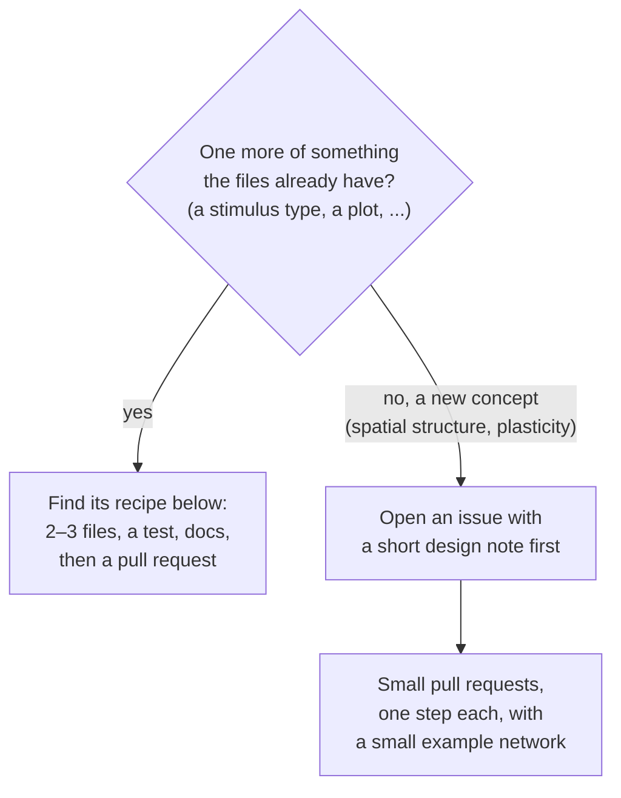

# Contributing

First ask whether the change belongs in the core. Behaviour that only your project needs goes in your project's `builders/` or `analyses/`, which the core finds without edits. Change the core when the fix or feature would help any project.

1. Fork the repository on GitHub and clone your fork.
2. Install it editable: `pip install -e ".[dev]"`. Tests that run a simulation need NEST; see the installation section of [microcircuit_lab/README.md](microcircuit_lab/README.md#installation) for the ways to get it.
3. Create a branch, make the change and add a test for it.
4. Run `ruff check .` and `pytest`. CI runs both.
5. Push the branch to your fork and open a pull request into `main`.

To pull later changes into your fork, add this repository as a remote: `git remote add upstream git@github.com:shimoura/microcircuit-lab.git`.

## Changing the core

### Follow the name

A concept keeps its name from the YAML file to the test. To change something, start from its YAML file and follow the name:


Anything that changes numbers before the simulation (units, scaling, compensation) is a step of `prepare_network` in `network/prepare.py`; the steps that add currents are in `network/compensation.py`.

### Does your idea fit what already exists?



A new concept touches every step and raises scientific questions to answer before the code. For spatial structure, for example: does `N_scaling` keep the density or the size of the sheet, and what does `K_scaling` do to a connection kernel? The design note settles those, so each pull request can be reviewed on its own.

### Recipes

Click the kind of change. Each recipe ends with a test and a line in the README. A change in `config/` also needs `python docs/write_config_files.py`, which rewrites [docs/config_files.md](docs/config_files.md); a test fails until you do.

<details>
<summary><b>A stimulus type</b></summary>

1. `config/stimuli.py`: add a class next to the others, and add it to `StimulusConfig` at the end of the file.
2. `backends/nest/backend.py`, `create_stimuli`: create its NEST device. Change `connect_stimuli` only if it connects differently.
3. Test in `tests/test_stimuli.py`.

The [worked example](#an-example-a-single-spike-stimulus) below does exactly this.
</details>

<details>
<summary><b>A weight or delay distribution</b></summary>

1. `config/connectivity.py`: add its name to the `distribution` list of `WeightDistribution` or `DelayDistribution`.
2. `backends/nest/parameters.py`: draw it in `create_weight_spec` or `create_delay_parameter`.
3. Test in `tests/test_bound_mode_and_tau_syn.py`.
</details>

<details>
<summary><b>A field on a population</b></summary>

1. `config/populations.py`: add it to `PopulationEntry` (the file) and `PopulationConfig` (the network).
2. `network/load.py`, `assemble_network`: copy it from one to the other.
3. `backends/nest/backend.py`: use it in `create_populations` or `initialize_population`.
4. Test in `tests/test_config_validation.py`.
</details>

<details>
<summary><b>A field on a connection, or a connection rule</b></summary>

1. `config/connectivity.py`: add it to `ConnectionConfig`.
2. `backends/nest/backend.py`: use it in `create_connections`.
3. If scaling or the indegrees depend on it: `network/quantities.py` and `network/prepare.py`.
4. Test in `tests/test_connection_rules.py`.
</details>

<details>
<summary><b>A scaling or compensation option</b></summary>

1. `config/scaling.py`: the option.
2. `network/scaling.py`: the formula.
3. `network/prepare.py` (or `network/compensation.py`, for a compensation current): use it in the right step of `prepare_network`.
4. Test in `tests/test_scaling.py` or `tests/test_scaling_compensation.py`, and in `tests/test_heterogeneous_areas.py` if it depends on cell types.
</details>

<details>
<summary><b>Something to record</b></summary>

1. `config/simulation.py`: add it to `RecordingConfig`.
2. `backends/nest/backend.py`: a `create_*`/`connect_*` pair, and reading it back.
3. `runs.py`, if it is saved in the run folder.
4. Test in `tests/test_output.py`.
</details>

<details>
<summary><b>A bundled plot</b></summary>

1. `analysis/<plot>.py`: the plot function, a settings class, and `register_plot(...)` at the end.
2. `analysis/__init__.py`: import the module, so the plot is registered when the package loads.
3. Test in `tests/test_<plot>.py`.
</details>

<details>
<summary><b>A simulator</b></summary>

A new package `backends/<name>/` and a line in `get_backend`; see "Adding a backend" in the README.
</details>

**No change to the core** is needed for a neuron model (name it in `neurons.yaml`, NESTML models too) or for a new model (a network folder or a builder; see "Adding a new model" in the README).

When a stimulus `type` or a `distribution` is not known, the error message points to this section.

### An example: a single-spike stimulus

1. Write the config you want, e.g. in `stimuli.yaml`:
   ```yaml
   stimuli:
     - type: spike
       targets: [L4_E]
       spike_times: [500.0]
       weight: {mean: 87.8, rel_std: 0.0, unit: PSC}
       delay: {mean: 1.5, rel_std: 0.0}
   ```
2. Running it fails with `stimuli.yaml: stimuli.0: Input tag 'spike' ... does not match any of the expected tags` and points here.
3. In `config/stimuli.py`, add the class next to the others and to `StimulusConfig`:
   ```python
   class SpikeStimulusConfig(StimulusBase):
       """Spikes at fixed times, e.g. a single-spike perturbation."""

       type: Literal["spike"] = "spike"
       spike_times: list[float] = Field(min_length=1, description="ms")
       weight: WeightDistribution
       delay: DelayDistribution
   ```
4. In `NestBackend.create_stimuli`, create its device:
   ```python
   elif isinstance(stimulus, SpikeStimulusConfig):
       model = "spike_generator"
       params["spike_times"] = stimulus.spike_times
   ```
   Connecting it needs nothing new: every stimulus except `dc` connects with its own weight and delay.
5. A test in `tests/test_stimuli.py`, and the new type in the README's list of stimuli.

## Code style

- Use plain names close to the papers and reference codes (`N_scaling`, `K_ext`, `tau_syn_ex`), no extra layers, no logic written twice.
- Use pydantic models for anything read from a file, so a mistake is reported with the file and the field. A field's limits go in `Field(...)`, not in separate checks, together with a `description` (with its unit) and, for a required field, `examples=[...]`: [docs/config_files.md](docs/config_files.md) is written from them.
- Docstrings explain what the code does and why. Functions meant to be called from outside the core (the top-level API, `builder_tools`, `Simulation`, `analysis`, `runs.register_artifact`, `network/units.py`, `yaml_files`) use the NumPy docstring style (`Parameters`, `Returns`, `Raises`); internal ones can stay in prose. Comments are full lines above the code, never at the end of a line.
- Core tests check the core and how it reads a builder's output. They must not depend on a specific builder.
- From the first release (v0.1.0) on, keep the field names of the config models stable (`populations`, `size`, `background_indegree`, ...): every run saves its network in `config.yaml` with those names, and renaming one breaks re-plotting old runs. A new field needs a default for the same reason.
