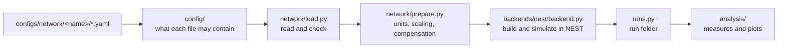
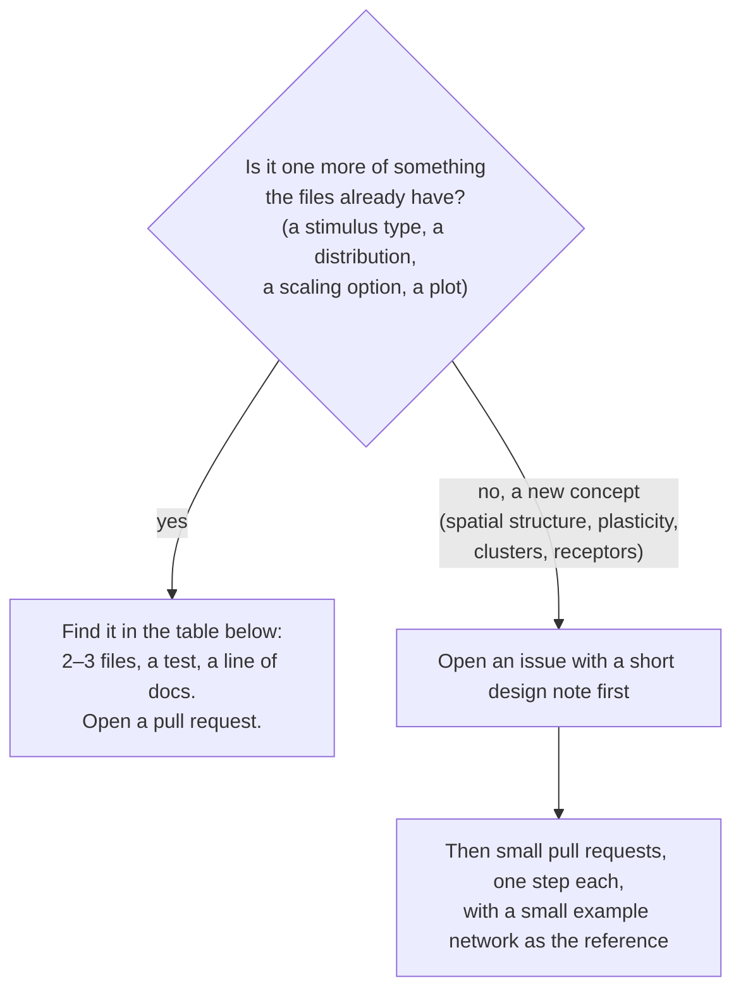

# Contributing

First ask whether the change belongs in the core. Behaviour that only your project needs goes in your project's `builders/` or `analyses/`, which the core finds without edits. Change the core when the fix or feature would help any project.

1. Fork the repository on GitHub and clone your fork.
2. Install it editable: `pip install -e ".[dev]"`. Tests that run a simulation need NEST; see the installation section of [microcircuit_lab/README.md](microcircuit_lab/README.md#installation) for the ways to get it.
3. Create a branch, make the change and add a test for it.
4. Run `ruff check .` and `pytest`. CI runs both.
5. Push the branch to your fork and open a pull request into `main`.

To pull later changes into your fork, add this repository as a remote: `git remote add upstream git@github.com:shimoura/microcircuit-lab.git`.

## Changing the core

### Where things are

Every network goes through the same steps, and each step has its place:



A concept keeps its name through the steps. Stimuli, for example, are written in `stimuli.yaml`, described in `config/stimuli.py`, built in `NestBackend.create_stimuli` and tested in `tests/test_stimuli.py`. The YAML file you want to change is the way in.

### Does your idea fit what already exists?



**A new concept touches every step** (config, loading, preparation, backend, run folder, analysis), and it raises scientific questions that need an answer before the code: for spatial structure, what `N_scaling` keeps (the density or the size of the sheet), what `K_scaling` does to a connection kernel, and how the indegrees needed by the compensation come out of it. The design note settles those, so each pull request can be reviewed on its own.

### What to change, by kind of change

| You want to add | Change | Test in |
|---|---|---|
| a stimulus type | `config/stimuli.py`: the class, and add it to `StimulusConfig` at the end of the file; `backends/nest/backend.py`: `create_stimuli` (and `connect_stimuli` if it connects differently) | `tests/test_stimuli.py` |
| a weight or delay distribution | `config/connectivity.py`: the `distribution` list of `WeightDistribution` / `DelayDistribution`; `backends/nest/backend.py`: `create_weight_spec` / `create_delay_parameter` | `tests/test_bound_mode_and_tau_syn.py` |
| a field on a connection | `config/connectivity.py` (`ConnectionConfig`); where it is used: `NestBackend.create_connections`, and `network/prepare.py` if scaling must change it | `tests/test_builder_tools.py`, or a new test |
| a field on a population | `config/populations.py` (`PopulationEntry` for the file, `PopulationConfig` for the network) and copying it in `assemble_network` (`network/load.py`); where it is used: `NestBackend.create_populations` / `initialize_population` | `tests/test_config_validation.py` |
| a connection rule (e.g. `fixed_indegree`) | `config/connectivity.py` (a `rule` field); `NestBackend.create_connections`; `network/quantities.py` and `network/prepare.py` if indegrees or scaling depend on it | a new test |
| a scaling or compensation option | `config/scaling.py` (the option), `network/scaling.py` (the formula), `network/prepare.py` (the step in `prepare_network`) | `tests/test_scaling*.py`, `tests/test_heterogeneous_areas.py` |
| something to record | `config/simulation.py` (`RecordingConfig`); `NestBackend`: a `create_*`/`connect_*` pair and reading it back; `runs.py` if it is saved | `tests/test_output.py` |
| a bundled plot | `analysis/<plot>.py` with `register_plot(...)` at the end, and import it in `analysis/__init__.py` (a module that is never imported never registers its plot) | `tests/test_<plot>.py` |
| a simulator | `backends/<name>/` and `get_backend` (see the README, "Adding a backend") | a new test |
| a neuron model | nothing in the core: name it in `neurons.yaml` (NESTML models too) | — |
| a model | nothing in the core: a builder or a network folder (see the README, "Adding a new model") | — |

When a stimulus `type` or a `distribution` is not known, the error message points to this section.

### An example: a single-spike stimulus

1. Write the config you want, e.g. in `stimuli.yaml`:
   ```yaml
   stimuli:
     - type: spike
       targets: [L4_E]
       spike_times: [500.0]
       weight: {mean: 87.8, rel_std: 0.0, unit: PSC}
       delay: {mean: 1.5, rel_std: 0.0}
   ```
2. Running it fails with `stimuli.yaml: stimuli.0: Input tag 'spike' ... does not match any of the expected tags` and points here.
3. In `config/stimuli.py`, add the class next to the others and to `StimulusConfig`:
   ```python
   class SpikeStimulusConfig(StimulusBase):
       """Spikes at fixed times, e.g. a single-spike perturbation."""

       type: Literal["spike"] = "spike"
       spike_times: list[float] = Field(min_length=1, description="ms")
       weight: WeightDistribution
       delay: DelayDistribution
   ```
4. In `NestBackend.create_stimuli`, create its device:
   ```python
   elif isinstance(stimulus, SpikeStimulusConfig):
       model = "spike_generator"
       params["spike_times"] = stimulus.spike_times
   ```
   Connecting it needs nothing new: every stimulus except `dc` connects with its own weight and delay.
5. A test in `tests/test_stimuli.py`, and the new type in the README's list of stimuli.

## Code style

- Write for a scientist reading the code: plain names close to the papers and reference codes (`N_scaling`, `K_ext`, `tau_syn_ex`), no extra layers, no logic written twice.
- Use pydantic models for anything read from a file, so a mistake is reported with the file and the field. A field's limits go in `Field(...)`, not in separate checks.
- Docstrings explain what the code does and why. Functions meant to be called from outside the core (the top-level API, `builder_tools`, `Simulation`, `analysis`, `runs.register_artifact`, `network/units.py`, `yaml_files`) use the NumPy docstring style (`Parameters`, `Returns`, `Raises`); internal ones can stay in prose. Comments are full lines above the code, never at the end of a line.
- Core tests check the core and how it reads a builder's output. They must not depend on a specific builder.
- Keep the field names of the config models stable (`populations`, `size`, `background_indegree`, ...): every run saves its network in `config.yaml` with those names, and renaming one breaks re-plotting old runs. A new field needs a default for the same reason.
