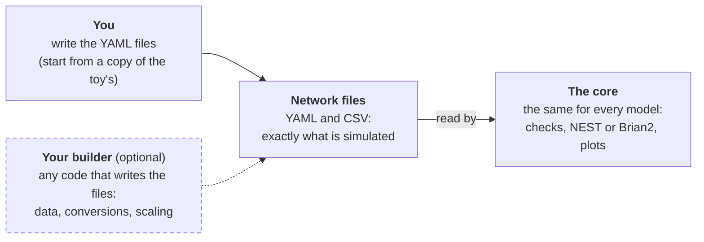
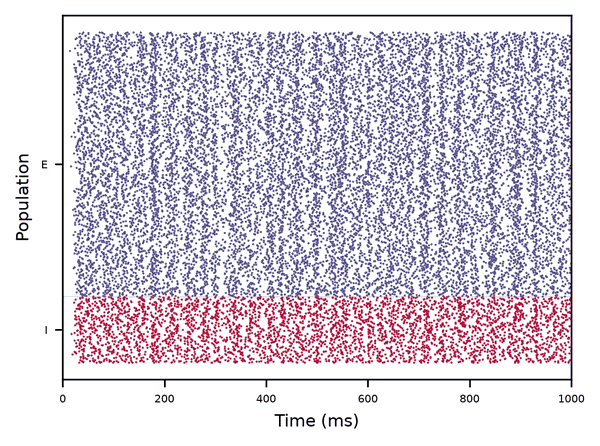

# Microcircuit Lab

[](https://doi.org/10.5281/zenodo.23547742)

Microcircuit Lab simulates spiking network models, from a single microcircuit to many areas, in NEST or Brian2.

## Why

A published network model usually comes with its own simulation code, and the model's choices are spread through it: which data it uses, how a PSP becomes a synaptic current, how the network is scaled down. Before you can check, reuse or compare the model, you have to find them.

Here they live apart. A network is a few text files that hold every number the simulator gets. You can write these files by hand, or, when the numbers come from data, let your own code write them (a *builder*). The core reads the files and simulates them, the same way for every model.



- The files are what is simulated. Nothing is converted or scaled when the network runs, so you can open the YAML files to read a network, compare it with another, or check it against the paper.
- A builder is optional. Write one when the numbers come from tables or data, or need converting; any code that writes valid files counts. See [Builders](docs/builders.md).
- The core is shared. The checks, the two simulators and the plots are the same for every model, so you can run one network on NEST and on Brian2, and a fix in the core helps every model.

## Quick start

Install the package, make a project folder, and run the toy network:

```bash title="Terminal"
python -m venv .venv
source .venv/bin/activate
pip install "microcircuit_lab[nest] @ git+https://github.com/shimoura/microcircuit-lab"

microcircuit-lab init my_project --with-core   # --with-core (optional): also a copy of the core, to read and change
cd my_project
microcircuit-lab run --network toy
```

The run is saved in `output/toy/<timestamp>/`, with its spikes and plots, such as this raster:



Other ways to get NEST (conda-forge, from source), and Brian2: [Installation](docs/installation.md).

## Where next

| You want to | Read |
| :--- | :--- |
| learn step by step | the [tutorials](docs/tutorials/README.md): run, change a parameter, write your own network model; then sweeps and comparisons in notebooks |
| run a published model (Potjans & Diesmann 2014, Jiang et al. 2024, the human multi-area model) | [examples/](https://github.com/shimoura/microcircuit-lab/tree/main/examples), one folder per model; add one to your project with `microcircuit-lab init . --example pd14` |
| see what happens when you run | [How it works](docs/how-it-works.md) |
| build your own network model | [A new network model](docs/new-network.md) |
| let code write a network (optional) | [Builders](docs/builders.md) |
| run a sweep, several seeds, any batch | [Running from a script](docs/scripts.md) |
| analyse a run yourself | [Analysing a run](docs/analysis.md) |
| look up a field of the files | [Configuration files](docs/config_files.md) |
| change the core | in your project's copy ([Your project](docs/project.md)), or for everyone ([CONTRIBUTING.md](https://github.com/shimoura/microcircuit-lab/blob/main/CONTRIBUTING.md)) |

The whole documentation is at https://shimoura.github.io/microcircuit-lab/, and as Markdown in [`docs/`](https://github.com/shimoura/microcircuit-lab/tree/main/docs).

## How to cite

If you use Microcircuit Lab in your work, please cite it. [`CITATION.cff`](https://github.com/shimoura/microcircuit-lab/blob/main/CITATION.cff) has the reference; on GitHub, "Cite this repository" in the sidebar gives it in APA and BibTeX. The DOI [10.5281/zenodo.23547742](https://doi.org/10.5281/zenodo.23547742) cites all versions; each release also has its own DOI on Zenodo. Please also cite the papers of the models you use (listed in each example's README).

## License

BSD 3-Clause, see [`LICENSE`](https://github.com/shimoura/microcircuit-lab/blob/main/LICENSE).
