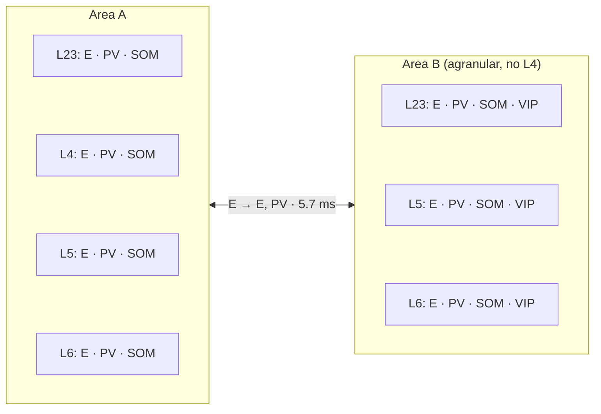

# Two-area toy network

A small synthetic multi-area network (24 populations, about 1,600 neurons) that shows how a multi-area model is described, and tests that the core handles areas with different layers and cell types. The numbers are made up: it is a test case and an example, not a model of cortex.

```bash
microcircuit-lab run --network toy_two_areas     # plots for each area under plots/A and plots/B
microcircuit-lab generate toy_two_areas          # rewrite configs/network/toy_two_areas/ from data.py
microcircuit-lab run --network toy_two_areas_advanced   # the same network with optional features on (below)
```

## Areas and populations



| Area | Layers | Cell types | Neurons per layer |
| :--- | :--- | :--- | :--- |
| A | L23, L4, L5, L6 | E, PV, SOM | E 200, PV 25, SOM 15 |
| B | L23, L5, L6 | E, PV, SOM, VIP | E 200, PV 25, SOM 15, VIP 10 |

Populations are named `<area>__<layer>_<cell type>`, e.g. `B__L23_VIP`. The `<area>__` prefix is what the analysis uses to plot each area on its own.

## Neuron entries

Populations of one cell type can share a neuron entry or have one per layer group, and the choice can differ between areas:

| Neuron entry | Populations | Differs from the base neuron in |
| :--- | :--- | :--- |
| `A_E` | A: E in every layer | nothing |
| `A_PV_upper` | A: PV in L23, L4 | C_m, tau_m, t_ref |
| `A_PV_deep` | A: PV in L5, L6 | as `A_PV_upper`, but a different C_m |
| `A_SOM` | A: SOM in every layer | C_m, tau_m, tau_syn_in |
| `B_E_upper` | B: E in L23 | tau_syn_ex = 2 ms, tau_syn_in = 4 ms |
| `B_E_deep` | B: E in L5, L6 | C_m, tau_m |
| `B_PV`, `B_SOM`, `B_VIP` | B: one entry per type, every layer | C_m, tau_m (and t_ref for PV) |

All are `iaf_psc_exp`; the base neuron is that of PD14.

## Connections

- **Within an area:** a probability per source type and target type (PV inhibits E and PV, SOM all but SOM, VIP mostly SOM), times 1 within a layer and 0.2 between layers.
- **Between areas:** only E cells project, onto E and PV cells of every layer of the other area, with probability 0.02 and a delay of distance / conduction speed (20 mm at 3.5 mm/ms).
- **Weights:** PSPs of 0.5 mV (E) and −1 mV (PV, SOM, VIP), 10 % spread; delays 1.5 ms (E) and 0.75 ms (inhibitory), 50 % spread.
- **Background:** Poisson input at 8 spikes/s per synapse, with an indegree per cell type tuned so every population fires at about 3–16 spikes/s.

The reference rates in `reference.yaml` are the mean of four 2 s runs of this network; they are needed for the DC compensation when the network is scaled.

## Advanced variant

`microcircuit-lab generate toy_two_areas --advanced` writes `configs/network/toy_two_areas_advanced/`: the same areas, populations and probabilities, with the optional features of the config files turned on, as an example to copy:

| Feature | Where | In this network |
| :--- | :--- | :--- |
| Values drawn per neuron | `neurons.yaml`, `populations.yaml` | each neuron's `V_th` (normal, 1 mV spread); starting `V_m` uniform between `V_reset` and `V_th` |
| Connection rules | `connectivity.yaml` | `pairwise_bernoulli` with the probability within an area (no neuron connected to itself); `fixed_indegree` between areas |
| Synapse models | `synapses.yaml` | between areas, a depressing `tsodyks2_synapse`, with lognormal delays |
| Receptor ports | `synapses.yaml`, `neurons.yaml` | `B__L23_E` is an `iaf_psc_exp_multisynapse` neuron with a port for excitatory (2 ms), inhibitory (4 ms) and input from the other area (20 ms, depressing); its weights are in pA, since PSP weights are converted for the default port only, and its background input names a port too |

Its rates differ from those above. It has no `scaling.yaml` (it runs at full scale) and no reference rates, so a scaled copy needs `compensate_recurrent_input: false` in its `scaling.yaml`.

## Files

- `data.py`: every number above, as small tables.
- `build.py`: turns the tables into `configs/network/toy_two_areas/` (`main(argv)` is the entry point `microcircuit-lab generate` calls).
- `advanced.py`: the advanced variant, built from the same tables and functions.
