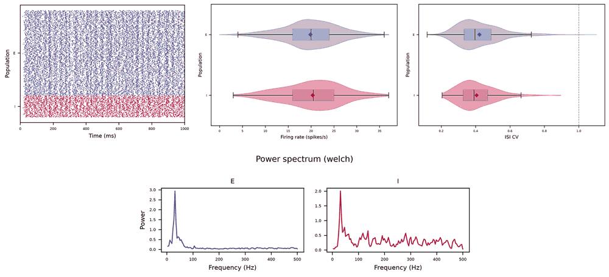

# Analysing a run

`microcircuit-lab run` makes these plots for every run (here the toy network): the raster, the firing rates, the ISI CV and the power spectrum.



Which plots are made, and how they look, is set in `configs/analysis/<name>.yaml` (optional: without it, all four, with the default style); every setting is in [Configuration files](config_files.md#analysisnameyaml).

## Re-plot without simulating again

```bash title="Terminal"
microcircuit-lab run --network toy                                          # prints "Run directory: ..."
microcircuit-lab run --run-dir output/toy/<timestamp> --begin 200 --end 400
```

`--run-dir` takes the analysis flags (`--begin`, `--end`, `--area`, `--<plot>`, ...) but not the simulation ones (`--simulation`, `--backend`, `--nest-modules`, `--extensions`, `--brian2-...`), which it refuses: the run is already simulated. The plots go back into the run's `plots/`.

A multi-area network (populations named `<area>__<population>`, e.g. `V1__L23_E`) gets one set of plots per area, in `plots/<area>/`; a population without `__` next to them (`TC`) is an area of its own. `--area V1` (or `area: V1` in the analysis file) plots that area only, also in `plots/V1/`, and `--area together` one set with every population, in `plots/`, for a small network.

## The plot functions in Python

```python
from microcircuit_lab import read_run
from microcircuit_lab.analysis import compute_population_firing_rates, plot_firing_rates

run = read_run("output/toy/<timestamp>")
rates = compute_population_firing_rates(run, begin=200.0)
plot_firing_rates(run, begin=200.0)
```

- Plots: `plot_raster`, `plot_firing_rates`, `plot_power_spectrum`, `plot_isi_cv`.
- Numbers: `compute_*` for rates, ISI CV, power spectrum and deviation from the reference rates.
- Multi-area networks: pass `area="V1"`; `list_areas(run)` gives the names.

## Your own analysis: any script

There are no rules: read a run folder and do what you want.

```python
# my_analysis.py
import sys

from microcircuit_lab import read_run
from microcircuit_lab.analysis import compute_population_firing_rates

run = read_run(sys.argv[1])
print(compute_population_firing_rates(run, begin=200.0))

senders, times = run.spikes("E")   # node IDs and times (ms)
```

```bash title="Terminal"
python my_analysis.py output/toy/<timestamp>
```

- Read data through `run` (`spikes`, `recording`, `network`, `simulation`, `metadata`); all of it is in [Reading a run](run-folder.md#reading-a-run).
- Keep the script anywhere, e.g. in `experiments/`. In `analyses/`, put its work under `if __name__ == "__main__":`, because `microcircuit-lab run` imports every file there.

## Optional: let `microcircuit-lab run` make your plot

Register a function in a file in `analyses/`, and the command gets a flag for it:

```python
# analyses/rate_bars.py
import matplotlib.pyplot as plt

from microcircuit_lab.analysis import compute_population_firing_rates, register_plot


def rate_bars(run, save_path, area=None):
    rates = compute_population_firing_rates(run, area=area)
    fig, ax = plt.subplots()
    ax.bar(list(rates), list(rates.values()))
    fig.savefig(save_path)


register_plot("rate_bars", rate_bars)
```

```bash title="Terminal"
microcircuit-lab run --run-dir output/toy/<timestamp> --rate-bars
```

The figure is saved in `plots/` (for a multi-area network, one per area in `plots/<area>/`). The first parameter is the run, read with `read_run`; name only what else you need, and the command fills it in:

| Parameter | What you get |
|---|---|
| `save_path` | where to save the figure |
| `area` | one area name, or `None` for single-area networks |
| `begin`, `end` | the time window in ms |
| `style` | the shared plot style |
| `config` | the `rate_bars:` section of the analysis file, as a dict |
| `show` | `True` with `--show` |
| `show_reference` | `True` with `--reference` |

- Any other parameter needs a default.
- The plot is off by default: pass `--rate-bars`, or set `enabled: true` in its section of the analysis file.
- A name already taken (`raster`, ...) raises an error.
- A package can provide such plots through the `microcircuit_lab.analyses` entry-point group (see `microcircuit_lab/analysis/run_command_plots.py`).

Every function, with its arguments: [Python API](api.md#analysis).
