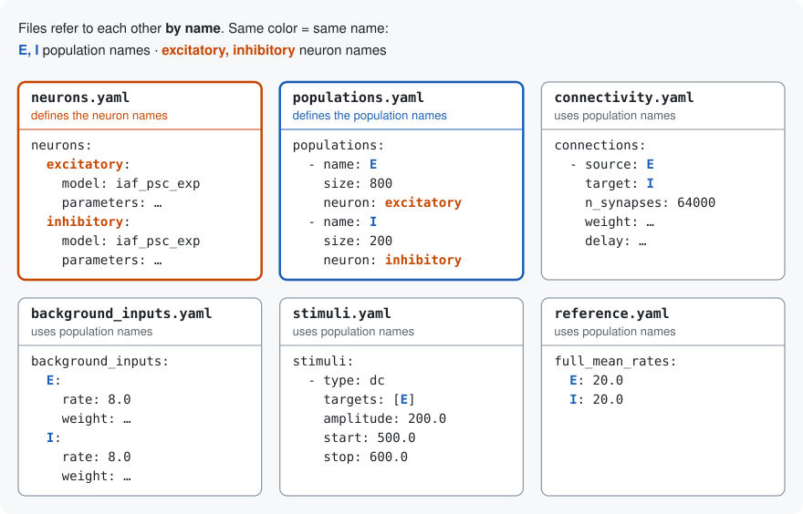

# Config files

<!-- Written by docs/write_config_files.py from microcircuit_lab/config/; do not edit by hand. -->

Every field each config file accepts, as a YAML example. The comment above a field says whether it is required (or its default), the values it takes, and what it means. A mistake is reported when the network is read, naming the file and the field.

## A network: `configs/network/<name>/`

One folder per network, one file per part. A population is named once, in `populations.yaml`, and the other files use that name; a neuron likewise, in `neurons.yaml`. (`network.yaml` lists the files; `scaling.yaml` uses no names.)



What this means for a model:

- **A population has one neuron entry.** Every neuron in it gets the same model and parameters, except values written as a distribution (a neuron parameter in `neurons.yaml`, a starting value in `initial_state`): those are drawn for each neuron, e.g. `{distribution: normal, mean: -58, std: 10}`; any distribution in `nest.random` works, with its arguments as keys.
- **Connections are set per pair of populations**: an entry for each source and target, with a rule and its number (`n_synapses` in total, an `indegree`, an `outdegree` or a probability `p`) and the distributions the weights and delays are drawn from. A pair can have several entries, one per synapse in `synapses.yaml` (e.g. AMPA and NMDA on their own receptor ports). PSP weights and the scaling compensation are only computed for the default receptor port.
- **So, for neurons with another model or other parameters, or wired differently, make a separate population.** In `configs/network/toy_stimulated/`, `E` (`iaf_psc_exp`) and `E_adex` (`aeif_cond_exp`) are two populations, each with its own connections.
- **Several populations can share one neuron entry**, e.g. one `excitatory` entry for the excitatory populations of every layer.
- **Names are only labels.** `E` does not make a population excitatory: the sign of its outgoing weights does.

A small working example to copy: [`configs/network/toy/`](../configs/network/toy/).

### network.yaml

Names the file of each part. The names below are the usual ones.

```yaml
# required · text · file holding the populations list
populations: populations.yaml
# required · text · file holding the neuron definitions
neurons: neurons.yaml
# required · text · file holding the connection list
connectivity: connectivity.yaml
# required · text · file holding the background Poisson input of each population
poisson_background: poisson_background.yaml
# optional · text · file recording how this network was scaled (written by
#   scale_network, never applied); omit the key for a network that was not scaled
scaling: scaling.yaml
# optional · text · file holding the reference rates; omit the key for none
reference: reference.yaml
# optional · text · file holding targeted stimuli; omit the key for none
stimuli: stimuli.yaml
# optional · text · file holding the synapse definitions; omit the key to use the
#   default synapse everywhere
synapses: synapses.yaml
```

### populations.yaml

The populations: size, neuron and initial state.

```yaml
# required · list of entries · one entry per population
populations:
  # required · text · unique population name; referenced by connectivity,
  #   poisson_background, stimuli and reference
  - name: L23_E
    # required · integer > 0 · number of neurons
    size: 20683
    # required · text · name of an entry in neurons.yaml; every neuron of the population
    #   gets that model and those parameters
    neuron: excitatory
    # optional, default empty · mapping · starting value of each state variable of the
    #   neuron model, e.g. V_m (mV): a number, or a distribution drawn per neuron: its
    #   name and its arguments, e.g. {distribution: normal, mean: -58, std: 10}, which
    #   the simulator looks up; a variable left out starts at the model's default
    initial_state:
      V_m: {distribution: normal, mean: -58.0, std: 10.0}
```

### neurons.yaml

The neuron models, by name. Several populations can share one.

```yaml
# required · mapping · one entry per neuron, keyed by any name; populations refer to it
#   by that name
neurons:
  excitatory:
    # required · text · the simulator's neuron model name, e.g. iaf_psc_exp
    model: iaf_psc_exp
    # required · parameters passed to that model as-is; keys are model-specific and the
    #   backend validates them (I_e is passed only when set); a value is a number, a
    #   list of numbers (e.g. tau_syn: [0.5, 5.0], one per receptor port), or a
    #   distribution drawn per neuron like in initial_state (I_e must be a number)
    parameters:
      C_m: 250.0
      tau_m: 10.0
      tau_syn_ex: 0.5
      tau_syn_in: 0.5
      E_L: -65.0
      V_th: -50.0
      V_reset: -65.0
      t_ref: 2.0
```

### synapses.yaml

Optional: synapse models and receptor ports, by name. Without it, every connection uses the default synapse.

```yaml
# optional, default empty · mapping · one entry per synapse, keyed by any name;
#   connections, background inputs and stimuli refer to it by that name
synapses:
  depressing:
    # required · text · the simulator's synapse model name, e.g. static_synapse or
    #   stdp_synapse
    model: tsodyks2_synapse
    # optional, default empty · mapping · parameters passed to that model as-is; the
    #   backend validates them
    parameters:
      U: 0.5
      tau_rec: 800.0
    # optional · receptor port of the target neuron: a number (e.g. 1 for AMPA in a
    #   multisynapse model) or a name the target's model defines; omit for the default
    #   port (0). PSP weights and the scaling compensation are only computed for the
    #   default port
    receptor_port: 1
```

### connectivity.yaml

The connections between populations.

```yaml
# optional · list of entries · one entry per (source, target, synapse); leave a pair out
#   rather than writing n_synapses: 0. Required unless connections_file is given
connections:
  # required · text · source population name
  - source: L4_E
    # required · text · target population name
    target: L23_E
    # optional, default fixed_total_number · text · how the synapses are placed:
    #   fixed_total_number, fixed_indegree, fixed_outdegree or pairwise_bernoulli, each
    #   with its own number (n_synapses, indegree, outdegree or p); one_to_one or
    #   all_to_all, with no number; or another rule, which the simulator looks up, with
    #   parameters
    rule: fixed_total_number
    # optional · integer ≥ 0 · fixed_total_number: total number of synapses in the
    #   projection
    n_synapses: 1440000
    # optional · integer ≥ 0 · fixed_indegree: synapses onto each target neuron
    indegree:
    # optional · integer ≥ 0 · fixed_outdegree: synapses from each source neuron
    outdegree:
    # optional · number ≥ 0, ≤ 1 · pairwise_bernoulli: probability that a source-target
    #   pair is connected
    p:
    # optional · mapping · only for a rule that is not shared: its parameters, e.g.
    #   {width: 10, p0: 0.5}
    parameters:
    # optional · true or false · whether a neuron may connect to itself; omit for the
    #   simulator's default
    allow_autapses:
    # optional · true or false · whether a pair may have several synapses; omit for the
    #   simulator's default
    allow_multapses:
    # optional · text · name of an entry in synapses.yaml; omit for the default synapse
    synapse: depressing
    # required · weight of each synapse
    weight:
      # required · number · amplitude, in the unit set by `unit`; a negative weight is
      #   inhibitory
      mean: 0.15
      # required · number ≥ 0 · standard deviation / |mean|
      rel_std: 0.1
      # optional, default normal · text · how each weight is drawn, with that mean and
      #   standard deviation: normal, uniform, lognormal or fixed; or the name of a
      #   project distribution, which the backend defines, with parameters
      distribution: normal
      # optional · mapping · only for a project distribution: the values its expression
      #   uses, e.g. {length: 20}
      parameters:
      # required · one of pA | nS | mV · the unit of the weight: pA (a current), nS (a
      #   conductance) or mV (a jump of the membrane potential); nothing is converted
      unit: pA
    # required · delay of each synapse
    delay:
      # required · number > 0 · mean delay (ms)
      mean: 1.5
      # required · number ≥ 0 · standard deviation / mean
      rel_std: 0.5
      # optional, default normal · text · how each delay is drawn, with that mean and
      #   standard deviation: normal, uniform, lognormal or fixed; or the name of a
      #   project distribution, with parameters
      distribution: normal
      # optional · mapping · only for a project distribution: the values its expression
      #   uses
      parameters:
      # optional · number > 0 · smallest allowed delay (ms) of a drawn delay, never
      #   below half the simulation step; omit for half the simulation step
      minimum: 0.1
# optional · text · instead of connections: a CSV file, relative to the network folder,
#   with one row per connection (e.g. connections.csv), for a large network
connections_file:
# optional, default redraw · one of redraw | clip · what to do with a drawn weight or
#   delay outside its allowed range: 'redraw' draws again, 'clip' replaces it by the
#   limit; applies to all weights and delays of the network, background inputs included
bound_mode: redraw
```

### poisson_background.yaml

The background Poisson input of each population: synapses per neuron and their rate. Other always-on inputs are stimuli without start/stop.

```yaml
# required · mapping · one entry per population, keyed by its name; a population left
#   out gets none
poisson_background:
  L23_E:
    # required · number ≥ 0 · firing rate of each Poisson synapse (spikes/s)
    rate: 8.0
    # required · number ≥ 0 · Poisson synapses per neuron
    indegree: 1600
    # required · weight of each Poisson synapse
    weight: {mean: 0.15, rel_std: 0.1, unit: pA}   # all fields as in connectivity.yaml
    # required · delay of each Poisson synapse
    delay: {mean: 1.5, rel_std: 0.5}   # all fields as in connectivity.yaml
    # optional · text · name of an entry in synapses.yaml; omit for the default synapse
    synapse: depressing
    # optional · text · a name for the population's Poisson generator: populations that
    #   give the same name share one generator, and each neuron still gets its own
    #   independent spike train. Saves memory when many populations have the same input,
    #   but gives other random draws than one generator each. They need the same rate,
    #   indegree and synapse (a generator connects through one synapse model). Omit for
    #   a generator of its own
    generator: L23_E
```

### stimuli.yaml

Optional: inputs for an experiment, applied as written (never scaled).

```yaml
# optional, default empty · list of entries · one entry per stimulus; `type` selects its
#   fields
stimuli:
  # A constant current from ``start`` to ``stop``, injected directly (no weight or
  #   delay).
  # required · selects the fields below
  - type: dc
    # required · list of names, at least 1 · population names to stimulate; one device,
    #   connected to every neuron of each
    targets: [L4_E, L4_I]
    # optional, default 0.0 · number ≥ 0 · when the stimulus starts (ms)
    start: 0.0
    # optional · number > 0 · when it stops (ms); omit to keep it on until the end
    stop: 600.0
    # required · number · current (pA)
    amplitude: 200.0
  # Homogeneous Poisson spike train, active for [start, stop).
  # required · selects the fields below
  - type: poisson
    # required · list of names, at least 1 · population names to stimulate; one device,
    #   connected to every neuron of each
    targets: [L4_E, L4_I]
    # optional, default 0.0 · number ≥ 0 · when the stimulus starts (ms)
    start: 0.0
    # optional · number > 0 · when it stops (ms); omit to keep it on until the end
    stop: 600.0
    # required · number ≥ 0 · spike rate (spikes/s)
    rate: 50.0
    # required · weight of each stimulus connection
    weight: {mean: 0.15, rel_std: 0.1, unit: pA}   # all fields as in connectivity.yaml
    # required · delay of each stimulus connection
    delay: {mean: 1.5, rel_std: 0.5}   # all fields as in connectivity.yaml
    # optional · text · name of an entry in synapses.yaml; omit for the default synapse
    synapse: depressing
  # Poisson spike train with a piecewise-constant rate profile.
  # required · selects the fields below
  - type: inhomogeneous_poisson
    # required · list of names, at least 1 · population names to stimulate; one device,
    #   connected to every neuron of each
    targets: [L4_E, L4_I]
    # optional, default 0.0 · number ≥ 0 · when the stimulus starts (ms)
    start: 0.0
    # optional · number > 0 · when it stops (ms); omit to keep it on until the end
    stop: 600.0
    # required · list of numbers, at least 1 · when the rate changes (ms), increasing
    rate_times: [200.0, 400.0]
    # required · list of numbers, at least 1 · the rate from each of those times on
    #   (spikes/s), one per time
    rate_values: [20.0, 0.0]
    # required · weight of each stimulus connection
    weight: {mean: 0.15, rel_std: 0.1, unit: pA}   # all fields as in connectivity.yaml
    # required · delay of each stimulus connection
    delay: {mean: 1.5, rel_std: 0.5}   # all fields as in connectivity.yaml
    # optional · text · name of an entry in synapses.yaml; omit for the default synapse
    synapse: depressing
```

### scaling.yaml

Only in a scaled network: how it was scaled, written by `scale_network` and never applied (the other files hold the scaled numbers); see "Scaling a network" in the README.

```yaml
# required · text · the full-scale network this one was scaled from (or the builder
#   command that makes it)
scaled_from: pd14
# required · text · the function that scaled it
scaled_with: microcircuit_lab.builder_tools.scaling.scale_network
# required · mapping · the arguments the function was given (its own, e.g. N_scaling and
#   K_scaling)
parameters:
  N_scaling: 0.1
  K_scaling: 0.1
```

### reference.yaml

Optional: published values to compare with, and to compensate a scaled network.

```yaml
# optional, default empty · mapping · mean rate (spikes/s) of each population at full
#   scale; needed when a scaled network compensates the recurrent input, and shown next
#   to the rates of a run
full_mean_rates:
  L23_E: 0.97
  L23_I: 2.9
```

## Running and plotting: `configs/simulation/`, `configs/analysis/`

`microcircuit-lab run --network <name>` uses `configs/simulation/<name>.yaml` and `configs/analysis/<name>.yaml`, or the defaults below for a file that is missing. `--simulation` and `--analysis` pick other files.

### simulation/<name>.yaml

How to run: duration, seed, threads, what to record and save.

```yaml
# optional, default 100.0 · number > 0 · simulated time (ms)
t_sim: 100.0
# optional, default 0.1 · number > 0 · simulation time step (ms)
resolution: 0.1
# optional, default 42 · integer · seed of the random numbers
rng_seed: 42
# optional, default 1 · integer ≥ 1 · threads per process
local_num_threads: 1
# optional, default true · true or false · print the simulation progress
print_time: true
# optional · the simulator to use
backend:
  # optional, default nest · one of nest | brian2 · the simulator to run the network
  #   with
  name: nest
  # optional, default empty · mapping · options of that simulator, passed to its backend
  #   as-is; the backend validates them (see the simulator's section in the README)
  options:
    device: cpp_standalone
# optional · what to record
recording:
  # optional, default true · true or false · record the spikes of every neuron
  spike_recording: true
  # optional, default false · true or false · record membrane potentials
  voltage_recording: false
  # optional, default 1.0 · number > 0 · time between two voltage samples (ms)
  voltage_interval: 1.0
  # optional, default 5 · integer ≥ 1 · neurons per population whose voltage is
  #   recorded; null records all
  voltage_sample_size: 5
# optional · where and what to save
output:
  # optional · path · folder for the runs; omit for output/<network name>
  output_dir: output/pd14
  # optional, default false · true or false · false: each run gets its own
  #   <output_dir>/<date_time> folder; true: every run writes into output_dir itself
  overwrite: false
  # optional, default true · true or false · write metadata.json (versions, spike
  #   counts, files written); needed with config.yaml to re-plot the run
  save_metadata: true
  # optional, default true · true or false · write config.yaml (the prepared network);
  #   needed to re-plot the run
  save_config: true
```

### analysis/<name>.yaml

Which plots to make and how they look. Each bundled plot has its own section; a plot of your own (`register_plot`) adds one with its name.

```yaml
# optional, default 0.0 · number ≥ 0 · start of the analysed time (ms), e.g. after the
#   transient
begin: 0.0
# optional · number · end of the analysed time (ms); omit for the end of the run
end: 1000.0
# optional · text · multi-area networks: one area's name, or all for one set of plots
#   per area; omit to plot every population together
area: all
# optional, default false · true or false · mark the reference rates on the firing-rate
#   plot (as --reference)
show_reference: false
# optional · colors, labels and sizes of every plot
style:
  # optional, default layer · one of layer | cell_type | population | custom · layer: a
  #   color per layer, mixed with white by excitatory_tone (E) or inhibitory_tone (I);
  #   cell_type: a color per cell type; population: matplotlib's color cycle; custom:
  #   custom_colors
  color_mode: layer
  # optional, default as shown · mapping · color per layer, for color_mode: layer
  layer_colors:
    L23: tab:blue
    L4: tab:orange
    L5: tab:green
    L6: tab:red
  # optional, default as shown · mapping · color per cell type, for color_mode:
  #   cell_type
  cell_type_colors:
    E: tab:blue
    I: tab:red
  # optional, default empty · mapping · color per population name, for color_mode:
  #   custom
  custom_colors:
    E: '#595289'
    I: '#af143c'
  # optional, default 0.25 · number · for color_mode: layer, how much white is mixed
  #   into E colors (0-1)
  excitatory_tone: 0.25
  # optional, default 0.65 · number · for color_mode: layer, how much white is mixed
  #   into I colors (0-1)
  inhibitory_tone: 0.65
  # optional, default empty · mapping · label to show instead of a population name
  population_labels:
    L23_E: L2/3E
  # optional, default 8.0 · number · font size of tick labels (pt)
  tick_label_size: 8.0
  # optional, default 9.0 · number · font size of axis labels (pt)
  axis_label_size: 9.0
  # optional, default 10.0 · number · font size of titles (pt)
  title_size: 10.0
  # optional, default 8.0 · number · font size of legends (pt)
  legend_size: 8.0
  # optional, default 300 · integer · resolution of the saved figures
  dpi: 300
# optional · the firing_rates plot, saved as firing_rates.png
firing_rates:
  # optional, default true · true or false · make this plot
  enabled: true
  # optional · pair of numbers · width and height (inches); omit to size from the number
  #   of populations
  figsize: [6.0, 4.0]
  # optional, default 8.0 · number · width (inches) when figsize is omitted
  width: 8.0
  # optional, default 0.55 · number · height per population (inches) when figsize is
  #   omitted
  height_per_population: 0.55
  # optional, default 3.5 · number · smallest height (inches) when figsize is omitted
  min_height: 3.5
  # optional, default 0.35 · number · opacity of the violins (0-1)
  violin_alpha: 0.35
  # optional, default 0.18 · number · width of the boxes
  box_width: 0.18
  # optional, default true · true or false · mark each population's mean
  show_mean: true
  # optional, default 28.0 · number · size of that mark
  mean_marker_size: 28.0
  # optional, default true · true or false · first population at the top
  invert_yaxis: true
  # optional, default false · true or false · also show each neuron's rate as a dot
  show_points: false
  # optional, default 500 · integer · at most this many dots per population (picked at
  #   random)
  max_points_per_population: 500
  # optional, default 8.0 · number · size of a dot
  point_size: 8.0
  # optional, default 0.2 · number · opacity of the dots (0-1)
  point_alpha: 0.2
  # optional, default true · true or false · show a legend
  show_legend: true
# optional · the isi_cv plot, saved as isi_cv.png
isi_cv:
  # optional, default true · true or false · make this plot
  enabled: true
  # optional · pair of numbers · width and height (inches); omit to size from the number
  #   of populations
  figsize: [6.0, 4.0]
  # optional, default 8.0 · number · width (inches) when figsize is omitted
  width: 8.0
  # optional, default 0.55 · number · height per population (inches) when figsize is
  #   omitted
  height_per_population: 0.55
  # optional, default 3.5 · number · smallest height (inches) when figsize is omitted
  min_height: 3.5
  # optional, default 0.35 · number · opacity of the violins (0-1)
  violin_alpha: 0.35
  # optional, default 0.18 · number · width of the boxes
  box_width: 0.18
  # optional, default true · true or false · mark each population's mean
  show_mean: true
  # optional, default 28.0 · number · size of that mark
  mean_marker_size: 28.0
  # optional, default true · true or false · first population at the top
  invert_yaxis: true
  # optional, default 3 · integer ≥ 2 · neurons with fewer spikes in the window are left
  #   out
  min_spikes: 3
# optional · the power_spectrum plot, saved as power_spectrum.png
power_spectrum:
  # optional, default true · true or false · make this plot
  enabled: true
  # optional, default welch · text · welch, periodogram or multitaper
  method: welch
  # optional, default empty · mapping · passed to the method, e.g. bandwidth for
  #   multitaper
  method_kwargs: {bandwidth: 4.0}
  # optional · pair of numbers · width and height (inches); omit to size from the grid
  figsize: [9.0, 6.0]
  # optional, default 3.0 · number · width per column (inches) when figsize is omitted
  width_per_column: 3.0
  # optional, default 1.8 · number · height per row (inches) when figsize is omitted
  height_per_row: 1.8
  # optional, default 4.5 · number · smallest width (inches) when figsize is omitted
  min_width: 4.5
  # optional, default 2.2 · number · smallest height (inches) when figsize is omitted
  min_height: 2.2
  # optional, default 1.2 · number · line width
  linewidth: 1.2
  # optional, default false · true or false · power on a log axis
  log_power: false
  # optional, default false · true or false · frequency on a log axis
  log_freq: false
  # optional · pair of numbers · frequency range to show (Hz); omit for all; with
  #   log_freq, start above 0
  xlim: [1.0, 150.0]
# optional · the raster plot, saved as raster.png
raster:
  # optional, default true · true or false · make this plot
  enabled: true
  # optional, default 1.0 · number · size of a spike dot
  marker_size: 1.0
  # optional, default 0.8 · number · opacity of the dots (0-1)
  alpha: 0.8
  # optional · pair of numbers · width and height (inches); omit to size from the number
  #   of populations
  figsize: [6.0, 4.0]
  # optional, default 10.0 · number · width (inches) when figsize is omitted
  width: 10.0
  # optional, default 0.55 · number · height per population (inches) when figsize is
  #   omitted
  height_per_population: 0.55
  # optional, default 4.0 · number · smallest height (inches) when figsize is omitted
  min_height: 4.0
  # optional, default true · true or false · draw a line between populations
  separator_lines: true
  # optional, default 0.25 · number · opacity of those lines (0-1)
  separator_alpha: 0.25
  # optional, default true · true or false · show a legend
  show_legend: true
  # optional, default true · true or false · first population at the top
  invert_yaxis: true
  # optional · integer > 0 · show at most this many neurons per population; omit for all
  max_neurons_per_population:
  # optional · number > 0, ≤ 1 · show this fraction of each population's neurons;
  #   replaces max_neurons_per_population when set
  neuron_fraction: 0.05
  # optional · number ≥ 0 · start of this plot only (ms); omit to use the top-level
  #   begin
  begin:
  # optional · number ≥ 0 · end of this plot only (ms); omit to use the top-level end
  end:
```
