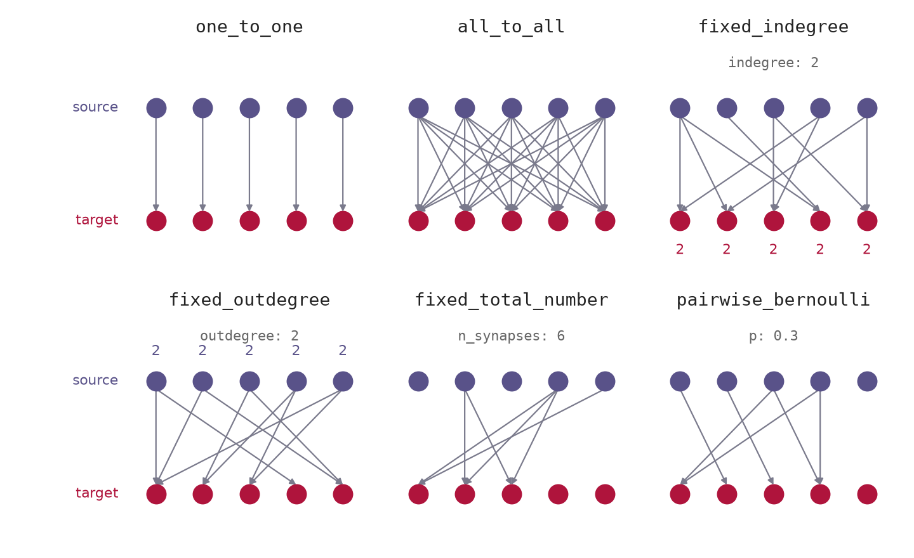

# Connections

Each entry of `connectivity.yaml` connects one population to another, with a `rule` and the number the rule takes:

```yaml
connections:
  - {source: E, target: I, rule: fixed_indegree, indegree: 100,
     weight: {value: 87.8, unit: pA}, delay: {value: 1.5}}
```

The rules every simulator runs, drawn for 5 source neurons (top) and 5 target neurons (bottom); each arrow is a synapse, and the small numbers count each neuron's synapses:



| `rule` | Takes | Makes |
|---|---|---|
| `fixed_total_number` (default) | `n_synapses` | that many synapses in total, between random pairs |
| `fixed_indegree` | `indegree` | that many onto each target neuron |
| `fixed_outdegree` | `outdegree` | that many from each source neuron |
| `pairwise_bernoulli` | `p` | each pair connected with probability `p` |
| `one_to_one` | | the k-th source neuron to the k-th target neuron (populations of the same size) |
| `all_to_all` | | every pair |
| `from_file` (optional) | `file` | every synapse listed in a CSV file ([below](#connections-from-a-file-optional)) |

- `allow_autapses` (a neuron onto itself) and `allow_multapses` (several synapses on one pair) are both allowed unless the entry says `false`.
- Scaling keeps each neuron's share of inputs (`p` grows when the populations shrink). It stops with an error where that is impossible (`one_to_one` with `K_scaling` other than 1, `all_to_all` with `K_scaling` other than `N_scaling`) and where it isn't implemented yet (`from_file`, the simulators' own rules): scale those in the builder.
- Optional: any other rule name is looked up by the simulator, with its arguments as keys of their own. On NEST, one of its own rules: `{rule: pairwise_poisson, pairwise_avg_num_conns: 2}`. On Brian2, one of your own: [Connection rules of your own](brian2.md#connection-rules-of-your-own-optional).

## Synapse models and receptor ports (optional)

Without anything more, a connection uses the simulator's `static_synapse` on the neuron's default input. For other synapses, name them in `synapses.yaml` (and add `synapses: synapses.yaml` to `network.yaml`), then use them by name:

```yaml
synapses:
  ampa: {model: static_synapse, receptor_port: 1}
  nmda: {model: static_synapse, receptor_port: 2}
  depressing: {model: tsodyks2_synapse, parameters: {U: 0.5, tau_rec: 800.0}}
```

```yaml
connections:
  - {source: E, target: E, rule: pairwise_bernoulli, p: 0.1, synapse: ampa, weight: {...}, delay: {...}}
  - {source: E, target: E, rule: pairwise_bernoulli, p: 0.1, synapse: nmda, weight: {...}, delay: {...}}
```

- A pair can have one entry per synapse, as here. A background input or a Poisson stimulus can name a synapse too.
- A port can also be a name (`receptor_port: AMPA`): NEST looks it up in the target model's `receptor_types` (e.g. `ht_neuron`); Brian2 takes it as the variable the connection adds to.
- A neuron with several ports (e.g. `iaf_psc_exp_multisynapse`) takes its time constants as a list, `tau_syn: [0.5, 100.0]`. It may have no default port, so its background input needs a `synapse` too.
- Scaling compensates lost input for weights in pA on the default port; other ports and units aren't implemented yet and stop with an error ([Scaling a network model](scaling.md)). With a plastic synapse, it uses the initial weights.
- With short-term plasticity (`tsodyks2_synapse`, ...) each spike transmits weight × u × x. A weight converted from a PSP gives that PSP at u·x = 1, so with U = 0.5 the first spike gives half of it.

A runnable network with all of this: `microcircuit-lab run --network toy_two_areas_advanced` ([the two-area example](https://github.com/shimoura/microcircuit-lab/blob/main/examples/toy_two_areas/README.md#advanced-variant)).

## Connections from a file (optional)

For synapses no rule can make (a trained network, a connectome), `rule: from_file` reads every synapse from a CSV file in the network folder:

```yaml
- {source: E, target: I, rule: from_file, file: synapses/E_to_I.csv, weight: {unit: pA}}
```

```text
source_index,target_index,weight,delay
0,3,87.2,1.4
0,10,91.0,0.9
```

One row per synapse: the neurons by their index in their population (from 0), the weight in the entry's `unit`, the delay in ms. The core checks the file when it reads the network (the columns, indices within the populations, delays above 0), and each run keeps a copy.

`write_network_directory(..., synapse_lists={"synapses/E_to_I.csv": SynapseList(...)})` writes these files from a builder. One table for every connection? Split it once:

```python
import pandas as pd

table = pd.read_csv("all_synapses.csv")   # source,target,source_index,target_index,weight,delay
for (source, target), rows in table.groupby(["source", "target"]):
    rows.drop(columns=["source", "target"]).to_csv(f"synapses/{source}_to_{target}.csv", index=False)
```

## Large networks (optional)

A builder writes `connectivity.yaml` one connection per line, so even a multi-area model stays readable. For millions of connections, YAML gets slow; `connectivity.yaml` can then name a CSV file with one row per connection:

```yaml
connections_file: connections.csv
```

Nested fields become columns joined by a dot. This entry:

```yaml
- {source: E, target: I, rule: pairwise_bernoulli, p: 0.1,
   weight: {distribution: normal, mean: 87.8, std: 8.78, unit: pA},
   delay: {value: 1.5}}
```

is this row:

```text
source,target,rule,p,weight.distribution,weight.mean,weight.std,weight.unit,delay.value
E,I,pairwise_bernoulli,0.1,normal,87.8,8.78,pA,1.5
```

A column a row doesn't use stays empty (`p` in a `fixed_indegree` row). The file opens in a spreadsheet. `write_network_directory` writes it when given a `ConnectionTable`, and a run with more than 20,000 connections saves its connections this way.
