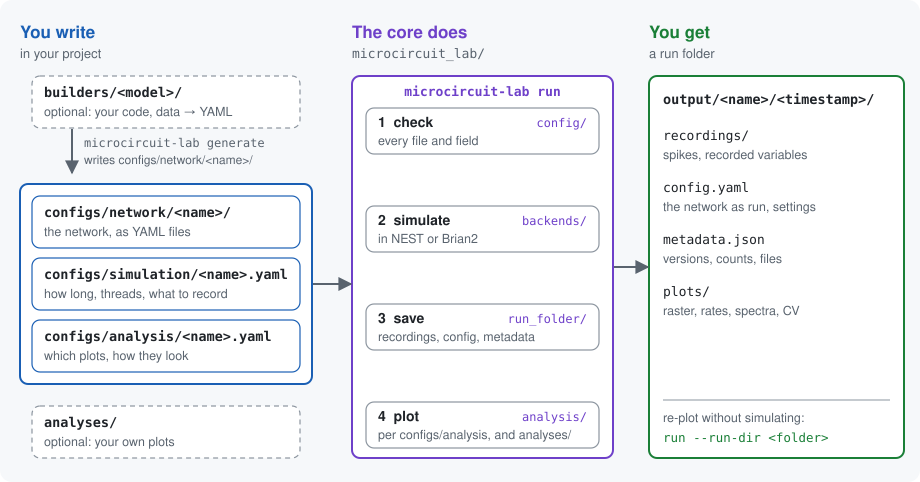

# How it works

- **You write** the network, simulation and analysis files, by hand or with a builder (optional: code that writes them from data; see [Builders](builders.md)).
- **Check**: every file and field, when the network is read. A mistake names the file and the field.
- **Simulate**: as the files give it, on NEST or Brian2. Nothing is converted or scaled on the way.
- **Save**: the run folder holds everything the run produced, and the settings it ran with.
- **Plot**: from the run folder. Plot again at any time without simulating (`microcircuit-lab run --run-dir <folder>`).

## The files sit in the middle

Follow one number from the model to the simulator:

| Where | What it holds | Example |
| :--- | :--- | :--- |
| you, by hand or in a builder (optional) | the model's decisions | a 0.15 mV PSP, converted to a current |
| the network files | what is simulated | `weight: {value: 87.8, unit: pA}` |
| the core | what every model needs | NEST gets a weight of 87.8 pA |

So you can read a network without running anything, and compare two networks file by file. Analyses and experiments are as free as builders: any script that reads a run folder works.

## Who checks what

A shared name is one that runs on every simulator, such as the rule `fixed_indegree` or the distribution `normal`.

| What | Checked by | When | Example |
| :--- | :--- | :--- | :--- |
| the file format, the values the core computes with, what a shared name means | the core | when the files are read | `size: 0` in `populations.yaml` |
| what a simulator can't do with a shared name | the simulator's backend | before the network is built | on Brian2, a weight in nS onto a current-based neuron |
| the simulator's own names: model parameters, its own rules and distributions | the simulator | when it builds that part | NEST refuses `tau_m: -1` |

Nothing is checked twice: NEST knows its models' parameters, so the core leaves them to NEST.

## Where next

- What a network folder holds: [Network files](network-files.md).
- Each step in detail, the code behind it, and where to look when something goes wrong: [From a builder to the plots](workflow.md).
