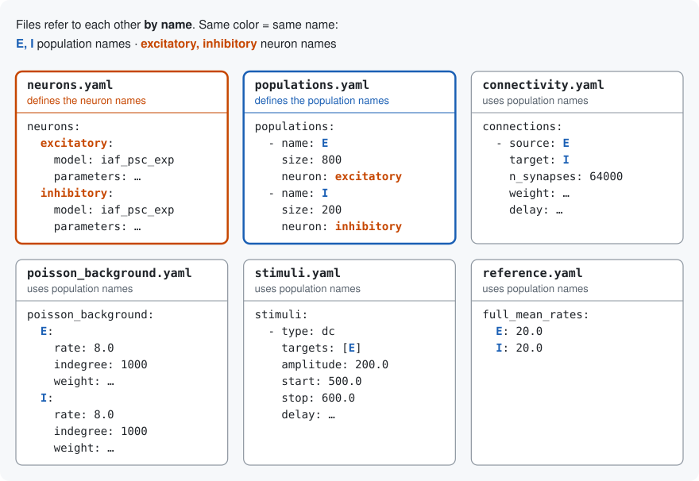

# Network files

A network model is a folder of YAML files, one per part. Populations and neurons are named once and used by name everywhere else:



The files of a project:

```text
configs/
├── network/<name>/
│   ├── network.yaml             names the other files
│   ├── populations.yaml         sizes, and the neuron of each population
│   ├── neurons.yaml             neuron models and parameters
│   ├── connectivity.yaml        rules, synapse numbers, weights, delays
│   ├── poisson_background.yaml  background Poisson input
│   ├── synapses.yaml            optional: synapse models, receptor ports
│   ├── stimuli.yaml             optional: inputs for experiments
│   ├── reference.yaml           optional: reference rates to compare with
│   └── scaling.yaml             only in a scaled network: how it was scaled
├── simulation/<name>.yaml       optional: duration, seed, threads, simulator, what to record
└── analysis/<name>.yaml         optional: which plots, time window, style
```

`microcircuit-lab run --network toy` uses `configs/simulation/toy.yaml` and `configs/analysis/toy.yaml` if they exist, and defaults otherwise; `--simulation` and `--analysis` pick others.

To start, copy `configs/network/toy/`: its files explain each field in comments. Every field of every file, with units, limits and defaults: [Configuration files](config_files.md).

## Checks

A mistake stops the run before anything is simulated, naming the file and the field:

```text title="Output"
populations.yaml: populations.0.size: Input should be greater than 0
```

To check a network without running it: `read_network("configs/network/<name>")`. The one thing checked later, by the simulator, is a neuron's `parameters:`, because every neuron model takes different ones.

## Units

Every number is in these units, whichever simulator runs it:

| Quantity | Unit |
| :--- | :--- |
| potentials | mV |
| times, delays | ms |
| capacitance | pF |
| currents | pA |
| conductances | nS |
| rates | spikes/s |

A parameter that a file leaves out keeps the value of the simulator's model (NEST: `nest.GetDefaults("iaf_psc_exp")`; Brian2: the model's `defaults` in `extensions/brian2/`). So write every parameter your model depends on.

## Names the simulator looks up

Some fields name something: a model, a rule, a distribution. A shared name runs on every simulator; any other name is looked up by the simulator that runs the network.

| Field | Shared names | Any other name |
|---|---|---|
| `model` in `neurons.yaml` | none | NEST: its own models, and NESTML modules; Brian2: a `NeuronModel` in `extensions/brian2/` |
| `model` in `synapses.yaml` | `static_synapse` | NEST: its own models; Brian2: a `SynapseModel` in `extensions/brian2/` |
| `rule` of a connection | `fixed_total_number`, `fixed_indegree`, `fixed_outdegree`, `pairwise_bernoulli`, `one_to_one`, `all_to_all` | NEST: its own rules; Brian2: a `ConnectionRule` in `extensions/brian2/` |
| `distribution` of a weight, delay or neuron value | `normal`, `uniform`, `lognormal` | NEST: its own (`nest.random`) and functions in `extensions/nest/`; Brian2: a `Distribution` in `extensions/brian2/` |
| `receptor_port` of a synapse | a number | NEST: a name in the target model's `receptor_types`; Brian2: the variable the connection adds to |

For example, `rule: pairwise_poisson, pairwise_avg_num_conns: 2` runs on NEST, which has that rule: its arguments are keys of their own. A network model that uses such names runs on that simulator only, and a name it doesn't have stops the run with a message. Scaling a network with such a rule isn't implemented yet: it stops with an error (scale it in the builder). Writing them for Brian2: [Brian2](brian2.md).

## Background input

Each neuron of a population gets `indegree` independent Poisson inputs, each firing at `rate` (spikes/s):

```yaml
poisson_background:
  E: {rate: 8.0, indegree: 1000, weight: {value: 87.8, unit: pA}, delay: {value: 1.5}}
  I: {rate: 8.0, indegree: 1000, weight: {value: 87.8, unit: pA}, delay: {value: 1.5}}
```

The simulator makes one generator per population, firing at `rate × indegree` (8 kHz here).

- **A drawn weight is drawn once per neuron**, not per input, as in the reference codes: the mean input is the same, its spread across neurons larger.
- **Optional: `generator: <name>`.** Populations that give the same name share one generator, which saves memory when many populations get the same input (same `rate`, `indegree` and `synapse`). Each neuron still gets its own spike train.
- **Optional: a mean current instead.** The builder step `replace_background_by_mean_current` puts the mean of this input into `I_e` and empties `poisson_background`: the same average drive, without the fluctuations (Potjans & Diesmann 2014, Fig. 5). It needs weights in pA on the default receptor port; apply it after `scale_network`. Example: `microcircuit-lab generate pd14 --network-name pd14_mean_current --background mean_current`.
- **Optional: a constant current of your own** adds to either: `I_e` in a neuron entry for the whole run, or a `dc` stimulus (below) for chosen populations and times.

## Stimuli (optional)

Inputs for experiments, in `stimuli.yaml` (add `stimuli: stimuli.yaml` to `network.yaml`):

```yaml
stimuli:
  - type: dc                 # a constant current from start to stop
    targets: [E]
    amplitude: 200.0         # pA
    start: 500.0             # ms
    stop: 600.0
    delay: {value: 1.0}      # so it is on from 501 to 601 ms

  - type: poisson            # a Poisson spike train
    targets: [E, I]
    rate: 50.0               # spikes/s
    start: 200.0
    stop: 400.0
    weight: {value: 87.8, unit: pA}
    delay: {value: 1.5}
```

- Types: `dc`, `poisson`, and `inhomogeneous_poisson` (a rate that changes in steps); their fields: [Configuration files](config_files.md#stimuliyaml).
- Stimuli are applied as written: not scaled, not compensated. They add to the background and to each other, so several entries make several pulses. Without `stop`, a stimulus lasts until the end.
- Times must be multiples of the time step (`resolution`).
- A runnable example: `microcircuit-lab run --network toy_stimulated`.

## Where next

- [Weights and delays](weights-and-delays.md): fixed or drawn, units, PSP to current.
- [Connections](connections.md): rules, synapse models, connections from a file.
