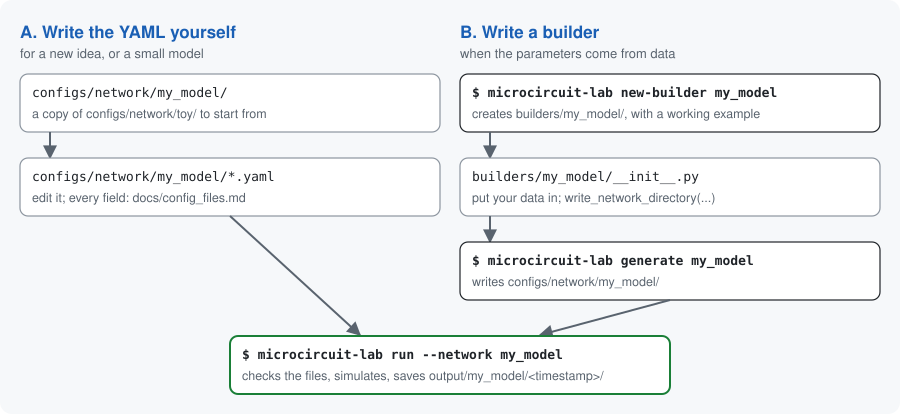

# A new network model



A new network model works with the core as it is. Write its files by hand (A, the simplest), or let code write them (B, optional).

## A. Write the YAML yourself

For a new idea, or a model small enough to write by hand. Start from the toy, whose files explain each field:

```bash title="Terminal"
cp -r configs/network/toy configs/network/my_model
# edit the files
microcircuit-lab run --network my_model
```

The run checks every file first; fix what it reports. For the duration, threads and recordings, add `configs/simulation/my_model.yaml` (optional: without it, the defaults are used, with a warning). Every field: [Configuration files](config_files.md).

## B. Let a builder write them (optional)

When the parameters come from data (published tables, recordings, matrices), let code write the files:

```bash title="Terminal"
microcircuit-lab new-builder my_model   # optional: builders/my_model/, a working example to start from
microcircuit-lab generate my_model      # runs it: writes configs/network/my_model/
microcircuit-lab run --network my_model
```

Any code that writes valid files works; the template and the helpers are there if you want them. What a builder can be, how `generate` finds it, and the helpers: [Builders](builders.md). [Tutorial 3](tutorials/3_own_network_model.md) writes the files by hand instead.
