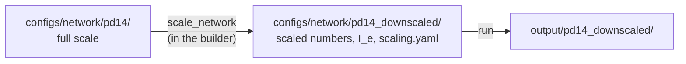

# Scaling a network model (optional)

A full-scale network model can be slow or need more memory than you have. A smaller copy is a network folder of its own, with the scaled numbers in its files, so what you read is still what is simulated:

```bash title="Terminal"
microcircuit-lab generate pd14 --n-scaling 0.1 --k-scaling 0.1 --network-name pd14_downscaled
microcircuit-lab run --network pd14_downscaled
```



`--n-scaling 0.1` keeps 10 % of the neurons, `--k-scaling 0.1` 10 % of the inputs of each neuron. The new folder's `scaling.yaml` records how it was made; it is a record only, not applied again:

```yaml
scaled_from: pd14
scaled_with: microcircuit_lab.builder_tools.scaling.scale_network
parameters: {N_scaling: 0.1, K_scaling: 0.1, preserve_mean_input: true, preserve_variance: true, compensate_recurrent_input: true}
```

The [PD14 example](https://github.com/shimoura/microcircuit-lab/tree/main/examples/pd14) runs a scaled copy and compares its rates with the full model.

## What scaling keeps

Fewer neurons (`N_scaling`) change nothing for each neuron. Fewer inputs (`K_scaling` = $k$) change the input current each neuron gets. With $K$ inputs of weight $J$ firing at rate $\nu$ through a synapse with time constant $\tau_s$, its mean and variance are

$$\mu = \tau_s\, K J \nu, \qquad \sigma^2 = \tfrac{1}{2}\,\tau_s\, K J^2 \nu .$$

Weights alone can keep one of the two, not both. Scaling the weights by $1/\sqrt{k}$ and adding the lost mean as a constant current keeps both (van Albada, Helias & Diesmann 2015, *PLoS Comput Biol* 11:e1004490). The options of `scale_network` choose:

| Options | Weights | Current added | Mean $\mu$ | Fluctuations $\sigma^2$ |
|---|---|---|---|---|
| defaults | $J/\sqrt{k}$ | $(1-\sqrt{k})\,\mu$ | kept | kept |
| `compensate_recurrent_input=False` | $J/\sqrt{k}$ | for the background only | recurrent part lower | kept |
| `preserve_mean_input=False` | $J/\sqrt{k}$ | none | lower: $\sqrt{k}\,\mu$ | kept |
| `preserve_variance=False` | $J/k$ | none | kept | larger: $\sigma^2/k$ |

- The current goes into each population's `I_e` in the scaled files.
- The recurrent part needs the full-scale rate of every population: `full_mean_rates` in `reference.yaml`. Without them scaling stops with an error; `compensate_recurrent_input=False` needs none.
- The current is computed for weights in pA on the default receptor port. Other units and ports aren't implemented yet: they stop the scaling, unless no current is needed (`preserve_mean_input=False` or `preserve_variance=False`).
- Excitatory and inhibitory inputs use their own $\tau_s$ (`tau_syn_ex`, `tau_syn_in`).
- Only the mean and variance are kept: a scaled network is close to the full one, not equal. Compare its rates with `reference.yaml`.
- A connection left with less than one synapse is dropped.
- Scaling a scaled network again isn't implemented yet: scale the full one by the product of the factors.

## From a script, or your own rule

Without a builder, or for a sweep over the factors, call `scale_network` yourself and write the result as a folder:

```python
from microcircuit_lab import read_network
from microcircuit_lab.builder_tools import scale_network, write_network

full = read_network("configs/network/toy")
small = scale_network(full, N_scaling=0.5, K_scaling=0.5, scaled_from="toy", compensate_recurrent_input=False)
write_network(small, "configs/network/toy_half")
```

For a scaling rule of your own, copy `scale_network` (`builder_tools/scaling.py`) into your project, change it, and call your copy; its `scaling.yaml` then names your function in `scaled_with`.
