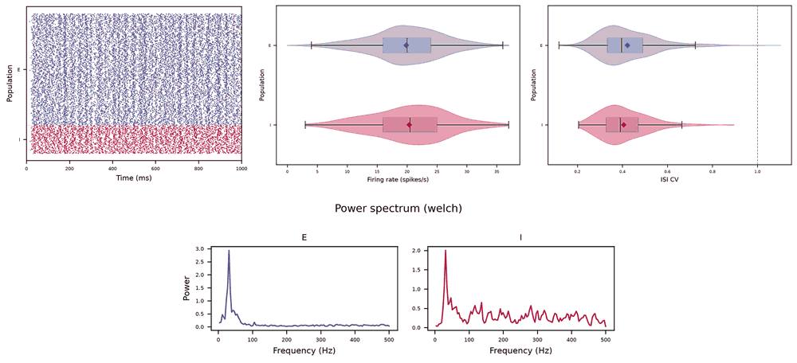

# 1 · Your first run

Make a project, run its network model, and find the results. About five minutes; you need the package ([Installation](../installation.md)).

## Make a project

A project is a folder for your network models and results. `init` makes one, with a small network model to start from, the toy:

```bash title="Terminal"
microcircuit-lab init my_project
cd my_project
```

```text title="Output"
Created my_project/builders
Created my_project/analyses
Created my_project/configs
...
Copied configs/network/toy
Copied configs/simulation/toy.yaml
...
```

What each folder is for: [Your project](../project.md).

## Run it

```bash title="Terminal"
microcircuit-lab run --network toy
```

```text title="Output"
Simulation statistics
E       N=  800  spikes=  15910  rate=  19.887 Hz
I       N=  200  spikes=   4076  rate=  20.380 Hz
Run directory: output/toy/20261120_205132
Plots saved under: output/toy/20261120_205132/plots
```

Two populations, 800 excitatory (E) and 200 inhibitory (I) neurons, fired about 20 times per second for 1 s of model time. NEST prints more lines while it works; they are left out here.

## The results

Each run gets a folder of its own, named after the time it started:

```text title="output/toy/<timestamp>/"
recordings/     the spikes
plots/          the plots below
config.yaml     the network model and the settings, as simulated
metadata.json   versions, run times, spike counts
```



- The plots, how to change them, and how to plot a run again: [Analysing a run](../analysis.md).
- What the run folder holds, and how to read it in Python: [The run folder](../run-folder.md).

## What was simulated

The network model is the folder `configs/network/toy/`: one short YAML file per part. Open them in any editor. `populations.yaml`, without its comments:

```yaml title="configs/network/toy/populations.yaml"
populations:
  - name: E
    size: 800
    neuron: excitatory
    initial_state:
      V_m: {distribution: normal, mean: -65.0, std: 5.0}
  - name: I
    size: 200
    neuron: inhibitory
    initial_state:
      V_m: {distribution: normal, mean: -65.0, std: 5.0}
```

The other files hold the neurons, the connections and the background input. Every number the simulator gets is in these files: [Network files](../network-files.md) explains each one. The settings of the run, 1 s of model time and the seed among them, are in `configs/simulation/toy.yaml`.

Next: [2 · Change a parameter](2_change_a_parameter.md).
