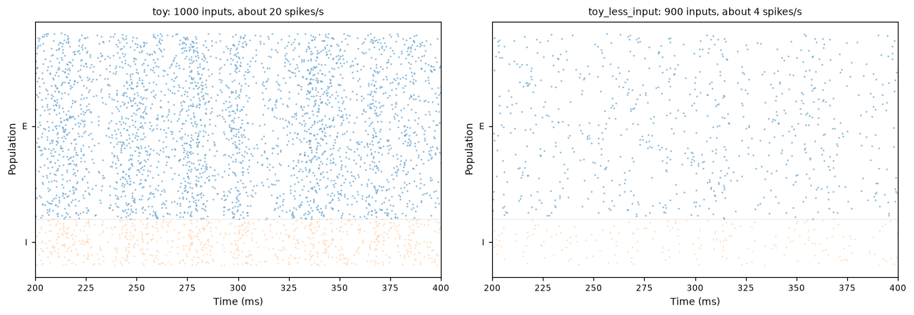

# 2 · Change a parameter

Change one number of the toy network model, run it again and compare. Then change a setting of the run. About five minutes, in the project of [tutorial 1](1_first_run.md).

## A number of the network model

Keep the toy as it is and change a copy. A network model is a folder, so copy the folder:

```bash title="Terminal"
cp -r configs/network/toy configs/network/toy_less_input
```

Open `configs/network/toy_less_input/poisson_background.yaml` in an editor and change both `indegree: 1000` to `900`: each neuron gets 900 background inputs instead of 1000.

```yaml title="configs/network/toy_less_input/poisson_background.yaml"
poisson_background:
  E:
    rate: 8.0
    indegree: 900       # was 1000
    ...
  I:
    rate: 8.0
    indegree: 900       # was 1000
    ...
```

Run the copy with the toy's settings (`--simulation toy`) and plots (`--analysis toy`):

```bash title="Terminal"
microcircuit-lab run --network toy_less_input --simulation toy --analysis toy
```

```text title="Output"
Simulation statistics
E       N=  800  spikes=   3541  rate=   4.426 Hz
I       N=  200  spikes=    920  rate=   4.600 Hz
Run directory: output/toy_less_input/20261120_205144
```

10 % fewer inputs, and the rates fall from about 20 to under 5 spikes/s ([Background input](../network-files.md#background-input) explains `rate` and `indegree`):



## A setting of the run

The duration, the seed, the threads and the simulator are settings of a run, in `configs/simulation/`, not part of the network model. Copy the toy's settings and change the seed:

```bash title="Terminal"
cp configs/simulation/toy.yaml configs/simulation/toy_seed7.yaml
```

```yaml title="configs/simulation/toy_seed7.yaml"
t_sim: 1000.0
resolution: 0.1
rng_seed: 7             # was 42
...
```

```bash title="Terminal"
microcircuit-lab run --network toy --simulation toy_seed7 --analysis toy
```

```text title="Output"
E       N=  800  spikes=  16309  rate=  20.386 Hz
I       N=  200  spikes=   4108  rate=  20.540 Hz
```

Another seed draws other connections and inputs: the rates move a little. Every setting, with its default: [Configuration files](../config_files.md#simulationnameyaml).

The simulator is a setting too. With Brian2 installed (`pip install brian2`):

```bash title="Terminal"
microcircuit-lab run --network toy --backend brian2
```

```text title="Output"
E       N=  800  spikes=  16173  rate=  20.216 Hz
I       N=  200  spikes=   4067  rate=  20.335 Hz
```

The same files, the same statistics; [tutorial 6](6_nest_and_brian2.ipynb) compares the two simulators in more detail. Each simulator's options: [NEST](../nest.md), [Brian2](../brian2.md).

Next: [3 · Your own network model](3_own_network_model.md).
