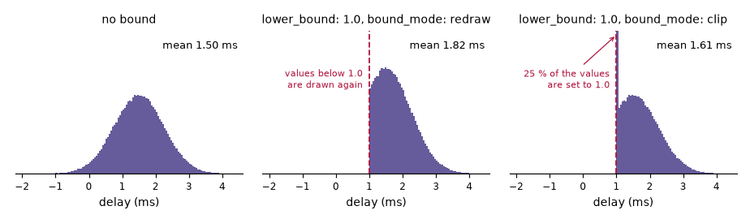

# Weights and delays

A weight or delay is a fixed `value`, or drawn for each synapse from a `distribution`:

```yaml
weight: {value: 87.8, unit: pA}                                       # fixed
weight: {distribution: normal, mean: 87.8, std: 8.78, unit: pA}       # drawn per synapse
delay:  {distribution: normal, mean: 1.5, std: 0.75, lower_bound: 0.1, bound_mode: redraw}
```

The numbers are those of the values the simulator draws: `mean` and `std` are the mean and standard deviation of the weights themselves. A neuron parameter or initial state drawn for each neuron is written the same way, without `unit`: `V_m: {distribution: normal, mean: -58, std: 10}`.

| Field | What it is |
|---|---|
| `value` | a fixed weight or delay |
| `distribution` | `normal` or `lognormal`, with `mean` and `std`; `uniform`, with `min` and `max`; or another name ([below](#other-distributions-optional)) |
| `lower_bound`, `upper_bound` | optional: what to do with a value past it is set by `bound_mode` |
| `bound_mode` | `redraw`: draw again; `clip`: set it to the bound |
| `unit` | weights only: `pA`, `nS` or `mV` (below) |

For `lognormal` too, `mean` and `std` are those of the values, not of their logarithm, and the values take the sign of `mean`.

## Bounds

Nothing is bounded unless the file says so. A bound changes the values, and so their mean:



- A drawn delay needs a `lower_bound` (e.g. the time step): a delay below half a step rounds to 0.
- An excitatory weight drawn from a normal can turn negative without `lower_bound: 0`, and each synapse is then excitatory or inhibitory by its own sign. Give the weights of an excitatory or inhibitory population the bound at 0 (`zero_bound` writes it, below).
- The scaling compensation uses the `mean` you wrote, not the mean after bounds: fine when `std` is a tenth of the mean, noticeable when it is about the mean.

## The unit of a weight

A weight's `unit` says what it is. Nothing is converted:

| `unit` | A weight is | Neuron model, e.g. |
|---|---|---|
| `pA` | a current | `iaf_psc_exp` |
| `nS` | a conductance | `aeif_cond_exp` |
| `mV` | a jump of the membrane potential | `iaf_psc_delta` |

Brian2 checks the unit against the variable the weight adds to; NEST can't. Whether input is excitatory or inhibitory comes from the sign of the weight, not from a population's name.

## From a paper's numbers (optional helpers)

Papers often give PSP amplitudes (mV) and a relative spread ("10 % of the mean"). A builder converts them; `builder_tools` has helpers for that:

```python
from microcircuit_lab.builder_tools import psp_to_psc_iaf_psc_exp, weight, zero_bound

current = psp_to_psc_iaf_psc_exp(0.15, C_m=250.0, tau_m=10.0, tau_syn=0.5)   # 0.15 mV -> 87.8 pA
weight(current, unit="pA", rel_std=0.1, **zero_bound(current, "redraw"))
# {distribution: normal, mean: 87.8, std: 8.78, lower_bound: 0.0, bound_mode: redraw, unit: pA}
```

The conversion holds for current-based LIF neurons with exponential synaptic currents (`iaf_psc_exp` and its variants); for an inhibitory weight, pass `tau_syn=<tau_syn_in>`. If you write the file by hand, keep the PSP in a comment next to the value, as `configs/network/toy/` does.

## Other distributions (optional)

`normal`, `uniform` and `lognormal` run on every simulator. Any other name is looked up by the simulator, with its arguments as keys of their own:

```yaml
weight: {distribution: exponential, beta: 20, mean: 20, unit: pA}   # NEST's own exponential
```

A weight from such a distribution also needs `mean`, which the core can't compute: its sign says excitatory or inhibitory, so the distribution must draw values of that sign. Background inputs and stimuli take the shared distributions; other distributions aren't implemented yet for them.

With NEST, a distribution of your own is a function in `extensions/nest/` that returns a NEST parameter; it gets the entry's keys:

```python
# extensions/nest/distributions.py
import nest

def erlang2(beta):
    return nest.random.exponential(beta=beta) + nest.random.exponential(beta=beta)
```

```yaml
weight: {distribution: erlang2, beta: 20, mean: 40, unit: pA}
```

NEST combines parameters with `+ - * /`, `nest.math` (`exp`, `sin`, `cos`, `min`, `max`, `redraw`) and `nest.logic.conditional`; it has no `log`, `pow` or `abs`. With Brian2: [Distributions of your own](brian2.md#distributions-of-your-own-optional).
