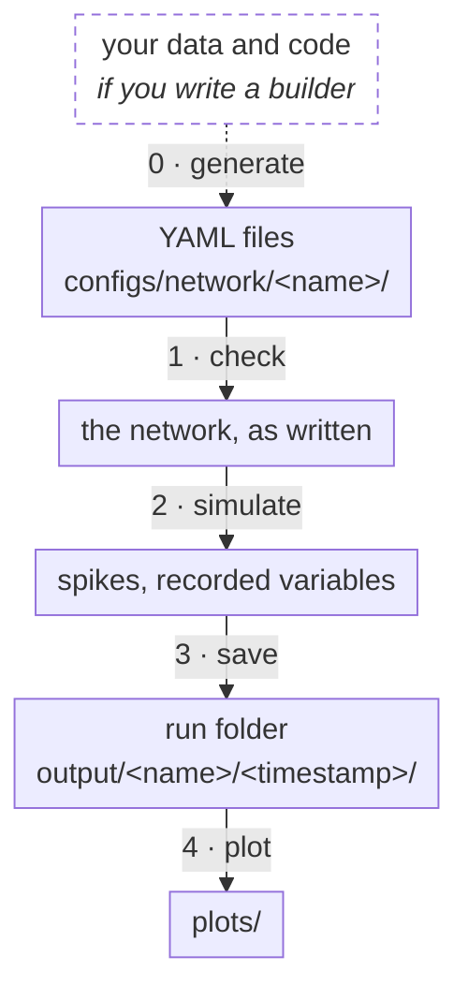
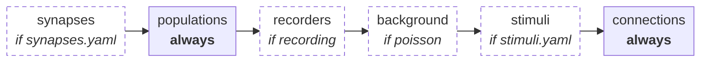

# From a builder to the plots

What happens between your files and the plots, step by step, and where the code of each step is. Read it when something goes wrong, or before you change the core.

`microcircuit-lab run --network <name>` goes through four steps. Step 0, writing the network with a builder, is optional. Each step turns one thing into the next:



A dashed box runs only when *the condition in italics* holds; a solid box always runs. The code paths are inside `microcircuit_lab/`.

## 0 · Generate (optional)

**In:** your data and code. **Out:** the YAML files.

Skip it when you write the files by hand. A builder is a folder `builders/<model>/` with a `main(argv)`, run by `microcircuit-lab generate <model>` ([Builders](builders.md)).

Everything a run simulates is in the files, so what a builder's helper does shows in the folder:

| Helper (`builder_tools`) | What the folder shows |
|---|---|
| `scale_network` | the scaled numbers, the compensation current in `I_e`, and `scaling.yaml` ([Scaling a network model](scaling.md)) |
| `replace_background_by_mean_current` | no background input, its mean current in `I_e` |

**Code:** `cli/generate.py`, `builder_tools/`

## 1 · Check

**In:** the YAML files. **Out:** the network, as written.

Each file is checked against its own module (`connectivity.yaml` → `config/connectivity.py`, ...), then names are matched across files. A mistake stops the run before the simulator starts, and names the file and the field:

```text title="Output"
Invalid network config in configs/network/toy:
  connectivity.yaml: connections.0.weight.std: Input should be greater than 0
```

What each field accepts: [config_files.md](config_files.md).

**Code:** `network/load.py`, `config/`

## 2 · Simulate

**In:** the network, as written, and `configs/simulation/<name>.yaml`. **Out:** spikes.

NEST objects are created in this order, then the network is simulated:



| In the files | In NEST |
| :--- | :--- |
| a synapse entry | a copy of its synapse model, under the entry's name |
| a population | its neurons: `nest.Create(model, size)` |
| `recording` in the simulation file | a `spike_recorder` (and a `multimeter` for each variable in `recording.variables`) |
| a background input | a `poisson_generator` firing at **rate × indegree** (the rate per synapse times the synapses of each neuron), shared by populations with the same `generator:` |
| a stimulus | a `dc_generator`, `poisson_generator` or `inhomogeneous_poisson_generator` |
| a connection (one row) | one `nest.Connect`, with its rule, weight and delay |

**Code:** `backends/nest/simulator.py` (`build`: the order), `backends/nest/distributions.py` (drawn weights, delays and values)

Before building, the backend runs `check()`:

- **NEST** stops on a distribution that neither NEST (`nest.random`) nor `extensions/nest/` has, or one with the wrong arguments. Model, rule and receptor names it reports itself, when building.
- **Brian2** stops on a model, rule or distribution that `extensions/brian2/` doesn't have, and on a weight whose `unit` doesn't fit.

With `--backend brian2`, the same parts become Brian2 objects (`backends/brian2/`: `simulator.py`, `connections.py`, `inputs.py`, `recording.py`), with the models, rules and distributions of `extensions/brian2/` ([Brian2](brian2.md)).

## 3 · Save

**In:** spikes. **Out:** the run folder.

```text
output/<name>/<timestamp>/
├── recordings/     spikes, written by the simulator
├── config.yaml     the network and the settings used
├── metadata.json   versions, git commits, spike counts, run times
└── plots/          step 4
```

**Code:** `run_folder/write.py`

## 4 · Plot

**In:** the run folder, `configs/analysis/<name>.yaml` and your `analyses/`. **Out:** `plots/`.

The plots read the run folder with `read_run`, not the simulation, so a run can be plotted again at any time. Your own analyses read it the same way ([Reading a run](run-folder.md#reading-a-run)).

To plot again, without simulating:

```bash title="Terminal"
microcircuit-lab run --run-dir output/<name>/<timestamp>
```

**Code:** `run_folder/read.py` (`read_run`), `analysis/`

## Where to look when...

| ... | Look at |
| :--- | :--- |
| a file is refused | the module named after the file, in `config/` |
| a name "is not defined" | `network/load.py` (populations, neurons), `config/network.py` (synapses) |
| Brian2 "has no" model, rule or distribution | its checks, in `backends/brian2/checks.py`, and `extensions/brian2/` |
| NEST "has no" model, rule or receptor | NEST's own message when building; of these names, `check()` in `backends/nest/simulator.py` looks only at distributions (`extensions/nest/`) |
| a background generator fires at a different rate than the files | step 2: the rate is `rate × indegree` (`generator_rate`, `config/poisson_background.py`) |
| rates drop in a scaled run | `builder_tools/scaling.py`, `builder_tools/constant_current.py`; full-scale rates in `reference.yaml` |
| something looks wrong in NEST | step 2: the `create_...` method for that part, in `backends/nest/simulator.py` |
| something looks wrong in Brian2 | step 2: the model in `extensions/brian2/`, then the `create_...` method in `backends/brian2/` (stimuli and background in `inputs.py`, recordings in `recording.py`, the rest in `simulator.py`) |
| the run went to the wrong folder | the `output` section of the simulation file |
| your plot is not found | `register_plot` in your file in `analyses/` |
| `generate` does not list your builder | step 0: a `main(argv)` in `builders/<model>/__init__.py` |
| a large network loads slowly | `connections_file` (CSV), `config/connection_table.py` |

`init --with-core` copies only the backends of the installed simulators (`--backends nest brian2` to choose).

To change the core: [CONTRIBUTING.md](https://github.com/shimoura/microcircuit-lab/blob/main/CONTRIBUTING.md#changing-the-core).
