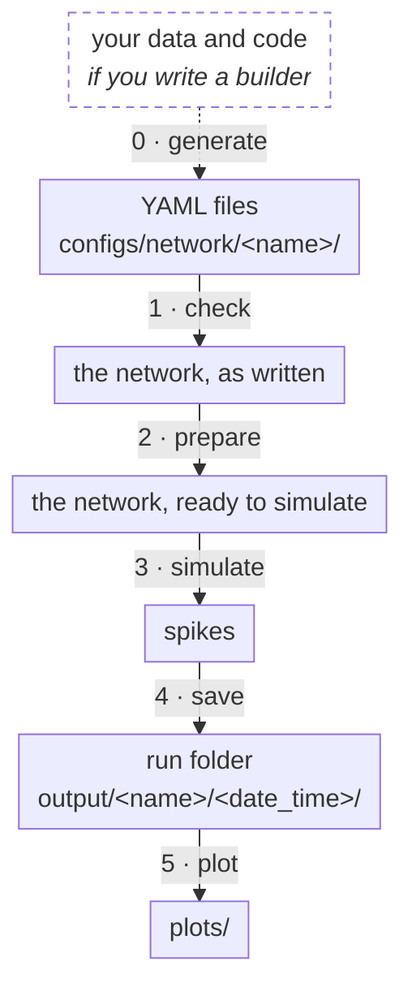
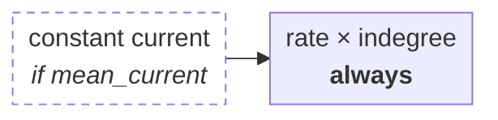
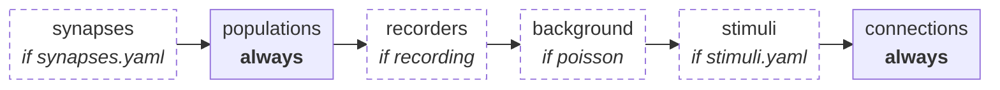

# From a builder to the plots

`microcircuit-lab run --network <name>` goes through five steps, after an optional step 0 that writes the network. Each step turns one thing into the next:



In the diagrams on this page, a dashed box runs only when *the condition in italics* holds; a solid box always runs. Paths of the code are inside `microcircuit_lab/`.

## 0 · Generate

**In:** your data and code. **Out:** the YAML files.

Optional: the YAML files can also be written by hand. A builder is a folder `builders/<model>/` with a `main(argv)`, run by `microcircuit-lab generate <model>`.

**Code:** `cli/generate.py`, `builder_tools/`

## 1 · Check

**In:** the YAML files. **Out:** the network, as written.

Each file is checked against its own module (`connectivity.yaml` → `config/connectivity.py`, ...), then names are matched across files. A mistake stops the run before the simulator starts, and names the file and the field:

```text
Invalid network config in configs/network/toy:
  connectivity.yaml: connections.0.weight.rel_std: Input should be greater than or equal to 0
```

What each field accepts: [config_files.md](config_files.md).

**Code:** `network/load.py`, `config/`

## 2 · Prepare

**In:** the network, as written. **Out:** the network, ready to simulate. The files themselves are not changed.



- **constant current:** the background becomes its mean, a constant current added to `I_e`, and its rate 0.
- **rate × indegree:** each population's background is one Poisson generator, firing at the rate per synapse times the number of synapses.

Everything else is simulated as written: a scaled network is a folder of its own, written by `scale_network` with the scaled numbers and the compensation current in `I_e` (README, "Scaling a network"). To see the two ends:

```python
from microcircuit_lab.network.load import read_network, load_network

written = read_network("configs/network/pd14")    # as written
prepared = load_network("configs/network/pd14")   # ready to simulate
```

**Code:** `network/prepare.py`, `builder_tools/constant_current.py` (`replace_background_by_mean_current`)

## 3 · Simulate

**In:** the network, ready to simulate, and `configs/simulation/<name>.yaml`. **Out:** spikes.

NEST objects are created in this order, then the network is simulated:



| In the files | In NEST |
| :--- | :--- |
| a synapse entry | a copy of its synapse model, under the entry's name |
| a population | its neurons: `nest.Create(model, size)` |
| `recording` in the simulation file | a `spike_recorder` (and a `multimeter` for voltages) |
| a background input | a `poisson_generator`, shared by populations with the same `generator:` |
| a stimulus | a `dc_generator`, `poisson_generator` or `inhomogeneous_poisson_generator` |
| a connection (one row) | one `nest.Connect`, with its rule, weight and delay |

**Code:** `backends/nest/simulator.py` (`build`: the order), `backends/nest/distributions.py` (drawn weights, delays and values)

Before building, the simulator checks the names the network uses (`check()`): models, project rules and distributions, named receptors. With `--backend brian2` the same parts become Brian2 objects, in `backends/brian2/simulator.py`; the neuron and synapse models, and any project rules and distributions, come from the project's `extensions/brian2/` (see "Running with Brian2" in the [README](../microcircuit_lab/README.md#running-with-brian2)).

## 4 · Save

**In:** spikes. **Out:** the run folder.

```text
output/<name>/<date_time>/
├── recordings/     spikes, written by the simulator
├── config.yaml     the prepared network and the settings used
├── metadata.json   versions, git commits, spike counts, files
└── plots/          step 5
```

**Code:** `run_folder.py`

## 5 · Plot

**In:** the run folder, `configs/analysis/<name>.yaml` and your `analyses/`. **Out:** `plots/`.

To plot again, without simulating:

```bash
microcircuit-lab run --run-dir output/<name>/<date_time>
```

**Code:** `analysis/`

## Where to look when...

| ... | Look at |
| :--- | :--- |
| a file is refused | the module named after the file, in `config/` |
| a name "is not defined" | `network/load.py` (populations, neurons), `config/network.py` (synapses) |
| the simulator "has no" model, rule, distribution or receptor | its `check()`, in `backends/<name>/simulator.py`; for Brian2, `extensions/brian2/` |
| weights or sizes differ from the files | step 2: compare `read_network` and `load_network` |
| rates drop in a scaled run | `builder_tools/scaling.py`, `builder_tools/constant_current.py`; full-scale rates in `reference.yaml` |
| something looks wrong in NEST | step 3: the `create_...` method for that part, in `backends/nest/simulator.py` |
| something looks wrong in Brian2 | step 3: the model in `extensions/brian2/`, then the `create_...` method in `backends/brian2/simulator.py` |
| the run went to the wrong folder | the `output` section of the simulation file |
| your plot is not found | `register_plot` in your file in `analyses/` |
| `generate` does not list your builder | step 0: a `main(argv)` in `builders/<model>/__init__.py` |
| a large network loads slowly | `connections_file` (CSV), `config/connection_table.py` |

To change the core: [CONTRIBUTING.md](../CONTRIBUTING.md#changing-the-core).
