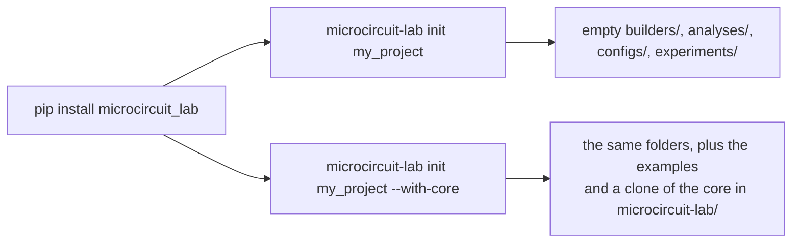
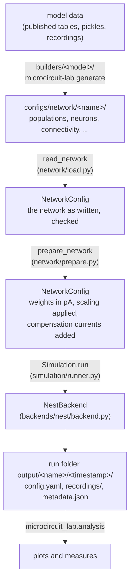
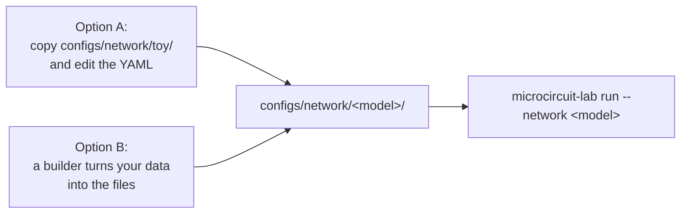

# Microcircuit Lab

Microcircuit Lab builds, simulates and analyses spiking network models of cortex, from a single microcircuit to multi-area models. A network is described in plain YAML files; the same core then prepares it, runs it in NEST and analyses the result, whatever model it came from. Model-specific code lives apart, in *builders*, so published models share one tested simulation path.

## Contents

- [Starting a project](#starting-a-project)
- [How it works](#how-it-works)
- [Project structure](#project-structure)
- [Installation](#installation)
- [Quick start](#quick-start)
- [Configuration](#configuration)
- [Scaling a network](#scaling-a-network)
- [Adding a new model](#adding-a-new-model)
- [Changing the core](#changing-the-core)
- [Adding a backend](#adding-a-backend)
- [Using a NESTML model](#using-a-nestml-model)
- [Included models](#included-models)
- [Experiments](#experiments)
- [Run outputs](#run-outputs)
- [Analysing a run](#analysing-a-run)
- [Testing](#testing)

## Starting a project

A project is a folder with your own `builders/`, `analyses/`, `configs/` and `experiments/`. The core is never copied into it. There are two ways to have the core available:



**Installed.** For using the core as it is:

```bash
pip install "microcircuit_lab[nest] @ git+https://github.com/shimoura/microcircuit-lab@v0.1.0"
microcircuit-lab init my_project      # creates the four folders, touches nothing that exists
cd my_project
microcircuit-lab new-builder my_model # creates builders/my_model/
microcircuit-lab generate my_model    # writes configs/network/my_model/
microcircuit-lab run --network my_model
```

**With the core inside the project.** For reading or editing the core next to your own code:

```bash
microcircuit-lab init my_project --with-core
```

This also clones the core into `my_project/microcircuit-lab/` (at the release tag of the version you installed), installs it in editable mode so your edits take effect at once, and adds that folder to the project's `.gitignore`, because it is a clone of its own repository. Pull new core versions with `git pull` inside that folder; to share a change, see [CONTRIBUTING.md](../CONTRIBUTING.md). Every run records both the project's git commit (`git`) and the core's (`core_git`) in `metadata.json`, so a result can be traced to the exact code that produced it. Without the clone, the core is recorded by its version only.

`--with-core` also copies the examples (`toy`, `toy_stimulated`, `toy_two_areas`, `pd14`, `humam`) into the project's `builders/` and `configs/`, so you can try them two ways:

```bash
microcircuit-lab run --network pd14           # run a network config as it is
microcircuit-lab generate humam               # or regenerate it with its builder first
microcircuit-lab run --network humam_single
```

The copies are yours to edit and don't follow later core updates. An example whose name already exists in the project is skipped, so `microcircuit-lab init . --with-core` is safe inside an existing repository. A plain `pip install` without `--with-core` has no examples.

Run the commands from the project root: that is where the core looks for `builders/`, `analyses/` and `configs/`. A change that only your project needs belongs in your `builders/` or `analyses/`, not in the core.

## How it works

A network goes through the same steps whatever model it comes from:



- **Builders** are the only model-specific code. They write the network files and are never imported by the core.
- **`read_network`** reads the files and checks every field (with the [pydantic](https://docs.pydantic.dev) models in `microcircuit_lab/config/`) and the references between files.
- **`prepare_network`** turns the network as written into the network to simulate: it converts weights given in mV to pA, applies the scaling and adds the compensation currents. `load_network` does both steps.
- **The backend** builds the network in the simulator (NEST today), simulates it and writes the recordings.
- **The analysis** reads a run, live or saved, through the same `simulation` object.

## Project structure

```text
microcircuit_lab/
├── config/            what each config file may contain, one module per file
│   ├── populations.py, neurons.py, connectivity.py, background_inputs.py,
│   │   stimuli.py, scaling.py, reference.py     (configs/network/<name>/*.yaml)
│   ├── network.py     the whole network (NetworkConfig) and network.yaml
│   ├── simulation.py  configs/simulation/<name>.yaml
│   └── analysis.py    configs/analysis/<name>.yaml
├── network/           from a network folder to the network to simulate
│   ├── load.py        read_network, load_network
│   ├── prepare.py     prepare_network and its steps
│   ├── scaling.py     scaling and compensation formulas
│   ├── units.py       PSP (mV) to PSC (pA) conversion
│   └── quantities.py  indegrees, mean PSCs, tau_syn per population, ...
├── simulation/        Simulation: load, run, re-open a run
├── backends/          simulators (NEST) and reading back a saved run
├── analysis/          rates, ISI CV, power spectrum, raster; plot registry; cache
├── cli/               the microcircuit-lab command (init, new-builder, generate, run)
├── builder_tools.py   everything a builder needs, in one import
├── runs.py            run folders, saved config, metadata
├── discovery.py       finds the builders/ and analyses/ of your project
└── yaml_files.py      reading and writing YAML

builders/              model-specific builders (PD14, HuMAM, toy_two_areas), outside the package
configs/               network, simulation and analysis configs of the examples
experiments/           example experiment scripts (e.g. a parameter sweep)
scripts/               helper scripts (building NEST from source)
tests/                 tests of the core
```

The same word follows a concept through the stages: `stimuli.yaml` is described by `config/stimuli.py`, built by `NestBackend.create_stimuli` and tested in `tests/test_stimuli.py`. Only `microcircuit_lab/` is installed by `pip`; the other folders come with a clone of the repository (or, for `builders/` and `configs/`, with `microcircuit-lab init --with-core`).

## Installation

To use the core as it is, install a released version in a virtual environment:

```bash
pip install "microcircuit_lab[nest] @ git+https://github.com/shimoura/microcircuit-lab@v0.1.0"
```

Replace `v0.1.0` with the version you want (see the repository's releases); drop `[nest]` if you get NEST another way (see **NEST** below). To work on the core itself, install a clone in editable mode:

```bash
python -m venv .venv
source .venv/bin/activate
pip install -e ".[dev]"
```

Or with mamba/conda:

```bash
mamba create -n microcircuit-lab python=3.12
mamba activate microcircuit-lab
pip install -e ".[dev]"
```

**NEST.** NEST is not a hard dependency, because how you get it depends on where you run: the PyPI package (`pip install -e ".[dev,nest]"`), conda-forge (`mamba install -c conda-forge nest-simulator`), or a build from source (common on clusters, e.g. for MPI or a site-specific compiler; see the [NEST installation docs](https://nest-simulator.readthedocs.io/en/stable/installation/index.html) and `scripts/install_nest_from_source.sh`). All that matters is that `import nest` works in the environment you run simulations in.

## Quick start

The smallest example is the bundled `toy` network, two populations (E and I) under `configs/network/toy/`:

```bash
microcircuit-lab run --network toy
```

`microcircuit-lab run --network <name>` runs any network under `configs/network/` and saves raster, firing-rate, power-spectrum and ISI-CV plots in one shared style. `--simulation` and `--analysis` default to the same name (see [Configuration](#configuration)); `--run-dir` re-plots a finished run instead (see [Re-plotting without re-simulating](#re-plotting-without-re-simulating)). `microcircuit-lab generate <model>` (re)writes a model's network files with its builder.

The same from Python, e.g. in a notebook or a script under `experiments/`:

```python
from microcircuit_lab import Simulation, load_network

simulation = Simulation.from_yaml(network_name="toy")  # configs/network/toy + configs/simulation/toy.yaml
simulation.run()

network = load_network("configs/network/pd14")          # just the network, ready to simulate
print(network.populations["L4_E"].size)
```

## Configuration

Network, simulation and analysis settings are kept apart:

```text
configs/
├── network/
│   └── <network_name>/
│       ├── network.yaml           names the other files
│       ├── populations.yaml
│       ├── neurons.yaml
│       ├── connectivity.yaml
│       ├── background_inputs.yaml
│       ├── stimuli.yaml           optional
│       ├── scaling.yaml
│       └── reference.yaml
├── simulation/
│   └── <simulation_name>.yaml     duration, seed, threads, what to record
└── analysis/
    └── <analysis_name>.yaml       optional: which plots, time window, style
```

**Where the fields are listed.** Each file has its module in `microcircuit_lab/config/` with the same name (`populations.yaml` → `config/populations.py`). Each field is listed there with its type and limits; a field with no default is required, one with `Field(default=...)` is optional and shows its default. `configs/network/toy/` is a small working network that uses them, ready to copy.

**Checks.** A network is checked every time it is loaded (to run it) or written (by a builder): a missing, misspelled or wrong-typed field fails at once with the file and the field named, for example `populations.yaml: populations.0.size: Input should be greater than 0`. References between files (a population's neuron, a connection's populations) and the preparation step are checked the same way. The one open block is a neuron's `parameters:`, because neuron models differ in what they accept; the simulator checks those names. `load_network(folder)` runs the whole check without a simulation.

**Pairing by name.** The three trees are matched by name, so one network can be run with more than one simulation profile or plot style (a short run for a quick check, a long one for a paper). By default `Simulation.from_yaml(network_name="toy")` uses `configs/simulation/toy.yaml`, and the analysis uses `configs/analysis/toy.yaml`; pass `simulation_name`/`analysis_name` to pick another. The analysis file is optional (built-in defaults are used without it), and so is the simulation file (`SimulationConfig()` defaults). The config models are pydantic models, so a one-off change in a script doesn't need a YAML file: `plot_raster(sim, config=RasterPlotConfig(neuron_fraction=0.05))`.

Besides `begin`/`end`/`area`/`show_reference`/`style`, the sections of an analysis file (`raster:`, `firing_rates:`, `power_spectrum:`, `isi_cv:`) are the names the plots are registered under (see [Adding a bundled plot](#adding-a-bundled-plot)). An unknown section name raises an error instead of being ignored.

### Background input and stimuli

`background_inputs.yaml` is the always-on background Poisson input of each population, tied to its `background_indegree`. It scales with `K_scaling`, and the compensation of a scaled network accounts for it.

`stimuli.yaml` (optional; leave out the file and the `stimuli:` line in `network.yaml` if unused) holds targeted, time-limited inputs for experiments:

- `type: dc`: a constant-current pulse;
- `type: poisson`: a Poisson spike train for part of the run;
- `type: inhomogeneous_poisson`: a Poisson rate that changes in steps.

Stimuli are not scaled or compensated; they are applied exactly as written. `config/stimuli.py` lists their fields:

```yaml
stimuli:
  - type: dc
    targets: [E]
    amplitude: 200.0
    start: 500.0
    stop: 600.0

  - type: poisson
    targets: [E, I]
    rate: 50.0
    start: 200.0
    stop: 400.0
    weight: {mean: 0.15, rel_std: 0.0, distribution: fixed, unit: PSP}
    delay: {mean: 1.5, rel_std: 0.0, distribution: fixed}
```

Amplitudes are in pA, rates in spikes/s and times in ms. A runnable version is `configs/network/toy_stimulated/` (the toy network plus a `stimuli.yaml`), kept apart from `configs/network/toy/` so the baseline network several tests use stays unperturbed:

```bash
microcircuit-lab run --network toy_stimulated
```

**Poisson or DC background.** A top-level `background_mode: dc` in `background_inputs.yaml` (default `poisson`) replaces the background Poisson input of every population by a constant current of the same mean, the comparison of Potjans & Diesmann (2014), Fig. 5. `configs/network/pd14_dc/` is a ready-to-run example; the step is `_replace_background_by_dc` in `network/prepare.py`.

### Weights and delays

**Out-of-range draws.** A normal weight keeps the sign of its mean and a delay must not be shorter than a minimum, but a random draw can break both. A top-level `bound_mode` in `connectivity.yaml` decides what happens, for every weight and delay of the network (background inputs and stimuli included): `redraw` (default) draws again until the value is allowed; `clip` replaces it by the limit (a weight of the wrong sign becomes 0, a short delay becomes the minimum), as HuMAM does. The minimum of a drawn delay is half the simulation step unless the `delay` sets its own `minimum` (in ms); a smaller `minimum` is raised to half the step, and a `fixed` delay keeps its value.

**Units.** Every `weight` needs a `unit`, on purpose without a default, so a config can't silently run with the wrong conversion:

- `PSP`: the amplitude of the postsynaptic potential, in mV. It is converted to a current with the target population's own neuron parameters (`network/units.py`). The formula holds for any current-based LIF neuron with exponential synaptic currents (`iaf_psc_exp` and its variants) and only needs `C_m`, `tau_m`, `tau_syn_ex` and `tau_syn_in`. The code can't check a neuron's dynamics, so `PSP` on a model with those four names but other dynamics gives wrong weights without an error.
- `PSC`: the current amplitude in pA, used as given.
- `native`: used exactly as given, without any interpretation; the right choice for a conductance-based model (nS) or any other.

A new neuron model never needs a new conversion: give it `PSC` or `native` weights. If it has these dynamics but other parameter names, map them with `psp_conversion_aliases` on its `neurons.yaml` entry (the names in `parameters:` stay whatever the model accepts):

```yaml
neurons:
  my_model:
    model: some_custom_model_name
    parameters:
      Cm: 250.0
      tau_membrane: 10.0
      tau_exc: 2.0
      tau_inh: 2.0
    psp_conversion_aliases:
      C_m: Cm
      tau_m: tau_membrane
      tau_syn_ex: tau_exc
      tau_syn_in: tau_inh
```

List only the names that differ. A compiled NESTML model is the usual case; see [Using a NESTML model](#using-a-nestml-model).

**Excitatory and inhibitory input** are told apart by the sign of the weight, never by a population's name. When `K_scaling` is below 1, the compensation current (and the DC current of `background_mode: dc`) uses `tau_syn_ex` for excitatory input and `tau_syn_in` for inhibitory input.

### File layout

Files written by hand (e.g. `configs/network/toy/`) use normal YAML block style, one field per line. Tables a builder writes with thousands of rows (`connectivity.yaml`, and `populations.yaml`/`background_inputs.yaml` of multi-area networks) are written one record per line, e.g. `- {source: ..., target: ..., weight: {...}, delay: {...}}`: `humam_all`'s `connectivity.yaml` is about 8,400 lines this way instead of about 100,000. Both are plain YAML and load the same. `write_network_directory` in `microcircuit_lab.builder_tools` does this by itself (`compact=False` keeps block style for populations and background inputs of small networks); `microcircuit_lab.yaml_files` has `write_yaml` and `flow_records` to do it by hand.

## Scaling a network

A full-scale network can be slow or need a lot of memory. `scaling.yaml` runs a smaller copy:

```yaml
N_scaling: 0.1   # keep 10 % of the neurons of every population
K_scaling: 0.1   # keep 10 % of the connections each neuron receives (the indegree)
```

Both default to 1 (no scaling). Fewer connections means less input, so the weights are made stronger and a constant current (DC) gives each neuron back the mean input it lost. The other options choose how:

| `preserve_variance` | `preserve_mean_input` | `compensate_recurrent_input` | What happens |
|---|---|---|---|
| true | true | true | **Default.** Weights are divided by √`K_scaling`, which keeps the size of the input fluctuations. A DC current replaces the mean input lost from the recurrent and the background connections. |
| true | true | false | Same weights. The DC replaces only the lost background input. |
| true | false | (ignored) | Same weights, no DC. The mean input is lower than in the full network. |
| false | (ignored) | (ignored) | Weights are divided by `K_scaling`, which keeps the mean input but increases the fluctuations. No DC. |

The recurrent part of the DC uses the full-scale mean rates, so `reference.yaml` needs `full_mean_rates` for every population; a missing one raises an error that names it. A connection left with less than one synapse after scaling is dropped.

Example, PD14 at `N_scaling = K_scaling = 0.1`: without the DC two populations are silent; with it, most rates are within 10–20 % of the full-scale values (L2/3 E is lower, 0.45 Hz instead of 0.9 Hz). The DC restores the mean input, not the fluctuations, so a downscaled network never reproduces the full one exactly.

## Adding a new model

A model enters as a network folder, `configs/network/<model>/`; the core doesn't change. There are two ways to write that folder:



### Option A: write the YAML yourself

Best for a new idea or a model small enough to write by hand.

1. Copy `configs/network/toy/` to `configs/network/<my_model>/`. It is a small working example with one comment per file; the modules in `microcircuit_lab/config/` list every field.
2. Change the values.
3. Optionally add `configs/simulation/<my_model>.yaml` for the duration, threads and recording (`config/simulation.py` lists the fields). Without it the defaults are used.
4. `microcircuit-lab run --network <my_model>`. Loading checks every file; fix what it reports.

### Option B: write a builder

Best for a model whose parameters come from data (published tables, recordings, pickled matrices). A builder is any code that writes a valid `configs/network/<model>/`: a script, a notebook, anything. For `microcircuit-lab generate <model>` to find it, it is a package `builders/<model>/` with a function `main(argv=None)`; there is no list to edit. A builder in another installed package can register its `main` under the `microcircuit_lab.builders` entry-point group instead (see `microcircuit_lab/discovery.py`).

1. `microcircuit-lab new-builder <model_name>` creates `builders/<model_name>/__init__.py` with a `main()` that already writes a small example network. Replace its values with your model's, and add a `README.md` with the model's sources.
2. Read your data (keep it in the package, e.g. a `data/` folder or a `data.py` as in `pd14`) and pass the parts to `write_network_directory`:

   ```python
   from microcircuit_lab.builder_tools import delay, weight, write_network_directory

   write_network_directory(
       "configs/network/my_model",
       populations=[...],
       neurons={...},
       connections=[{"source": "E", "target": "I", "n_synapses": 5000,
                     "weight": weight(0.15, unit="PSP", rel_std=0.1),
                     "delay": delay(1.5, rel_std=0.5)}, ...],
       background_inputs={...},
   )
   ```

   It writes every file and checks the result, so a mistake raises with the file and the field named. `microcircuit_lab.builder_tools` also has `num_synapses_from_conn_prob` (connection probability to synapse number, as in PD14) and `psp_to_psc_iaf_psc_exp`. `builders/pd14/`, `builders/toy_two_areas/` and `builders/humam/` are worked examples. Using `write_network_directory` is optional: files written any other way are checked the same way when the network is loaded, or at once with `load_network(<folder>)`.
3. `microcircuit-lab generate <model_name>`; run `microcircuit-lab generate` with no name to list the builders it found.

### Run it

Either way, the network then runs like any other:

```python
from microcircuit_lab import Simulation

simulation = Simulation.from_yaml(network_name="my_model")
simulation.run()
```

or `microcircuit-lab run --network my_model`.

## Changing the core

When an idea doesn't fit what the config files can already say (a new stimulus type, a new distribution, spatial structure, plasticity), the change goes in the core. [CONTRIBUTING.md](../CONTRIBUTING.md#changing-the-core) shows which files each kind of change touches, and when a change needs a short design note first. Don't add model-specific branches to the core; if only one model needs it, it belongs in that model's builder.

## Adding a backend

1. Implement the `SimulationBackend` contract from `microcircuit_lab/backends/base.py` in a new package `microcircuit_lab/backends/<name>/`.
   - `prepare_output(run_dir)` and `save_recordings(run_dir)` are where recordings go to disk, in whatever way is native and efficient for that simulator (see [Run outputs](#run-outputs)).
   - `get_spike_events()` reads them back however they were stored, so the analysis and `runs.py` never need backend-specific code.
   - The constructor can take keyword-only arguments beyond `(network, simulation_config)` for what that backend alone needs; `NestBackend`'s `extension_modules` is the example (see [Using a NESTML model](#using-a-nestml-model)).
2. Register it in `get_backend` (`microcircuit_lab/backends/__init__.py`).
3. Select it by name and pass its own arguments through `backend_options`, which the rest of the package never reads:

```python
simulation = Simulation.from_yaml(
    network_name="my_model",
    backend="nest",
    backend_options={},  # backend-specific arguments, e.g. extension_modules for NEST
)
```

## Using a NESTML model

NESTML compiles a custom neuron model into a NEST extension module, which `nest.Install(module_name)` loads before any neuron of that model is created. Only `NestBackend` knows about this (its `extension_modules` argument); nothing else in the package does.

1. **Write the `.nestml` source** in a top-level `nestml/` folder next to `configs/`, not inside `builders/`: nothing reads a `.nestml` file at run time (NESTML's compiler does), and a compiled module depends on the platform and the NEST version. A model used by several networks sits directly in `nestml/`; one written for a single model goes in `nestml/<model_name>/`:

   ```text
   nestml/
   ├── generic_lif.nestml           # used by several networks
   └── humam/
       └── humam_lif.nestml         # written for the HuMAM reproduction
   ```

   The compiled output is not committed, like `output/`.

2. **Compile it** once, ahead of time, with NESTML's own tools:

   ```python
   from pynestml.frontend.pynestml_frontend import generate_nest_target

   generate_nest_target(
       input_path="nestml/generic_lif.nestml",
       target_path="nestml/build/my_module",
       module_name="my_module",
   )
   ```

   The model is then known to NEST under the name your `.nestml` file gives it (with NESTML's suffix), e.g. `generic_lif_nestml`.

3. **Use it in a network.** For `neurons.yaml` it is just another model: its name as `model`, its parameters as `parameters`, and `psp_conversion_aliases` if you use `unit: PSP` and it names things differently (see [Weights and delays](#weights-and-delays)). To try it on a network you trust, copy the network rather than edit it, e.g. `configs/network/toy/` to `configs/network/toy_nestml/`.

4. **Load the module before the network is built:**

   ```python
   from microcircuit_lab import Simulation

   simulation = Simulation.from_yaml(
       network_name="toy_nestml",
       backend="nest",
       backend_options={"extension_modules": ["my_module"]},
   )
   simulation.run()
   ```

   The modules are loaded on every `run()`, in `NestBackend.initialize()`, before the populations are created.

## Included models

- **PD14** (`pd14`, `pd14_dc`): the Potjans & Diesmann (2014) cortical microcircuit, built from the published parameters.
- **HuMAM** (`humam_single`, `humam_all`): one area or all 34 areas of the human multi-area model (Pronold et al. 2024), from the bundled HuMAM data.
- **Two-area toy** (`toy_two_areas`): a small synthetic multi-area network whose areas have different layers and cell types (E, PV, SOM, VIP); an example and a test case, not a model of cortex.
- **Toy** (`toy`, `toy_stimulated`): two populations (E and I), the smallest example, with and without stimuli.

Each builder's README in `builders/` gives its sources and how its configs were generated.

## Experiments

An experiment (a parameter sweep, a comparison across configs) is a plain Python script under `experiments/<model_name>/` that runs simulations itself. There is no framework for it beyond `Simulation` and `microcircuit_lab.analysis`: read a network, change what you want in memory, prepare it, run it, and use the same `compute_*`/`plot_*` functions as everywhere else:

```python
from microcircuit_lab import Simulation, prepare_network, read_network

network = read_network("configs/network/toy")
populations = {name: pop.model_copy(update={"background_indegree": 2000})
               for name, pop in network.populations.items()}
network = prepare_network(network.model_copy(update={"populations": populations}))
```

`experiments/toy/background_drive_sweep.py` is a worked example (a sweep over the background indegree, which is how the toy network's own background drive was chosen). To analyse a run you already have, see [Analysing a run](#analysing-a-run).

### Re-plotting without re-simulating

A run saves everything a plot needs (`config.yaml`, `recordings/`), so trying another `--begin`/`--end`/`--area` or analysis profile doesn't need a new simulation. Pass `--run-dir` instead of `--network`; every other flag works the same:

```bash
microcircuit-lab run --network toy   # prints "Run directory: ..."
microcircuit-lab run --run-dir output/toy/<timestamp> --begin 200 --end 400
```

The plots go back into that run's `plots/` folder. From Python, `Simulation.from_run_dir(run_dir)` returns a `Simulation` whose `backend` reads the spikes back from `recordings/` (a `PostHocBackend`) without running anything, so the `plot_*`/`compute_*` functions work on it as on a fresh run. A run saved before this was added lacks the `first_gid` field it needs and raises a clear error; run it once more to get the field.

### Adding a bundled plot

A bundled plot (raster, firing rates, power spectrum and ISI CV today) is registered once; `AnalysisConfig` and `microcircuit-lab run` don't change. Write the plot function and a small config class for its settings in `analysis/<plot>.py`, import that module in `analysis/__init__.py` (a module that is never imported never registers its plot), and register it:

```python
from microcircuit_lab.analysis import register_plot

register_plot(
    "spectrogram",
    plot_spectrogram,
    config_cls=SpectrogramPlotConfig,
    filename="spectrogram.png",
)
```

`microcircuit-lab run` then has a `--spectrogram`/`--no-spectrogram` flag, and analysis files accept a `spectrogram:` section. For a plot in your own project, see [Analysing a run](#analysing-a-run).

### Firing-rate distributions

The distribution of single-neuron rates in each population, after a run:

```python
from microcircuit_lab.analysis import plot_firing_rates

plot_firing_rates(simulation, begin=500.0)
```

For a multi-area network, pick one area with `area="V1"`; `list_areas(simulation)` gives the area names. `"all"` is only understood by `microcircuit-lab run`, which loops over the areas; the plot functions take one area at a time. Published reference rates can be overlaid with `show_reference=True`.

## Run outputs

`Simulation.run()` saves its outputs, as set in the `output` and `recording` sections of the simulation file (all optional, see `config/simulation.py`):

```text
<output_dir>/                      default output/<network>/<timestamp>/; fixed with overwrite: true
├── recordings/                    spike recordings, see below
├── config.yaml                    the prepared network and the simulation settings actually used
└── metadata.json                  run identity, spike statistics per population, list of files
```

`overwrite: false` (the default) gives each run its own timestamped folder, so results are never replaced. `overwrite: true` reuses one folder, which is handy while iterating.

**Recordings are written by the simulator, not copied by Python.** With NEST, `recordings/` is set as NEST's own output folder before the network is built, so NEST writes spikes straight to disk during the simulation: `spikes-<id>-<thread>.dat`, one file per thread or process, tab-separated `sender  time_ms`. `backend.get_spike_events(population)` reads them back, merging the files and selecting the population's neurons, so the analysis never has to know. A backend without its own file output (or NEST used without `prepare_output()`) writes a single `spikes.csv` instead.

Voltage recording (`recording.voltage_recording: true`) works the same way and writes `voltage-<id>-<thread>.dat`. It records the first 5 neurons of each population by default (`recording.voltage_sample_size`), to keep files small; set another number, or `null` for every neuron.

`metadata.json`'s `artifacts` lists every file the run produced, by category (`recordings`, `config`, `plots`, ...), as paths relative to the run folder. `microcircuit-lab run` registers its plots there; code that saves another file into the run folder should call `register_artifact(simulation.output_dir, "<category>", path)` from `microcircuit_lab.runs` too. `simulation.output_dir` is set once `run()` has finished.

## Analysing a run

Every run writes a *run folder* (`output/<model>/<timestamp>/`) with its config and its spikes. An analysis is any Python code that opens a run folder, computes something and saves files back into it. How you do the middle part is up to you, as for builders.

### Write an analysis

Put a file in an `analyses/` folder next to `configs/` and `builders/`:

```python
# analyses/rate_bars.py
import sys

import matplotlib.pyplot as plt

from microcircuit_lab import Simulation
from microcircuit_lab.analysis import compute_population_firing_rates, register_plot
from microcircuit_lab.runs import register_artifact


def rate_bars(simulation, save_path, area=None):
    """Mean rate of each population, as bars."""
    rates = compute_population_firing_rates(simulation, area=area)
    fig, ax = plt.subplots()
    ax.bar(list(rates), list(rates.values()))
    ax.set_ylabel("Rate (spikes/s)")
    fig.savefig(save_path)


register_plot("rate_bars", rate_bars)


if __name__ == "__main__":
    simulation = Simulation.from_run_dir(sys.argv[1])
    path = simulation.output_dir / "plots" / "rate_bars.png"
    path.parent.mkdir(exist_ok=True)
    rate_bars(simulation, path)
    register_artifact(simulation.output_dir, "plots", path)
```

The file works two ways; use either or both:

- **Run it yourself** on any run folder:
  ```bash
  python analyses/rate_bars.py output/my_model/<timestamp>
  ```
  `Simulation.from_run_dir` opens the finished run without simulating it again. The last line lists the new file in the run's `metadata.json`.
- **Let `microcircuit-lab run` run it.** `register_plot("rate_bars", rate_bars)` gives a `--rate-bars` flag and a `rate_bars:` section in the analysis file. With `--area all` you get one figure per area, saved under `plots/` and listed in `metadata.json`:
  ```bash
  microcircuit-lab run --run-dir output/my_model/<timestamp> --rate-bars
  ```
  The command imports every file in `analyses/` before it reads its flags, so run it from the project folder. The `if __name__ == "__main__":` part doesn't run on import.

### What your function can ask for

The first parameter is always the simulation. After that, name only what you need, and `microcircuit-lab run` fills it in:

| Parameter | What you get |
|---|---|
| `save_path` | where to save the figure (the folder is created for you) |
| `area` | one area name, or `None` for single-area networks |
| `begin`, `end` | the time window in ms (`--begin`, `--end`) |
| `style` | the shared plot style; `population_color(name, index, style)` and `population_label(name, style)` use it |
| `config` | your settings: the `rate_bars:` section of the analysis file, as a plain dict (`{"enabled": true, "color": "green"}`) |
| `show` | `True` with `--show` |
| `show_reference` | `True` if reference rates should be overlaid (`--reference`) |

Any other parameter needs a default value, like `area=None` above; otherwise `register_plot` fails at once and lists the names you can use. A plot registered this way is off by default: pass `--rate-bars`, or set `enabled: true` in its section.

### Good to know

- A name that is already taken raises an error, so your plot can't replace `raster` or another bundled plot.
- For `--area all`, use `area` when you pick populations: `select_populations(simulation, None, area)` returns the populations of that area. If you cache a result with `load_or_compute` (`microcircuit_lab.analysis.cache`), put the area in its name, e.g. `f"rate_bars_{area}"`.
- Read data only through `simulation` (`simulation.backend.get_spike_events(...)`, `simulation.network`, `simulation.simulation_config`), so the analysis also works on saved runs.
- Many simulations with one parameter changed (a sweep, an f-I curve) are not an analysis of one run: write them as a script under `experiments/` (see [Experiments](#experiments)).
- A package can provide analyses too, by listing its module under the `microcircuit_lab.analyses` entry-point group in its `pyproject.toml` (see `microcircuit_lab/analysis/registry.py`).

## Testing

```bash
pytest
```

The tests cover the core: reading and checking config files, preparing a network (units, scaling, compensation), the analysis and the NEST backend. They don't test a builder's code; what a builder writes is tested by the core reading it, e.g. every network under `configs/network/` is loaded and checked. Tests that run a simulation need NEST.
