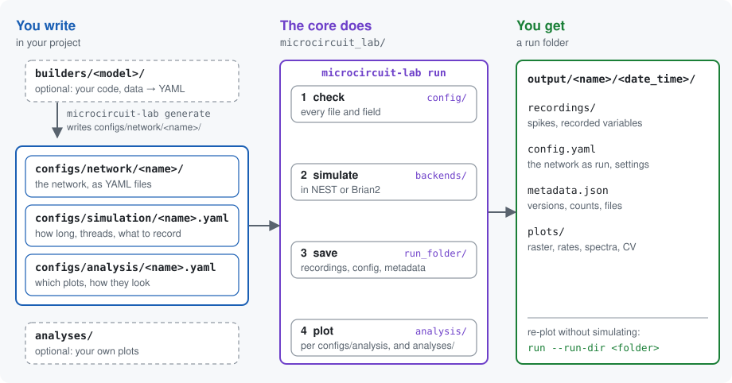
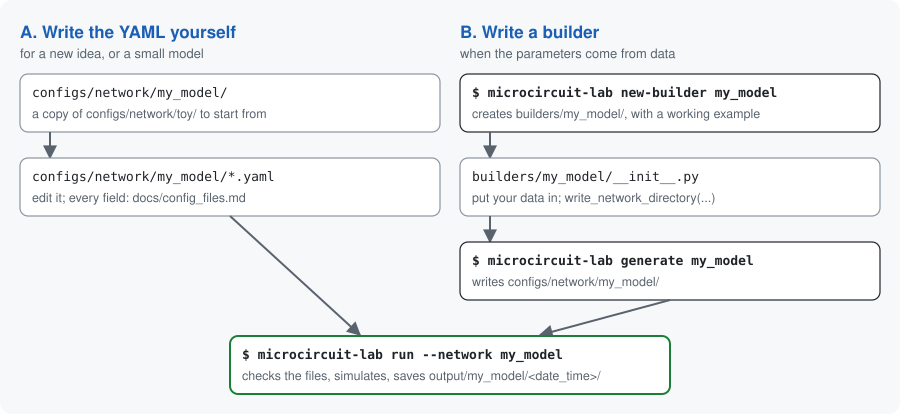

# Microcircuit Lab

Build, simulate and analyse spiking neural network models, from a single microcircuit to multi-area models. A network is a folder of YAML files; the same core checks it, runs it in NEST and plots the result, whatever model it came from.

## Contents

- [Quick start](#quick-start)
- [How it works](#how-it-works)
- [Included models](#included-models)
- [Starting a project](#starting-a-project)
- [Installation](#installation)
- [Configuration](#configuration)
- [Scaling a network](#scaling-a-network)
- [Adding a new model](#adding-a-new-model)
- [Analysing a run](#analysing-a-run)
- [Experiments](#experiments)
- [Run outputs](#run-outputs)
- [Using a NESTML model](#using-a-nestml-model)
- [Changing the core](#changing-the-core)
- [Adding a backend](#adding-a-backend)
- [Testing](#testing)

## Quick start

```bash
pip install "microcircuit_lab[nest] @ git+https://github.com/shimoura/microcircuit-lab@v0.1.0"
microcircuit-lab init my_project --with-core
cd my_project
microcircuit-lab run --network toy
```

This runs `toy`, two populations (E and I), and saves the run in `output/toy/<timestamp>/`, with a raster, firing rates, power spectrum and ISI CV in `plots/`.

The same from Python:

```python
from microcircuit_lab import Simulation

simulation = Simulation.from_yaml(network_name="toy")
simulation.run()
```

## How it works



- **Builder** (optional): your code that turns published tables or other data into the YAML files. The only model-specific code.
- **Check**: every file and field is checked; a mistake names the file and the field.
- **Prepare**: weights in mV become pA, scaling is applied, compensation currents are added.
- **Run folder**: everything a run produced. Plots can be redone from it without simulating again.

## Included models

| Network | What it is |
|---|---|
| `toy`, `toy_stimulated` | two populations (E and I), with and without stimuli; the smallest example |
| `toy_two_areas` | a made-up two-area network with different layers and cell types (E, PV, SOM, VIP) |
| `toy_two_areas_advanced` | the same network with the optional features on: values drawn per neuron, connection rules, synapse models, receptor ports |
| `pd14` | the Potjans & Diesmann (2014) microcircuit |
| `humam_single`, `humam_all` | the human multi-area model (Pronold et al. 2024): one area, or all 34 |

`pd14` is full scale (77,169 neurons, about 15 GB of memory) and simulates 11 s; for a quick look, scale it down first (see [Scaling a network](#scaling-a-network)). Each builder's README in `builders/` gives the model's sources.

## Starting a project

A project is your own folder, usually your own git repository:

```text
my_project/
├── builders/           your models' builders
├── analyses/           your analyses
├── configs/            network, simulation and analysis configs
├── experiments/        your experiment scripts
├── output/             the runs (created by the first run)
└── microcircuit-lab/   with --with-core: your copy of the core
```

| Command | What you get |
|---|---|
| `microcircuit-lab init my_project` | the empty folders; the core stays installed in your Python environment |
| `microcircuit-lab init my_project --with-core` | the folders, the examples, and a copy of the core in `microcircuit-lab/` (installed editable) |

Then, for a model of your own:

```bash
cd my_project
microcircuit-lab new-builder my_model   # creates builders/my_model/
microcircuit-lab generate my_model      # writes configs/network/my_model/
microcircuit-lab run --network my_model
```

Good to know:

- Run the commands from the project folder; that is where `builders/`, `analyses/` and `configs/` are looked for.
- With `--with-core`, the copy of the core is yours: change it and commit it with your project. Your edits take effect at once, and each run's `metadata.json` records your project's git commit, which then covers the core too.
- A later core release is not applied to the copy by itself; compare and merge it by hand if you want it. To propose a change to the original core, see [CONTRIBUTING.md](../CONTRIBUTING.md).
- The examples (every builder and config) are copied too, and are yours as well. A name that already exists is skipped, so `microcircuit-lab init . --with-core` is safe in an existing repository.

## Installation

```bash
pip install "microcircuit_lab[nest] @ git+https://github.com/shimoura/microcircuit-lab@v0.1.0"
```

Use the version you want in place of `v0.1.0`. Only NEST built from source runs on several MPI processes; the pip and conda-forge builds use threads only. Drop `[nest]` if you get NEST another way:

- conda-forge: `mamba install -c conda-forge nest-simulator`
- from source, e.g. on a cluster for MPI: see the [NEST installation docs](https://nest-simulator.readthedocs.io/en/stable/installation/index.html) and `scripts/install_nest_from_source.sh` (`NEST_WITH_MPI=ON` for MPI)

All that matters is that `import nest` works. Check the install with `microcircuit-lab --version`.

The power spectrum with `method: multitaper` needs `mne`: `pip install "microcircuit_lab[multitaper]"`.

To work on the core itself, clone the repository and install it editable:

```bash
python -m venv .venv
source .venv/bin/activate
pip install -e ".[dev,nest]"
```

## Configuration

```text
configs/
├── network/<name>/
│   ├── network.yaml             names the other files
│   ├── populations.yaml         sizes, neuron of each population
│   ├── neurons.yaml             neuron models and parameters
│   ├── connectivity.yaml        rules, synapse numbers, weights, delays
│   ├── synapses.yaml            optional: synapse models, receptor ports
│   ├── background_inputs.yaml   background Poisson input
│   ├── stimuli.yaml             optional: inputs for experiments
│   ├── scaling.yaml             optional: N_scaling, K_scaling
│   └── reference.yaml           optional: reference rates
├── simulation/<name>.yaml       duration, seed, threads, what to record
└── analysis/<name>.yaml         optional: which plots, time window, style
```

- **The fields** of every file, with units, limits and defaults: [docs/config_files.md](../docs/config_files.md), one commented example per file. `configs/network/toy/` is a small working example to copy.
- **Checks.** A mistake fails at once, naming the file and the field:
  ```text
  populations.yaml: populations.0.size: Input should be greater than 0
  ```
  `load_network("configs/network/<name>")` runs the whole check without simulating. A neuron's `parameters:` are the one block checked by the simulator, not here, since every neuron model takes different ones.
- **Matched by name.** `microcircuit-lab run --network toy` uses `configs/simulation/toy.yaml` and `configs/analysis/toy.yaml`; `--simulation` and `--analysis` pick others. Both files are optional.

### Stimuli

```yaml
stimuli:
  - type: dc                 # a constant current, from start to stop
    targets: [E]
    amplitude: 200.0         # pA
    start: 500.0             # ms
    stop: 600.0

  - type: poisson            # a Poisson spike train
    targets: [E, I]
    rate: 50.0               # spikes/s
    start: 200.0
    stop: 400.0
    weight: {mean: 0.15, rel_std: 0.0, distribution: fixed, unit: PSP}
    delay: {mean: 1.5, rel_std: 0.0, distribution: fixed}
```

- Types: `dc`, `poisson`, and `inhomogeneous_poisson` (a rate that changes in steps). [docs/config_files.md](../docs/config_files.md#stimuliyaml) lists their fields.
- Stimuli are applied exactly as written: not scaled, not compensated.
- They add to the background input and to each other: several entries give several pulses, with their own targets and times. Without `stop`, a stimulus lasts until the end of the run.
- Add `stimuli: stimuli.yaml` to `network.yaml`. A runnable example: `microcircuit-lab run --network toy_stimulated`.

### Background input

`background_inputs.yaml` is the always-on Poisson input of each population (rate per synapse × `background_indegree`).

- **`background_mode: mean_current`** (at the top of the file) replaces that Poisson input by its mean, a constant current: the same average drive, without the fluctuations, as in Potjans & Diesmann (2014), Fig. 5. It applies to every population, and needs current weights (`PSP` or `PSC`) on the default receptor port. Example: `microcircuit-lab generate pd14 --network-name pd14_mean_current --background-mode mean_current`.
- **A constant current of your own** is not a background mode; it adds to whichever background you use. For the whole run, set `I_e` in a neuron entry (every population using that entry); for chosen populations or times, add `dc` stimuli (above).
- **`generator: <name>`** in an entry: populations that give the same name share one Poisson generator. Each neuron still gets its own independent spike train; only the number of generators changes, which saves memory when many populations have the same input. They need the same `rate`, `background_indegree` and `synapse`. The random draws differ from one generator each, so the spikes are statistically the same, not identical.

### Weights and delays

Every `weight` needs a `unit` (there is no default, so a wrong conversion can't happen silently):

| `unit` | Meaning |
|---|---|
| `PSP` | PSP amplitude in mV, converted to pA with the target's `C_m`, `tau_m`, `tau_syn_ex`, `tau_syn_in`. Correct for current-based LIF neurons with exponential synaptic currents (`iaf_psc_exp` and its variants) only. |
| `PSC` | current amplitude in pA, used as given |
| `native` | used as given, e.g. nS for a conductance-based model |

A model with the same dynamics but other parameter names can still use `PSP`, by mapping the names in its `neurons.yaml` entry:

```yaml
neurons:
  my_model:
    model: some_custom_model_name
    parameters: {Cm: 250.0, tau_membrane: 10.0, tau_exc: 2.0, tau_inh: 2.0}
    psp_conversion_aliases: {C_m: Cm, tau_m: tau_membrane, tau_syn_ex: tau_exc, tau_syn_in: tau_inh}
```

- **Out-of-range draws.** `bound_mode` at the top of `connectivity.yaml`: `redraw` (default) draws again a weight with the wrong sign or a delay below the minimum; `clip` sets it to the limit, as HuMAM does. The minimum delay is half the time step, or the delay's own `minimum`. Either way the drawn values no longer have exactly the `mean` you wrote, while the PSP conversion and the scaling compensation use that `mean`: negligible for a small spread (`rel_std` 0.1), noticeable around `rel_std` 1.
- **Excitatory or inhibitory** input is told by the sign of the weight, never by a population's name.

### Connection rules and synapses

Each connection has a `rule` and the number that rule takes:

| `rule` | number | |
|---|---|---|
| `fixed_total_number` (default) | `n_synapses` | that many synapses in total |
| `fixed_indegree` | `indegree` | that many onto each target neuron |
| `fixed_outdegree` | `outdegree` | that many from each source neuron |
| `pairwise_bernoulli` | `p` | each pair connected with probability `p` |

Scaling keeps each neuron's share of synapses whatever the rule (`p` grows when the populations shrink). `allow_autapses` and `allow_multapses` are passed to NEST if given.

A connection, background input or Poisson stimulus can name a synapse from `synapses.yaml` (add `synapses: synapses.yaml` to `network.yaml`); without one it uses NEST's `static_synapse` on the default port:

```yaml
synapses:
  ampa: {model: static_synapse, receptor_port: 1}
  nmda: {model: static_synapse, receptor_port: 2}
  depressing: {model: tsodyks2_synapse, parameters: {U: 0.5, tau_rec: 800.0}}
```

```yaml
connections:
  - {source: E, target: E, rule: pairwise_bernoulli, p: 0.1, synapse: ampa, weight: {...}, delay: {...}}
  - {source: E, target: E, rule: pairwise_bernoulli, p: 0.1, synapse: nmda, weight: {...}, delay: {...}}
```

- A pair can have one entry per synapse, as above.
- The core knows the time constants of the default port only (`tau_syn_ex`, `tau_syn_in`). On another port, weights must be `PSC` or `native`. The input lost by scaling is compensated only for current weights (`PSP`, `PSC`) on the default port, not for `native` weights (e.g. conductances) or other ports; a warning lists those connections. A neuron with several ports (e.g. `iaf_psc_exp_multisynapse`) takes its time constants as a list: `tau_syn: [0.5, 100.0]`. Such a neuron may have no default port at all, so its background input needs a `synapse` too.
- With a plastic synapse, the PSP conversion and the scaling compensation use the initial weights. With short-term plasticity (`tsodyks2_synapse`, ...) each spike transmits weight × u × x, so a `PSP` weight is the amplitude at u·x = 1: with U = 0.5 the first spike gives half of it.
- A runnable example with all of this, and values drawn per neuron: `microcircuit-lab run --network toy_two_areas_advanced` ([builders/toy_two_areas](../builders/toy_two_areas/README.md#advanced-variant)).

### Large files

A builder writes long tables (`connectivity.yaml` of a multi-area model) one record per line, `- {source: ..., target: ..., weight: {...}, ...}`: `humam_all` has about 8,400 lines instead of 100,000. It is plain YAML and loads like any other. `write_network_directory` does this for you.

For millions of connections, YAML gets slow to write and read. `connectivity.yaml` can then name a CSV file instead of listing the rows:

```yaml
bound_mode: redraw
connections_file: connections.csv
```

The CSV has one row per connection and the same fields, with nested names joined by a dot (`weight.mean`, `delay.rel_std`); columns with a default can be left out. It opens in a spreadsheet. `write_network_directory` writes it when given a `ConnectionTable` (`config/connection_table.py`), and a run with more than 20,000 connections saves its prepared connections the same way, next to `config.yaml`.

## Scaling a network

A full-scale network can be slow or need a lot of memory. `scaling.yaml` runs a smaller copy:

```yaml
N_scaling: 0.1   # keep 10 % of the neurons
K_scaling: 0.1   # keep 10 % of the inputs of each neuron
```

`N_scaling` only makes the populations smaller: each neuron keeps all its inputs. `K_scaling` cuts the inputs, and that changes the input current each neuron gets. With $K$ inputs of weight $J$ (pA) firing at rate $\nu$ (spikes/ms), and synaptic time constant $\tau_s$, the mean and the variance of that current are

$$\mu = \tau_s\, K J \nu, \qquad \sigma^2 = \tfrac{1}{2}\,\tau_s\, K J^2 \nu .$$

With $K \to k K$ ($k$ = `K_scaling`), the weights alone can keep $\mu$ or $\sigma^2$, not both. Scaling the weights by $1/\sqrt{k}$ and adding the lost mean as a DC current keeps both (van Albada, Helias & Diesmann 2015, *PLoS Comput Biol* 11:e1004490). The options choose what to keep:

| `scaling.yaml` | Weights | DC added | Mean $\mu$ | Fluctuations $\sigma^2$ |
|---|---|---|---|---|
| defaults | $J/\sqrt{k}$ | $(1-\sqrt{k})\,\mu$ | kept | kept |
| `compensate_recurrent_input: false` | $J/\sqrt{k}$ | for the background input only | recurrent part lower | kept |
| `preserve_mean_input: false` | $J/\sqrt{k}$ | none | lower: $\sqrt{k}\,\mu$ | kept |
| `preserve_variance: false` | $J/k$ | none | kept | larger: $\sigma^2/k$ |

- The DC is added to each population's `I_e`, so the `I_e` in a run's saved `config.yaml` is the one you wrote plus the DC.
- The DC for the recurrent input needs the full-scale rate $\nu$ of every population, `full_mean_rates` in `reference.yaml`; without them, scaling stops with an error. `compensate_recurrent_input: false` compensates the background input only, and needs no rates.
- With `background_mode: mean_current`, the background current is already that of the full-scale network, so only the recurrent input is compensated.
- Excitatory and inhibitory inputs each use their own $\tau_s$ (`tau_syn_ex`, `tau_syn_in`).
- These are the mean and variance only. A scaled network is close to the full one, not equal: PD14 at $k = 0.1$ has most rates within 10–20 %, and L2/3 E lower (0.5 instead of 0.9 spikes/s).
- A connection left with less than one synapse is dropped.

## Adding a new model



The core never changes for a new model.

### Option A: write the YAML yourself

For a new idea, or a model small enough to write by hand.

```bash
cp -r configs/network/toy configs/network/my_model
# edit the files
microcircuit-lab run --network my_model
```

Loading checks every file; fix what it reports. Add `configs/simulation/my_model.yaml` for the duration, threads and recording, or the defaults are used (with a warning).

### Option B: write a builder

For a model whose parameters come from data (published tables, recordings, matrices).

```bash
microcircuit-lab new-builder my_model   # builders/my_model/__init__.py, with a working example
microcircuit-lab generate my_model      # runs it: writes configs/network/my_model/
```

Replace the example values with your model's. The builder hands its parts to `write_network_directory`, which writes and checks every file:

```python
from microcircuit_lab.builder_tools import delay, weight, write_network_directory

write_network_directory(
    "configs/network/my_model",
    populations=[...],
    neurons={...},
    connections=[{"source": "E", "target": "I", "n_synapses": 5000,
                  "weight": weight(0.15, unit="PSP", rel_std=0.1),
                  "delay": delay(1.5, rel_std=0.5)}, ...],
    background_inputs={...},
)
```

- A builder is found by its folder `builders/<model>/` with a `main(argv=None)`; there is no list to edit. `microcircuit-lab generate` with no name lists what it found.
- `builder_tools` also has `num_synapses_from_conn_prob` and `psp_to_psc_iaf_psc_exp`.
- `write_network_directory` is optional: files written any other way are checked the same way when loaded.
- Worked examples: `builders/pd14/`, `builders/toy_two_areas/`, `builders/humam/`. Add a `README.md` with your model's sources.
- A builder in another installed package can register under the `microcircuit_lab.builders` entry-point group (see `microcircuit_lab/project_code.py`).

## Analysing a run

### Re-plot without simulating again

```bash
microcircuit-lab run --network toy                                          # prints "Run directory: ..."
microcircuit-lab run --run-dir output/toy/<timestamp> --begin 200 --end 400
```

`--run-dir` takes the same flags as `--network`. The plots go back into the run's `plots/`.

Which plots are made, and how they look, is set in `configs/analysis/<name>.yaml`; every setting is in [docs/config_files.md](../docs/config_files.md#analysisnameyaml).

### Use the bundled functions

```python
from microcircuit_lab import Simulation
from microcircuit_lab.analysis import compute_population_firing_rates, plot_firing_rates

simulation = Simulation.from_run_dir("output/toy/<timestamp>")   # opens the run, no simulation
rates = compute_population_firing_rates(simulation, begin=200.0)
plot_firing_rates(simulation, begin=200.0)
```

- Plots: `plot_raster`, `plot_firing_rates`, `plot_power_spectrum`, `plot_isi_cv`.
- Numbers: `compute_*` for rates, ISI CV, power spectrum and deviation from the reference rates.
- Multi-area networks: pass `area="V1"`; `list_areas(simulation)` gives the names.

### Your own analysis: any script

There are no rules: open a run folder and do what you want.

```python
# my_analysis.py
import sys

from microcircuit_lab import Simulation
from microcircuit_lab.analysis import compute_population_firing_rates

simulation = Simulation.from_run_dir(sys.argv[1])
print(compute_population_firing_rates(simulation, begin=200.0))

events = simulation.backend.get_spike_events("E")   # {"senders": ..., "times": ...}
```

```bash
python my_analysis.py output/toy/<timestamp>
```

- Read data through `simulation` (`backend.get_spike_events`, `network`, `simulation_config`).
- Keep the script anywhere, e.g. in `experiments/`. In `analyses/`, put its work under `if __name__ == "__main__":`, because `microcircuit-lab run` imports every file there.
- To list a file you saved in the run's `metadata.json`: `register_artifact(simulation.output_dir, "plots", path)` from `microcircuit_lab.run_folder`.

### Optional: let `microcircuit-lab run` make your plot

Register a function in a file in `analyses/`, and the command gets a flag for it:

```python
# analyses/rate_bars.py
import matplotlib.pyplot as plt

from microcircuit_lab.analysis import compute_population_firing_rates, register_plot


def rate_bars(simulation, save_path, area=None):
    rates = compute_population_firing_rates(simulation, area=area)
    fig, ax = plt.subplots()
    ax.bar(list(rates), list(rates.values()))
    fig.savefig(save_path)


register_plot("rate_bars", rate_bars)
```

```bash
microcircuit-lab run --run-dir output/toy/<timestamp> --rate-bars
```

The figure is saved in `plots/`, one per area with `--area all`, and listed in `metadata.json`. The first parameter is the simulation; name only what else you need, and the command fills it in:

| Parameter | What you get |
|---|---|
| `save_path` | where to save the figure |
| `area` | one area name, or `None` for single-area networks |
| `begin`, `end` | the time window in ms |
| `style` | the shared plot style |
| `config` | the `rate_bars:` section of the analysis file, as a dict |
| `show` | `True` with `--show` |
| `show_reference` | `True` with `--reference` |

- Any other parameter needs a default.
- The plot is off by default: pass `--rate-bars`, or set `enabled: true` in its section of the analysis file.
- A name already taken (`raster`, ...) raises an error.
- A package can provide such plots through the `microcircuit_lab.analyses` entry-point group (see `microcircuit_lab/analysis/run_command_plots.py`).

## Experiments

An experiment (a sweep, a comparison) is a plain script in `experiments/` that runs simulations itself:

```python
from microcircuit_lab import Simulation, prepare_network, read_network
from microcircuit_lab.config.simulation import SimulationConfig

network = read_network("configs/network/toy")
populations = {name: pop.model_copy(update={"background_indegree": 2000})
               for name, pop in network.populations.items()}
network = prepare_network(network.model_copy(update={"populations": populations}))

simulation = Simulation(network, SimulationConfig(t_sim=1000.0), network_name="toy")
simulation.run()
```

`read_network` gives the network as written; change it, then `prepare_network` gets it ready to simulate. A worked example: `experiments/toy/background_drive_sweep.py`.

## Run outputs

```text
output/<network>/<timestamp>/
├── recordings/     spikes (and voltages), written by NEST during the run
├── plots/          made by microcircuit-lab run
├── config.yaml     the prepared network and the simulation settings used
└── metadata.json   versions (core, simulator), git commits, MPI processes, spike counts, list of files
```

- Each run gets its own folder. `output.overwrite: true` in the simulation file reuses one.
- NEST writes `spikes-<id>-<thread>.dat` straight to disk, one file per thread; `simulation.backend.get_spike_events(population)` reads them back.
- Voltages (`recording.voltage_recording: true`) are recorded for 5 neurons per population by default (`recording.voltage_sample_size`; `null` for all).

### Several MPI processes

```bash
mpirun -n 4 microcircuit-lab run --network pd14
```

- Needs NEST built from source with MPI (above), on a cluster against the cluster's MPI.
- NEST spreads the neurons over the processes. Each process writes its own spike files into the same `recordings/` folder, so the processes must share a file system.
- The first process picks the run folder; when all have finished simulating, it alone prints the rates and writes `config.yaml`, `metadata.json` and the plots.
- In your own script, save or plot only where `simulation.is_main_process` is true.

## Using a NESTML model

1. Write the model in a top-level `nestml/` folder (e.g. `nestml/my_lif.nestml`), and compile it once:
   ```python
   from pynestml.frontend.pynestml_frontend import generate_nest_target

   generate_nest_target(input_path="nestml/my_lif.nestml",
                        target_path="nestml/build/my_module", module_name="my_module")
   ```
2. Use it in `neurons.yaml` like any model, by the name NESTML gives it (e.g. `my_lif_nestml`). With `unit: PSP` and other parameter names, add `psp_conversion_aliases` (see [Weights and delays](#weights-and-delays)).
3. Load the module when running:
   ```python
   simulation = Simulation.from_yaml(
       network_name="toy_nestml",
       backend_options={"extension_modules": ["my_module"]},
   )
   ```
   or `microcircuit-lab run --network toy_nestml --extension-modules my_module`.

Don't commit the compiled output; it depends on the platform and the NEST version.

## Changing the core

Change the core when an idea doesn't fit what the config files can say (a new stimulus type, spatial structure, plasticity) and would help any model. If only one model needs it, it belongs in that model's builder. [CONTRIBUTING.md](../CONTRIBUTING.md#changing-the-core) shows which files each kind of change touches.

```text
microcircuit_lab/
├── config/            what each YAML file may contain (one module per file)
├── network/           reading, checking and preparing a network
├── simulation.py      Simulation: load, run, reopen a run
├── backends/          the simulators (NEST), and reading back a saved run
├── analysis/          measures and plots
├── cli/               the microcircuit-lab command
├── builder_tools.py   what a builder needs, in one import
├── run_folder.py      run folders and their metadata
├── project_code.py    finds the builders/ and analyses/ of a project
└── yaml_files.py      reading and writing YAML
```

Only this folder is installed by `pip`. In a clone, `builders/`, `configs/` and `experiments/` hold the examples, laid out like a project's.

### Adding a bundled plot

Like a project plot, with `register_plot` and a settings class, in `analysis/<plot>.py`. Also import the module in `analysis/__init__.py`, so it is registered when the package loads:

```python
register_plot("spectrogram", plot_spectrogram,
              config_cls=SpectrogramPlotConfig, filename="spectrogram.png")
```

## Adding a backend

1. Implement `SimulationBackend` (`microcircuit_lab/backends/interface.py`) in a package `microcircuit_lab/backends/<name>/`, like `nest/`. `prepare_output` and `save_recordings` write the recordings in the simulator's own way; `get_spike_events` reads them back, so nothing else needs to know. `version()` gives the simulator's version for `metadata.json`.
2. Register it in `get_backend`, and its file reader (like `nest/spike_files.py`, which does not import the simulator) in `read_saved_spikes`, both in `microcircuit_lab/backends/__init__.py`. Saved runs can then be re-plotted without the simulator.
3. Select it with `Simulation.from_yaml(..., backend="<name>", backend_options={...})`; `backend_options` go to its constructor unchanged.

## Testing

```bash
pytest
```

The tests cover the core: reading and checking configs, preparing a network, the NEST backend and the analysis. A builder is tested through what it writes: every network in `configs/network/` is loaded and checked. Tests that simulate need NEST.
