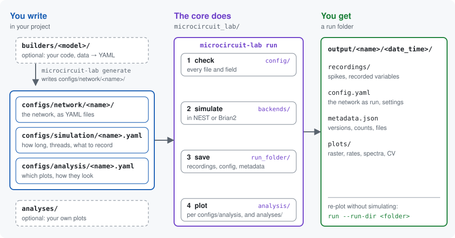
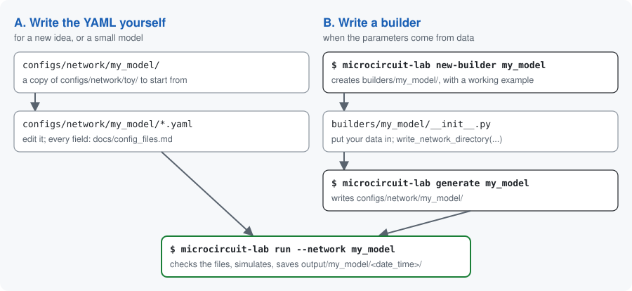

# Microcircuit Lab

Build, simulate and analyse spiking neural network models, from a single microcircuit to multi-area models. A network is a folder of YAML files; the same core checks it, runs it in NEST or Brian2 and plots the result, whatever model it came from.

## Contents

- [Quick start](#quick-start)
- [How it works](#how-it-works)
- [Installation](#installation)
- [Included networks](#included-networks)
- [Starting a project](#starting-a-project)
- [Configuration](#configuration)
- [Scaling a network](#scaling-a-network)
- [Adding a new network](#adding-a-new-network)
- [Running from a script](#running-from-a-script)
- [The run folder](#the-run-folder)
- [Analysing a run](#analysing-a-run)
- [Simulators](#simulators)
  - [NEST](#nest)
  - [Brian2](#brian2)
- [Changing the core](#changing-the-core)

## Quick start

```bash
pip install "microcircuit_lab[nest] @ git+https://github.com/shimoura/microcircuit-lab"
microcircuit-lab init my_project --with-core
cd my_project
microcircuit-lab run --network toy
```

This runs `toy`, two populations (E and I), and saves the run in `output/toy/<timestamp>/`, with a raster, firing rates, power spectrum and ISI CV in `plots/`.

The same from Python:

```python
from microcircuit_lab import Simulation

simulation = Simulation.from_yaml(network_name="toy")
simulation.run()
```

Next:

- **Other settings** (duration, seed, threads, what to record): edit `configs/simulation/toy.yaml` and run again.
- **Parameter sweeps, several seeds, any batch:** a Python script that loops over runs; recipes in [Running from a script](#running-from-a-script).
- **Your own network:** [Adding a new network](#adding-a-new-network).

## How it works



- **Builder** (optional): your code that turns published tables or other data into the YAML files. The only model-specific code.
- **Check**: every file and field is checked; a mistake names the file and the field.
- **Simulate**: the network is simulated as the files give it. Each population's background is one Poisson generator firing at its rate per synapse times its indegree; a smaller network is a folder of its own ([Scaling a network](#scaling-a-network)).
- **Run folder**: everything a run produced. Plots can be redone from it without simulating again.

The files and functions behind each step, and where to look when something goes wrong: [docs/workflow.md](../docs/workflow.md).

## Installation

```bash
pip install "microcircuit_lab[nest] @ git+https://github.com/shimoura/microcircuit-lab"
```

This installs the latest version. For a fixed one, add its tag from the [releases](https://github.com/shimoura/microcircuit-lab/releases) to the address: `...microcircuit-lab@<tag>`. Drop `[nest]` if you get NEST another way:

- conda-forge: `mamba install -c conda-forge nest-simulator`

For NEST from source or with MPI, see [NEST](#nest); for Brian2, see [Brian2](#brian2).

Python 3.11 or newer is needed (3.12 for Brian2). All that matters is that `import nest` works. Check the install with `microcircuit-lab --version`.

The power spectrum with `method: multitaper` needs `mne`: `pip install "microcircuit_lab[multitaper]"`.

To work on the core itself, clone the repository and install it editable:

```bash
python -m venv .venv
source .venv/bin/activate
pip install -e ".[dev,nest]"
```

<a id="included-models"></a>

## Included networks

| Network | What it is |
|---|---|
| `toy`, `toy_stimulated` | two populations (E and I), with and without stimuli; the smallest example, written by hand with comments |
| `toy_from_builder` | the same network as `toy`, written by the builder `builders/toy` |
| `toy_two_areas` | a made-up two-area network with different layers and cell types (E, PV, SOM, VIP) |
| `toy_two_areas_advanced` | the same network with the optional features on: values drawn per neuron, connection rules, synapse models, receptor ports |
| `pd14` | the Potjans & Diesmann (2014) microcircuit |
| `humam_single`, `humam_all` | the human multi-area model (Pronold et al. 2024): one area, or all 34 |

`pd14` is full scale (77,169 neurons, about 15 GB of memory) and simulates 11 s; for a quick look, run `pd14_downscaled` (N and K scaled by 0.1; see [Scaling a network](#scaling-a-network)). Each builder's README in `builders/` gives the model's sources.

## Starting a project

A project is your own folder, usually your own git repository:

```text
my_project/
├── builders/           your networks' builders
├── analyses/           your analyses
├── configs/            network, simulation and analysis configs
├── experiments/        your experiment scripts
├── extensions/         what you add to a simulator: neurons, synapses, connection rules, ...
├── output/             the runs (created by the first run)
└── microcircuit-lab/   with --with-core: your copy of the core
```

| Command | What you get |
|---|---|
| `microcircuit-lab init my_project` | the folders and the toy example (below); the core stays installed in your Python environment |
| `microcircuit-lab init my_project --with-core` | the folders, the examples, and a copy of the core in `microcircuit-lab/` (installed editable) with the backends of your installed simulators; `--backends nest brian2` chooses, and running it again adds a missing one |

The toy example comes twice, once per way of working:

```bash
cd my_project
microcircuit-lab run --network toy        # configs/network/toy/: YAML files with comments, edit them directly
microcircuit-lab generate toy             # builders/toy/build.py writes configs/network/toy_from_builder/
microcircuit-lab run --network toy_from_builder --simulation toy --analysis toy
```

Both are the same network, with the same spikes. The Brian2 models (`extensions/brian2/`) come too when Brian2 is installed.

Then, for a model of your own:

```bash
cd my_project
microcircuit-lab new-builder my_model   # creates builders/my_model/
microcircuit-lab generate my_model      # writes configs/network/my_model/
microcircuit-lab run --network my_model
```

Good to know:

- Run the commands from the project folder; that is where `builders/`, `analyses/`, `configs/` and `extensions/` are looked for.
- With `--with-core`, the copy of the core is yours: change it and commit it with your project. Your edits take effect at once, and each run's `metadata.json` records your project's git commit, which then covers the core too.
- A later core release is not applied to the copy by itself; compare and merge it by hand if you want it. To propose a change to the original core, see [CONTRIBUTING.md](https://github.com/shimoura/microcircuit-lab/blob/main/CONTRIBUTING.md).
- The examples (every builder, config and `extensions/` model) are copied too, and are yours as well. A name that already exists is skipped, so `microcircuit-lab init .` (with or without `--with-core`) is safe in an existing repository, and adds only what is missing.
- After an upgrade that changes the file format, delete the toy's folders and run `microcircuit-lab init .` again to get them in the new format.

## Configuration

```text
configs/
├── network/<name>/
│   ├── network.yaml             names the other files
│   ├── populations.yaml         sizes, neuron of each population
│   ├── neurons.yaml             neuron models and parameters
│   ├── connectivity.yaml        rules, synapse numbers, weights, delays
│   ├── synapses.yaml            optional: synapse models, receptor ports
│   ├── poisson_background.yaml  background Poisson input
│   ├── stimuli.yaml             optional: inputs for experiments
│   ├── scaling.yaml             only in a scaled network: how it was scaled
│   └── reference.yaml           optional: reference rates
├── simulation/<name>.yaml       duration, seed, threads, simulator, what to record
└── analysis/<name>.yaml         optional: which plots, time window, style
```

- **The fields** of every file, with units, limits and defaults: [docs/config_files.md](../docs/config_files.md), one commented example per file. `configs/network/toy/` is a small working example to copy.
- **Checks.** A mistake fails at once, naming the file and the field:
  ```text
  populations.yaml: populations.0.size: Input should be greater than 0
  ```
  `read_network("configs/network/<name>")` runs the whole check without simulating. A neuron's `parameters:` are the one block checked by the simulator, not here, since every neuron model takes different ones.
- **Units.** Every number in the files is in the package's units, whichever simulator runs it: mV, ms, pF, pA, nS, and spikes/s for rates.
- **Names the simulator looks up.** Some fields name something. The shared names run on every simulator; any other name is looked up by the simulator that runs the network, and one it doesn't have stops the run, saying so: Brian2 before anything is built, NEST when it builds that part (a project distribution before):

  | Field | Shared | Any other name |
  |---|---|---|
  | `neurons.yaml` `model` | none | NEST: its own models and NESTML modules; Brian2: a `NeuronModel` in `extensions/brian2/` |
  | `synapses.yaml` `model` | `static_synapse` | NEST: its own models; Brian2: a `SynapseModel` in `extensions/brian2/` |
  | `rule` of a connection | `fixed_total_number`, `fixed_indegree`, `fixed_outdegree`, `pairwise_bernoulli`, `one_to_one`, `all_to_all` | with its arguments as keys of their own; NEST: its own rules; Brian2: a `ConnectionRule` in `extensions/brian2/` ([Connection rules of your own](#connection-rules-of-your-own)) |
  | `distribution` of a connection's weight or delay | `normal`, `uniform`, `lognormal` | with its arguments as keys of their own; Brian2: a `Distribution` in `extensions/brian2/` ([Distributions of your own](#distributions-of-your-own)) |
  | `receptor_port` of a synapse | a number | NEST: a name in the target model's `receptor_types`; Brian2: the variable the connection adds to |

  A network that uses names of one simulator runs on that simulator only. What the core can't know about a name of your own, it doesn't guess: scaling a network with such a rule, or with weights from such a distribution, stops with an error.
- **Matched by name.** `microcircuit-lab run --network toy` uses `configs/simulation/toy.yaml` and `configs/analysis/toy.yaml`; `--simulation` and `--analysis` pick others. Both files are optional.

### Stimuli

```yaml
stimuli:
  - type: dc                 # a constant current, from start to stop
    targets: [E]
    amplitude: 200.0         # pA
    start: 500.0             # ms
    stop: 600.0

  - type: poisson            # a Poisson spike train
    targets: [E, I]
    rate: 50.0               # spikes/s
    start: 200.0
    stop: 400.0
    weight: {value: 87.8, unit: pA}
    delay: {value: 1.5}
```

- Types: `dc`, `poisson`, and `inhomogeneous_poisson` (a rate that changes in steps). [docs/config_files.md](../docs/config_files.md#stimuliyaml) lists their fields.
- Stimuli are applied exactly as written: not scaled, not compensated.
- They add to the background input and to each other: several entries give several pulses, with their own targets and times. Without `stop`, a stimulus lasts until the end of the run.
- Add `stimuli: stimuli.yaml` to `network.yaml`. A runnable example: `microcircuit-lab run --network toy_stimulated`.

### Background input

`poisson_background.yaml` is the background Poisson input of each population: each neuron gets `indegree` independent Poisson synapses, each firing at `rate` (spikes/s), with the `weight` and `delay` of an entry.

```yaml
poisson_background:
  E: {rate: 8.0, indegree: 1600, weight: {value: 87.8, unit: pA}, delay: {value: 1.5}}
```

Other always-on inputs (a constant current, a Poisson train, an inhomogeneous Poisson input) are `stimuli.yaml` entries without `start` and `stop`.

- **A mean current instead of the Poisson input**: the builder step `replace_background_by_mean_current` (`microcircuit_lab.builder_tools`) adds the mean of that input to `I_e` and removes the input from the files (`poisson_background` empty): the same average drive, without the fluctuations, as in Potjans & Diesmann (2014), Fig. 5. It applies to every population, and needs weights in pA on the default receptor port. Apply it after `scale_network` and before `write_network`. Example: `microcircuit-lab generate pd14 --network-name pd14_mean_current --background mean_current`.
- **A constant current of your own** adds to whichever background you use. For the whole run, set `I_e` in a neuron entry (every population using that entry); for chosen populations or times, add `dc` stimuli (above).
- **A drawn background weight is drawn once per neuron**, not per synapse: the simulators make one generator at `rate × indegree` and one connection per neuron, as the reference codes do. The mean input is the same; its spread across neurons is larger.
- **`generator: <name>`** in an entry: populations that give the same name share one Poisson generator. Each neuron still gets its own independent spike train; only the number of generators changes, which saves memory when many populations have the same input. They need the same `rate`, `indegree` and `synapse`. The random draws differ from one generator each, so the spikes are statistically the same, not identical.

### Weights and delays

A weight or delay is a fixed `value`, or drawn for each synapse from a `distribution`. The numbers are what the simulator gets, and what the drawn values have:

```yaml
weight: {value: 87.8, unit: pA}                                                         # fixed
weight: {distribution: normal, mean: 87.8, std: 8.78, lower_bound: 0, bound_mode: redraw, unit: pA}
weight: {distribution: uniform, min: 72.6, max: 103.0, unit: pA}
weight: {distribution: lognormal, mean: -351.2, std: 35.1, unit: pA}                   # negative: inhibitory
delay:  {distribution: normal, mean: 1.5, std: 0.75, lower_bound: 0.1, bound_mode: redraw}
```

| Field | What it is |
|---|---|
| `value` | a fixed weight or delay |
| `distribution` | `normal` or `lognormal` (with `mean`, `std`), `uniform` (with `min`, `max`), or one of your own |
| `mean`, `std` | the mean and standard deviation of the drawn values, for every distribution: a lognormal value has them too, and the sign of `mean` |
| `lower_bound`, `upper_bound` | optional: a drawn value past one is drawn again or set to it; a drawn delay needs `lower_bound` |
| `bound_mode` | with a bound: `redraw` draws again, `clip` sets the value to the bound |
| `unit` | weights only (below) |

A weight's `unit` (required) says what it is. Nothing is converted:

| `unit` | Meaning | Example model |
|---|---|---|
| `pA` | a current | `iaf_psc_exp` |
| `nS` | a conductance | `aeif_cond_exp` |
| `mV` | a jump of the membrane potential | `iaf_psc_delta` |

NEST can't check the unit; Brian2 checks it against the variable the weight adds to. A model that gives its weights as PSP amplitudes converts them in its builder, with the target's neuron parameters:

```python
from microcircuit_lab.builder_tools import psp_to_psc_iaf_psc_exp, weight, zero_bound

current = psp_to_psc_iaf_psc_exp(0.15, C_m=250.0, tau_m=10.0, tau_syn=0.5)   # 87.8 pA
weight(current, unit="pA", rel_std=0.1, **zero_bound(current, "redraw"))
# {distribution: normal, mean: 87.8, std: 8.78, lower_bound: 0.0, bound_mode: redraw, unit: pA}
```

The formula holds for current-based LIF neurons with exponential synaptic currents (`iaf_psc_exp` and its variants); for an inhibitory weight, pass `tau_syn=<tau_syn_in>`. Keep the PSP in a comment next to the value if you write the file by hand, as `configs/network/toy/` does.

- **Nothing is bounded unless the file says so.** An excitatory normal weight can turn negative without `lower_bound: 0`; `zero_bound(mean, mode)` writes the bound that keeps a weight's sign. A delay below half the time step rounds to 0, so a drawn delay needs a `lower_bound` (e.g. the time step).
- **A relative spread** (a paper's "10 % of the mean") is converted in the builder: `weight(87.8, unit="pA", rel_std=0.1)` writes `std: 8.78`, and `distribution="uniform"` the `min` and `max` with that mean and standard deviation.
- **Bounds change the mean.** Values drawn again or clipped no longer have exactly the `mean` you wrote, while the scaling compensation uses that `mean`: negligible for a small spread (`std` a tenth of the mean), noticeable when `std` is about the mean.
- **Excitatory or inhibitory** input is told by the sign of the weight (its mean), never by a population's name.
- **Distributions.** `normal`, `uniform` and `lognormal` work on every simulator. Any other name is a distribution of your own, with its arguments as keys of their own, for the weights and delays of connections; for now Brian2 only (see [Distributions of your own](#distributions-of-your-own)).

### Connection rules and synapses

Each connection has a `rule` and the number that rule takes:

| `rule` | number | |
|---|---|---|
| `fixed_total_number` (default) | `n_synapses` | that many synapses in total |
| `fixed_indegree` | `indegree` | that many onto each target neuron |
| `fixed_outdegree` | `outdegree` | that many from each source neuron |
| `pairwise_bernoulli` | `p` | each pair connected with probability `p` |
| `one_to_one` | none | the k-th source neuron to the k-th target neuron (populations of the same size) |
| `all_to_all` | none | every pair |

These rules run on every simulator. Any other name, with its arguments as keys of their own instead of a number, is looked up by the simulator: on NEST one of its own rules (e.g. `rule: pairwise_poisson, pairwise_avg_num_conns: 2`), on Brian2 a rule of your own (see [Connection rules of your own](#connection-rules-of-your-own)).

Scaling keeps each neuron's share of synapses whatever the rule (`p` grows when the populations shrink). Three cases can't keep it, and stop with an error: `one_to_one` with `K_scaling` other than 1 (each neuron always gets one input), `all_to_all` with `K_scaling` different from `N_scaling` (each neuron gets the whole source population), and any other rule. `allow_autapses` and `allow_multapses` are passed to the simulator if given; left out, both are allowed.

A connection, background input or Poisson stimulus can name a synapse from `synapses.yaml` (add `synapses: synapses.yaml` to `network.yaml`); without one it uses the simulator's `static_synapse` on the default port:

```yaml
synapses:
  ampa: {model: static_synapse, receptor_port: 1}
  nmda: {model: static_synapse, receptor_port: 2}
  depressing: {model: tsodyks2_synapse, parameters: {U: 0.5, tau_rec: 800.0}}
```

```yaml
connections:
  - {source: E, target: E, rule: pairwise_bernoulli, p: 0.1, synapse: ampa, weight: {...}, delay: {...}}
  - {source: E, target: E, rule: pairwise_bernoulli, p: 0.1, synapse: nmda, weight: {...}, delay: {...}}
```

- A pair can have one entry per synapse, as above.
- A port can also be given by name (`receptor_port: AMPA`), which the simulator resolves: NEST looks it up in the `receptor_types` of the target's neuron model (e.g. `ht_neuron`), Brian2 takes it as the variable the connection adds to.
- The core knows the time constants of the default port only (`tau_syn_ex`, `tau_syn_in`). The input lost by scaling is compensated only for weights in pA on the default port; with other units (e.g. conductances) or ports, scaling stops with an error (see [Scaling a network](#scaling-a-network)). A neuron with several ports (e.g. `iaf_psc_exp_multisynapse`) takes its time constants as a list: `tau_syn: [0.5, 100.0]`. Such a neuron may have no default port at all, so its background input needs a `synapse` too.
- With a plastic synapse, the scaling compensation uses the initial weights. With short-term plasticity (`tsodyks2_synapse`, ...) each spike transmits weight × u × x, so a weight converted from a PSP gives that PSP at u·x = 1: with U = 0.5 the first spike gives half of it.
- A runnable example with all of this, and values drawn per neuron: `microcircuit-lab run --network toy_two_areas_advanced` ([builders/toy_two_areas](../builders/toy_two_areas/README.md#advanced-variant)).

### Large files

A builder writes long tables (`connectivity.yaml` of a multi-area model) one record per line, `- {source: ..., target: ..., weight: {...}, ...}`: one line per connection instead of about 13. It is plain YAML and loads like any other. `write_network_directory` does this for you.

For millions of connections, YAML gets slow to write and read. `connectivity.yaml` can then name a CSV file instead of listing the rows:

```yaml
connections_file: connections.csv
```

The CSV has one row per connection and the same fields, with nested names joined by a dot (`weight.mean`, `delay.lower_bound`). This entry of `connectivity.yaml`

```yaml
- {source: E, target: I, rule: pairwise_bernoulli, p: 0.1,
   weight: {distribution: normal, mean: 87.8, std: 8.78, lower_bound: 0.0, bound_mode: redraw, unit: pA},
   delay: {distribution: normal, mean: 1.5, std: 0.75, lower_bound: 0.1, bound_mode: redraw}}
```

is this row of `connections.csv`:

```
source,target,rule,p,weight.distribution,weight.mean,weight.std,weight.lower_bound,weight.bound_mode,weight.unit,delay.distribution,delay.mean,delay.std,delay.lower_bound,delay.bound_mode
E,I,pairwise_bernoulli,0.1,normal,87.8,8.78,0.0,redraw,pA,normal,1.5,0.75,0.1,redraw
```

The rule's number goes under its own name (`p`, `n_synapses`, ...); rows with another rule leave that cell empty. An argument of a rule or distribution of your own is a column of its own (`pairwise_avg_num_conns`, `weight.beta`), empty in the rows that don't use it. Columns with a default (`rule`, `distribution`) can be left out when reading. It opens in a spreadsheet. `write_network_directory` writes it when given a `ConnectionTable` (`config/connection_table.py`), and a run with more than 20,000 connections saves its connections the same way, next to `config.yaml`.

## Scaling a network

A full-scale network can be slow or need a lot of memory. A smaller copy is a network folder of its own, with the scaled numbers in its files, so what you read is what is simulated:

```bash
microcircuit-lab generate pd14 --n-scaling 0.1 --k-scaling 0.1 --network-name pd14_downscaled
microcircuit-lab run --network pd14_downscaled
```

`--n-scaling 0.1` keeps 10 % of the neurons, `--k-scaling 0.1` 10 % of the inputs of each neuron. The builder calls `scale_network` and writes the result; the folder's `scaling.yaml` records how it was made, and is never applied:

```yaml
# configs/network/pd14_downscaled/scaling.yaml
scaled_from: pd14
scaled_with: microcircuit_lab.builder_tools.scaling.scale_network
parameters:          # the function's own arguments
  N_scaling: 0.1
  K_scaling: 0.1
  preserve_mean_input: true
  preserve_variance: true
  compensate_recurrent_input: true
```

From a script (a network without a builder, a sweep over the factors, other options), call it yourself:

```python
from microcircuit_lab import Simulation, read_network
from microcircuit_lab.builder_tools import scale_network, write_network
from microcircuit_lab.config.simulation import SimulationConfig

full = read_network("configs/network/toy")
small = scale_network(full, N_scaling=0.5, K_scaling=0.5, scaled_from="toy", compensate_recurrent_input=False)
write_network(small, "configs/network/toy_half")                       # a folder, or:
Simulation(small, SimulationConfig(t_sim=1000.0), network_name="toy_half").run()   # each run folder keeps the scaled numbers
```

Other scaling rules: copy `scale_network` (`builder_tools/scaling.py`) into your project, e.g. `builders/common/scaling.py`, change it, and call your copy; its record names it in `scaled_with` (`f"{__name__}.scale_network"`), with its own `parameters`. A function of your own builds the record the same way: `ScalingRecord(scaled_from=..., scaled_with=f"{__name__}.my_scaling", parameters={...})` (`config/scaling.py`), set as the network's `scaling`. A scaled network can't be scaled again (its currents aren't the full input): scale the full one with the product of the factors.

`N_scaling` only makes the populations smaller: each neuron keeps all its inputs. `K_scaling` cuts the inputs, and that changes the input current each neuron gets. With $K$ inputs of weight $J$ (pA) firing at rate $\nu$ (spikes/ms), and synaptic time constant $\tau_s$, the mean and the variance of that current are

$$\mu = \tau_s\, K J \nu, \qquad \sigma^2 = \tfrac{1}{2}\,\tau_s\, K J^2 \nu .$$

With $K \to k K$ ($k$ = `K_scaling`), the weights alone can keep $\mu$ or $\sigma^2$, not both. Scaling the weights by $1/\sqrt{k}$ and adding the lost mean as a DC current keeps both (van Albada, Helias & Diesmann 2015, *PLoS Comput Biol* 11:e1004490). The options choose what to keep:

| `scale_network` | Weights | DC added | Mean $\mu$ | Fluctuations $\sigma^2$ |
|---|---|---|---|---|
| defaults | $J/\sqrt{k}$ | $(1-\sqrt{k})\,\mu$ | kept | kept |
| `compensate_recurrent_input=False` | $J/\sqrt{k}$ | for the background input only | recurrent part lower | kept |
| `preserve_mean_input=False` | $J/\sqrt{k}$ | none | lower: $\sqrt{k}\,\mu$ | kept |
| `preserve_variance=False` | $J/k$ | none | kept | larger: $\sigma^2/k$ |

- The DC is added to each population's `I_e` in the scaled files (a population gets a neuron entry of its own when its current differs from the others'). `I_e` is sent to the simulator only when a neuron entry sets it or a DC is added, so a model without `I_e` works when it needs no DC; when it does, the run stops with an error naming it.
- The DC for the recurrent input needs the full-scale rate $\nu$ of every population, `full_mean_rates` in `reference.yaml`; without them, scaling stops with an error. `compensate_recurrent_input=False` compensates the background input only, and needs no rates.
- The DC is known only for weights in pA on the default receptor port; another unit (e.g. nS) or port stops the scaling with an error, unless `preserve_mean_input=False` or `preserve_variance=False` (no DC needed).
- With `replace_background_by_mean_current` after scaling, the current is computed from the scaled background, and the DC adds the lost part, so together they are the full-scale mean.
- Excitatory and inhibitory inputs each use their own $\tau_s$ (`tau_syn_ex`, `tau_syn_in`).
- These are the mean and variance only. A scaled network is close to the full one, not equal; compare its rates with `reference.yaml` (the example numbers are in the [PD14 README](../builders/pd14/README.md)).
- A connection left with less than one synapse is dropped.

<a id="adding-a-new-model"></a>

## Adding a new network



The core never changes for a new network.

### Option A: write the YAML yourself

For a new idea, or a model small enough to write by hand.

```bash
cp -r configs/network/toy configs/network/my_model
# edit the files
microcircuit-lab run --network my_model
```

Loading checks every file; fix what it reports. Add `configs/simulation/my_model.yaml` for the duration, threads and recording, or the defaults are used (with a warning).

### Option B: write a builder

For a model whose parameters come from data (published tables, recordings, matrices).

```bash
microcircuit-lab new-builder my_model   # builders/my_model/__init__.py, with a working example
microcircuit-lab generate my_model      # runs it: writes configs/network/my_model/
```

Replace the example values with your model's. The builder hands its parts to `write_network_directory`, which writes and checks every file:

```python
from microcircuit_lab.builder_tools import delay, weight, write_network_directory, zero_bound

write_network_directory(
    "configs/network/my_model",
    populations=[...],
    neurons={...},
    connections=[{"source": "E", "target": "I", "n_synapses": 5000,
                  "weight": weight(87.8, unit="pA", rel_std=0.1, **zero_bound(87.8, "redraw")),
                  "delay": delay(1.5, rel_std=0.5, lower_bound=0.1, bound_mode="redraw")}, ...],
    poisson_background={...},
)
```

- A builder is found by its folder `builders/<model>/` with a `main(argv=None)`; there is no list to edit. `microcircuit-lab generate` with no name lists what it found.
- `builder_tools` also has `num_synapses_from_conn_prob`, `psp_to_psc_iaf_psc_exp` ([Weights and delays](#weights-and-delays)), `scale_network` ([Scaling a network](#scaling-a-network)) and `replace_background_by_mean_current` ([Background input](#background-input)).
- `write_network_directory` is optional: files written any other way are checked the same way when loaded.
- `write_network_directory` writes every value, defaults included (e.g. `rule`), so the files keep their meaning if a default of the core changes.
- Worked examples: `builders/pd14/`, `builders/toy_two_areas/`, `builders/humam/`. Add a `README.md` with your model's sources.
- A builder in another installed package can register under the `microcircuit_lab.builders` entry-point group (see `microcircuit_lab/project_code.py`).

## Running from a script

The command and a script run the same steps (check, simulate, save); the command also makes the plots.

| | Command | Script |
| :--- | :--- | :--- |
| run a network as configured | `microcircuit-lab run --network toy` | `Simulation.from_yaml(network_name="toy").run()` |
| change a setting (seed, duration, ...) | edit `configs/simulation/toy.yaml` | change it in code, below |
| change the network | edit its YAML files | `read_network`, change, below |
| many runs (seeds, a sweep) | a shell loop | a Python loop, below |
| plots | made from `configs/analysis/toy.yaml` | call the plot functions, or `run --run-dir <folder>` afterwards |

Scripts go in your project's `experiments/` and run from the project folder (`python experiments/my_sweep.py`), so that `configs/` and `output/` are found. A worked example, in the repository: [`experiments/toy/background_drive_sweep.py`](https://github.com/shimoura/microcircuit-lab/blob/main/experiments/toy/background_drive_sweep.py).

**Other settings.** The settings are a `SimulationConfig` (fields: [docs/config_files.md](../docs/config_files.md)); replace it before `run()`:

```python
from microcircuit_lab import Simulation

simulation = Simulation.from_yaml(network_name="toy")
settings = simulation.simulation_config
simulation.simulation_config = settings.model_copy(update={"t_sim": 2000.0, "rng_seed": 7})
simulation.run()
print(simulation.output_dir)   # where this run was saved
```

The simulator is part of these settings (`backend`), so a new `SimulationConfig` runs on its own `backend` (NEST if not set), not on the one given to `from_yaml`. `model_copy` keeps it.

**A batch.** Each run is independent (the simulator starts afresh) and gets its own `<timestamp>` folder. The folder is the simulation file's `output_dir`, or `output/<network>` if it has none; give each group of runs its own:

```python
from microcircuit_lab import Simulation, read_run
from microcircuit_lab.analysis import compute_population_firing_rates

rates = {}
for seed in (1, 2, 3):
    simulation = Simulation.from_yaml(network_name="toy")
    settings = simulation.simulation_config
    output = settings.output.model_copy(update={"output_dir": f"output/toy_seeds/seed_{seed}"})
    simulation.simulation_config = settings.model_copy(update={"rng_seed": seed, "output": output})
    simulation.run()
    rates[seed] = compute_population_firing_rates(read_run(simulation.output_dir))   # {population: spikes/s}
```

**A changed network.** `read_network` gives the network as written; change it and simulate it as it is:

```python
from microcircuit_lab import Simulation, read_network
from microcircuit_lab.config.simulation import SimulationConfig

network = read_network("configs/network/toy")
poisson_background = {name: entry.model_copy(update={"indegree": 2000})
                      for name, entry in network.poisson_background.items()}
network = network.model_copy(update={"poisson_background": poisson_background})

simulation = Simulation(network, SimulationConfig(t_sim=1000.0), network_name="toy_k2000")
simulation.run()
```

**Results and plots.** The functions in `microcircuit_lab.analysis` take a run read from its folder, just simulated or from long ago:

```python
from microcircuit_lab import read_run
from microcircuit_lab.analysis import plot_raster

run = read_run(simulation.output_dir)
plot_raster(run, save_path=run.folder / "plots" / "raster.png", show=False)
later = read_run("output/toy_seeds/seed_1/<timestamp>")   # no simulator needed
```

Runs in one script go one after another. For runs in parallel, start several scripts; each run still gets its own folder. With several MPI processes, save or plot only where `simulation.is_main_process` is true (see [Several MPI processes](#several-mpi-processes)).

<a id="run-outputs"></a>

## The run folder

```text
output/<network>/<timestamp>/
├── recordings/     spikes (and recorded variables), written by the simulator
├── plots/          made by microcircuit-lab run
├── config.yaml     the network and the simulation settings used
└── metadata.json   versions (core, simulator), git commits, MPI processes, spike counts, list of files
```

- Each run gets its own folder. `output.overwrite: true` in the simulation file reuses one, after emptying its `recordings/` folder.
- NEST writes the spikes straight to disk; Brian2 keeps them in memory and writes them at the end. `read_run(folder).spikes(population)` reads them back.
- Any neuron variable can be recorded, not only the membrane potential. Name it as the simulator does, in the simulation file:

  ```yaml
  recording:
    variables:
      V_m: {interval: 1.0, sample_size: 5}          # 5 neurons per population, every 1 ms
      I_syn_ex: {interval: 1.0, populations: [E]}   # synaptic input (g_ex for conductance-based models), all neurons of E
  ```

  | Field | Meaning | Default |
  | :--- | :--- | :--- |
  | `interval` | ms between two samples | 1.0 |
  | `sample_size` | the first N neurons of each population | all |
  | `populations` | which populations | all |

- A name the model does not have fails in the simulator. Brian2 saves mV, ms, pA, nS and Hz; other dimensions in SI base units.
- To read a finished run without the simulator: `read_run(run_dir).recording("V_m")` returns `senders`, `times` (ms) and `values`, sorted by sender, then time.

### Reading a run

`read_run` opens a run folder without the simulator. The plots read runs this way, and so do your own analyses.

```python
from microcircuit_lab import read_run

run = read_run("output/toy/<timestamp>")
run.populations                  # ["E", "I"], in network order
spikes = run.spikes("E")         # spikes.senders, spikes.times (ms), sorted by sender
run.node_ids("E")                # the node IDs of the population
trace = run.recording("V_m")     # trace.senders, trace.times (ms), trace.values; needs recording.variables
run.reference                    # the reference rates, or None
run.network                      # the whole network as simulated (config.yaml), read when first used
run.simulation                   # the simulation settings (config.yaml), e.g. run.simulation.t_sim
run.metadata                     # metadata.json as a dict: simulator, seed, spike counts, files
run.folder                       # the run folder, a pathlib.Path
```

The spike files are read once, at the first `run.spikes(...)`. A run made with an older version still re-plots: only `run.network` may need that version, and its error names it.

**Without the package** (another language, another tool), the run folder is plain files:

| File | What it holds |
|---|---|
| `metadata.json` → `populations` | per population: `size`, `first_node_id`, `last_node_id` (one block of node IDs), spike counts |
| `recordings/spikes-*.dat` (NEST) | tab-separated `sender`, `time_ms`, after `#` comment lines; one file per thread |
| `recordings/spikes.csv` (Brian2) | `sender,time_ms` |
| `recordings/<variable>-*.dat` / `<variable>.csv` | `sender`, `time_ms`, the variable |
| `config.yaml` | the network and the simulation settings as run |

```python
import json
populations = json.load(open("output/toy/<timestamp>/metadata.json"))["populations"]
populations["E"]["first_node_id"], populations["E"]["last_node_id"]   # 1, 800
```

## Analysing a run

### Re-plot without simulating again

```bash
microcircuit-lab run --network toy                                          # prints "Run directory: ..."
microcircuit-lab run --run-dir output/toy/<timestamp> --begin 200 --end 400
```

`--run-dir` takes the analysis flags (`--begin`, `--end`, `--area`, `--<plot>`, ...) but not the simulation ones (`--simulation`, `--backend`, `--nest-modules`, `--extensions`, `--brian2-...`), which it refuses: the run is already simulated. The plots go back into the run's `plots/`.

Which plots are made, and how they look, is set in `configs/analysis/<name>.yaml`; every setting is in [docs/config_files.md](../docs/config_files.md#analysisnameyaml).

### Use the bundled functions

```python
from microcircuit_lab import read_run
from microcircuit_lab.analysis import compute_population_firing_rates, plot_firing_rates

run = read_run("output/toy/<timestamp>")
rates = compute_population_firing_rates(run, begin=200.0)
plot_firing_rates(run, begin=200.0)
```

- Plots: `plot_raster`, `plot_firing_rates`, `plot_power_spectrum`, `plot_isi_cv`.
- Numbers: `compute_*` for rates, ISI CV, power spectrum and deviation from the reference rates.
- Multi-area networks: pass `area="V1"`; `list_areas(run)` gives the names.

### Your own analysis: any script

There are no rules: open a run folder and do what you want.

```python
# my_analysis.py
import sys

from microcircuit_lab import read_run
from microcircuit_lab.analysis import compute_population_firing_rates

run = read_run(sys.argv[1])
print(compute_population_firing_rates(run, begin=200.0))

senders, times = run.spikes("E")   # node IDs and times (ms)
```

```bash
python my_analysis.py output/toy/<timestamp>
```

- Read data through `run` (`spikes`, `recording`, `network`, `simulation`, `metadata`).
- Keep the script anywhere, e.g. in `experiments/`. In `analyses/`, put its work under `if __name__ == "__main__":`, because `microcircuit-lab run` imports every file there.
- To list a file you saved in the run's `metadata.json`: `register_artifact(run.folder, "plots", path)` from `microcircuit_lab.run_folder.write`.

### Optional: let `microcircuit-lab run` make your plot

Register a function in a file in `analyses/`, and the command gets a flag for it:

```python
# analyses/rate_bars.py
import matplotlib.pyplot as plt

from microcircuit_lab.analysis import compute_population_firing_rates, register_plot


def rate_bars(run, save_path, area=None):
    rates = compute_population_firing_rates(run, area=area)
    fig, ax = plt.subplots()
    ax.bar(list(rates), list(rates.values()))
    fig.savefig(save_path)


register_plot("rate_bars", rate_bars)
```

```bash
microcircuit-lab run --run-dir output/toy/<timestamp> --rate-bars
```

The figure is saved in `plots/`, one per area with `--area all`, and listed in `metadata.json`. The first parameter is the run, read with `read_run`; name only what else you need, and the command fills it in:

| Parameter | What you get |
|---|---|
| `save_path` | where to save the figure |
| `area` | one area name, or `None` for single-area networks |
| `begin`, `end` | the time window in ms |
| `style` | the shared plot style |
| `config` | the `rate_bars:` section of the analysis file, as a dict |
| `show` | `True` with `--show` |
| `show_reference` | `True` with `--reference` |

- Any other parameter needs a default.
- The plot is off by default: pass `--rate-bars`, or set `enabled: true` in its section of the analysis file.
- A name already taken (`raster`, ...) raises an error.
- A package can provide such plots through the `microcircuit_lab.analyses` entry-point group (see `microcircuit_lab/analysis/run_command_plots.py`).

## Simulators

The same config files run on NEST and Brian2; the simulation file's `backend` or `--backend` picks one.

### NEST

NEST from source, e.g. on a cluster for MPI: see the [NEST installation docs](https://nest-simulator.readthedocs.io/en/stable/installation/index.html) and [`scripts/install_nest_from_source.sh`](https://github.com/shimoura/microcircuit-lab/blob/main/scripts/install_nest_from_source.sh) in the repository (`NEST_WITH_MPI=ON` for MPI). Only NEST built from source runs on several MPI processes; the pip and conda-forge builds use threads only.

<a id="using-a-nestml-model"></a>

#### NESTML models

1. Write the model in `extensions/nestml/` (e.g. `extensions/nestml/my_lif.nestml`), and compile it once:
   ```python
   from pynestml.frontend.pynestml_frontend import generate_nest_target

   generate_nest_target(input_path="extensions/nestml/my_lif.nestml",
                        target_path="extensions/nestml/build/my_module", module_name="my_module")
   ```
2. Use it in `neurons.yaml` like any model, by the name NESTML gives it (e.g. `my_lif_nestml`), with weights in the unit of the variable they add to (see [Weights and delays](#weights-and-delays)).
3. Load the module when running:
   ```python
   simulation = Simulation.from_yaml(
       network_name="toy_nestml",
       backend_options={"nest_modules": ["my_module"]},
   )
   ```
   or `microcircuit-lab run --network toy_nestml --nest-modules my_module`, or in the simulation file:
   ```yaml
   backend:
     name: nest
     options:
       nest_modules: [my_module]
   ```

Don't commit the compiled output; it depends on the platform and the NEST version.

#### Several MPI processes

```bash
mpirun -n 4 microcircuit-lab run --network pd14
```

- Needs NEST built from source with MPI (above), on a cluster against the cluster's MPI. Brian2 runs in one process.
- NEST spreads the neurons over the processes. Each process writes its own spike files into the same `recordings/` folder, so the processes must share a file system.
- The first process picks the run folder; when all have finished simulating, it alone prints the rates and writes `config.yaml`, `metadata.json` and the plots.
- In your own script, save or plot only where `simulation.is_main_process` is true.

<a id="running-with-brian2"></a>

### Brian2

Install [Brian2](https://brian2.readthedocs.io) with `pip install "microcircuit_lab[brian2] @ git+https://github.com/shimoura/microcircuit-lab"` (in a clone: `pip install -e ".[brian2]"`; Brian2 2.10 needs Python 3.12 or newer), then

```bash
microcircuit-lab run --network toy --backend brian2
```

or `Simulation.from_yaml(network_name="toy", backend="brian2")`. With `--brian2-device cpp_standalone` (`backend_options={"device": "cpp_standalone"}`) the network is compiled to C++ and runs with the simulation's `local_num_threads`.

A simulation file can choose the simulator and its options itself, so a profile such as `configs/simulation/toy_brian2.yaml` runs the same network on Brian2 (`--simulation toy_brian2`):

```yaml
backend:
  name: brian2                 # default: nest
  options:                     # passed to the backend as-is
    device: cpp_standalone
```

`--backend`, the `--brian2-...` flags and the `backend`/`backend_options` arguments override it. The options belong to the simulator named with them: with `--backend nest`, a Brian2 profile's options are left out. The run's `config.yaml` records the simulator and options used.

#### Models of your own

Brian2 has no neuron models of its own, so the core holds none: each model that `neurons.yaml` and `synapses.yaml` name is a `NeuronModel` or `SynapseModel` (`microcircuit_lab/backends/brian2/models.py`) in a Python file in `extensions/brian2/` of your project, or in a module given with `--extensions`. A name it cannot find is an error that says so, before anything is built. This repository's [`extensions/brian2/`](../extensions/brian2/) has the NEST models the example networks use, `static_synapse` is built in, and `init --with-core` copies them into a project.

```python
# extensions/brian2/my_lif.py
from microcircuit_lab.backends.brian2.models import NeuronModel

my_lif = NeuronModel(
    name="my_lif",
    equations="""
    dV_m/dt = -(V_m - E_L)/tau_m + (I_syn_ex + I_syn_in + I_e + I_stim)/C_m : volt (unless refractory)
    dI_syn_ex/dt = -I_syn_ex/tau_syn_ex : amp
    dI_syn_in/dt = -I_syn_in/tau_syn_in : amp
    E_L : volt
    C_m : farad
    tau_m : second
    tau_syn_ex : second
    tau_syn_in : second
    t_ref : second
    V_th : volt
    V_reset : volt
    I_e : amp
    """,
    threshold="V_m >= V_th",
    reset="V_m = V_reset",
    excitatory="I_syn_ex",
    inhibitory="I_syn_in",
    defaults={"E_L": -70.0, "C_m": 250.0, "tau_m": 10.0, "tau_syn_ex": 2.0, "tau_syn_in": 2.0,
              "t_ref": 2.0, "V_th": -55.0, "V_reset": -70.0, "V_m": -70.0, "I_e": 0.0},
)
```

- Values in the config files and in `defaults` are in the package's [units](#configuration) (mV, ms, pF, pA, nS, Hz); the equations use Brian2's.
- Every parameter is declared in the equations. A parameter in `neurons.yaml` that the model does not have, or one with no value, is an error.
- `I_e` is needed only where `neurons.yaml` sets it or scaling adds its compensation current to it; a model that declares it gives it a default (0.0). `I_stim` is the current of `dc` stimuli.
- A connection adds its weight to `excitatory` or `inhibitory`, as its sign says, or to `receptor_port` (e.g. `"I_syn_{port}"`) if its synapse has a `receptor_port`; a port given by name is that variable (e.g. `g_ampa`). A weight onto a conductance adds its size, as in NEST.
- A list parameter such as `tau_syn: [0.5, 2.0]` sets `tau_syn_1` and `tau_syn_2`; `equations` can be a function of the parameters when their number varies (see `iaf_psc_exp_multisynapse.py`).
- A `SynapseModel` takes Brian2's own forms. `model` holds the synapse's variables (the weight `w_syn` is added), `on_pre` and `on_post` are code or a dict of pathways to code (`{target}` is the variable the connection adds to), `delays` gives an expression for the delay of each pathway other than `pre` (the connection's delay sets `pre`), and `method` is the integration method. A summed variable such as `I_gap_post = g_gap*(V_m_pre - V_m_post) : amp (summed)` makes a gap junction (with `on_pre=""`; the target neuron declares `I_gap`, with a default). `extensions/brian2/` has no NEST-matching `stdp_synapse`: write a model of your own; NEST's `stdp_synapse` parameters are not mapped.

```python
stdp = SynapseModel(
    name="stdp",
    model="dapre/dt = -apre/tau_plus : 1 (event-driven)\ndapost/dt = -apost/tau_minus : 1 (event-driven)\n"
    "tau_plus : second (constant)\ntau_minus : second (constant)\nw_max : amp (constant)",
    on_pre="{target} += w_syn\napre += 0.01\nw_syn = clip(w_syn + apost*pA, 0*pA, w_max)",
    on_post="apost -= 0.012\nw_syn = clip(w_syn + apre*pA, 0*pA, w_max)",
    defaults={"tau_plus": 20.0, "tau_minus": 20.0, "w_max": 100.0},
)
```

#### Connection rules of your own

A `rule` that is not one of the shared rules is a `ConnectionRule` in `extensions/brian2/` (or in a module given with `--extensions`). Its `condition`, `p` and `n` are the arguments of Brian2's `Synapses.connect`, as Brian2 expressions: which pairs may connect, the probability that such a pair does, and how many synapses it gets. They can use the connection's arguments (`width`, `p0` below), the neurons' variables (`V_m_pre`, `V_m_post`), and `index_pre` / `index_post`, each neuron's index within its population:

```python
# extensions/brian2/rules.py
from microcircuit_lab.backends.brian2.models import ConnectionRule

ring = ConnectionRule(name="ring", condition="abs(index_pre - index_post) <= width", p="p0")
```

```yaml
# connectivity.yaml
- {source: E, target: E, rule: ring, width: 10, p0: 0.5, allow_autapses: false, weight: {...}, delay: {...}}
```

In a CSV connection table, each argument is a column (`width`, `p0`). On Brian2, an argument no expression uses stops the run (a misspelled name); a shared rule takes none. Scaling a network with such a rule stops with an error, since the core can't know how the rule scales (scale it in its builder instead).

#### Distributions of your own

A weight or delay `distribution` that is not a shared one is a `Distribution` in `extensions/brian2/`: a Brian2 `expression` for each synapse's value, in the package's units (pA or nS for a weight, ms for a delay). It can use the fields the entry gives (`mean`, `std`, `min`, `max`), its arguments (`length` below), the neurons' variables and `index_pre` / `index_post`:

```python
# extensions/brian2/distributions.py
from microcircuit_lab.backends.brian2.models import Distribution

decay = Distribution(name="decay", expression="mean * exp(-abs(index_pre - index_post) / length)", redraw_rounds=0)
```

```yaml
# connectivity.yaml
- {source: E, target: E, rule: fixed_indegree, indegree: 100,
   weight: {distribution: decay, mean: 87.8, length: 20, lower_bound: 0, bound_mode: redraw, unit: pA},
   delay: {...}}
```

- A weight needs `mean`: its sign says whether the weight is excitatory or inhibitory, and the expression can use it.
- How often an expression crosses a bound can't be known, so the definition says what to do with `bound_mode: redraw`: the value is drawn again `redraw_rounds` times and then set to the bound (0 sets it at once). A definition without `redraw_rounds` stops the run before the build when an entry uses `redraw`; `clip` needs none.
- Scaling a network with weights from such a distribution stops with an error: the compensation needs the weights' real mean, which the core can't know. Delays are fine, since scaling leaves them alone. Background inputs and stimuli take the shared distributions only.

#### Performance

Brian2 spends time on every object it has, so the network is built from few:

- The populations of a neuron model share one `NeuronGroup`, and all connections between two of them through the same synapse are one `Synapses`, however many rows the connection table has.
- The default device runs on one thread. It compiles the network's code with Cython (Brian2's default, or numpy if there is no compiler): that takes a minute or so the first time a kind of network runs, and the compiled code is kept for later runs.
- `backend_options={"codegen_target": "numpy"}` compiles nothing, so it starts at once but runs slower; worth it for a quick look at a small network.
- `cpp_standalone` compiles the whole network for a minute or so at every run, and is the faster one for long or large runs; with `backend_options={"standalone_directory": "brian2_build"}` (or `standalone_directory` in the simulation file's `backend.options`) it keeps its code in that folder and compiles only what changed since the last run there. Two runs at the same time must not share the folder.
- Its threads (`local_num_threads`) speed up the simulation itself; Brian2 creates the synapses on one thread.

#### Limitations

The bundled Brian2 `aeif_cond_exp` integrates with Euler, while NEST uses an adaptive RK45 solver, so its spike times can differ slightly at `resolution: 0.1`; a smaller resolution reduces it.

Brian2 runs in one process (no MPI). Background input goes through static synapses only: each neuron gets a Poisson number of input spikes at each step, as from NEST's `poisson_generator`, and the input's delay is left out, since it only shifts a stationary Poisson train.

## Changing the core

Change the core when an idea doesn't fit what the config files can say (a new stimulus type, spatial structure, plasticity) and would help any model. If only one model needs it, it belongs in that model's builder. [CONTRIBUTING.md](https://github.com/shimoura/microcircuit-lab/blob/main/CONTRIBUTING.md#changing-the-core) shows which files each kind of change touches.
